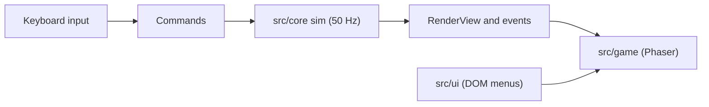

# Taming the Elements

[](https://github.com/hchan/tamingTheElements/actions/workflows/ci.yml)
[](https://hchan.github.io/tamingTheElements/)

A real-time 1v1 elemental arena game with monster capture. Pick an elemental, fight in a 1280x720 arena, gain XP, capture
weakened opponents into your garrison (from chapter 2) and swap garrison members mid-battle. Chapter 4 ends with the
Eternal Void boss.

**[Play it in your browser](https://hchan.github.io/tamingTheElements/)**

## The game

- **Four elements** plus void. Fire beats air, air beats earth, earth beats water, water beats fire (x1.25 damage; the
  reverse is divided by 1.25). Void is neutral.
- **12 playable races**, each with its own abilities. Full tables are in [docs/GAME-DESIGN.md](docs/GAME-DESIGN.md).
- **Capture** unlocks in chapter 2; the Eternal Void cannot be captured.
- **Four chapters** with XP caps and objectives (chapter 5 is post-game).
- **World Tour and Arcade Versus**: the main menu has five entries: Play, Versus, Online, Settings, Help (the old Classic routes still work as deep links). Arcade Versus is a faster, flashier ruleset against the Arcade AI, 1v1 or a 2v2 tag team (hit-stop, stun
  and knockback, combos, a hyper meter and a super on X, gamepad RT or the on-screen Super button; in 2v2, tag with 3,
  gamepad LB or the Tag button). It is on by default (the old Settings opt-in is gone). It never writes your save (no XP, capture
  or progress). **Two players on one computer**: pick *Opponent: Two players (this computer)* on the picker (1v1; each player picks a race). Player 1 keeps the usual keys (W A S D or arrows, Space/Enter, E dash, Q guard (hold), X super, R weather, H charge, Z or 0 trap, rebindable on Key Bindings); Player 2 uses **I J K L** move, **U** attack, **O** second attack, **Y** dash, **N** guard (hold), **B** super, **T** weather, **G** charge (fixed). A second gamepad drives Player 2 (the first drives Player 1). Pause (Shift-P), mute (Ctrl-M) and fullscreen (F) stay shared. Design and status: [docs/FUN-DESIGN.md](docs/FUN-DESIGN.md).

## Status

The game is being ported from a legacy Crafty.js version to Phaser 4 + TypeScript + Vite. The legacy game (`war/`) was
retired from the tree on 2026-11-10; it is preserved at the git tag `legacy-crafty-1.0` and can be restored as a parity
oracle with `pnpm oracle:restore` (see [docs/legacy/ARCHIVE.md](docs/legacy/ARCHIVE.md), [docs/PARITY.md](docs/PARITY.md)).

## Quickstart

Requires Node 22 (see `.nvmrc`) and corepack, which provides the pnpm version pinned in `package.json`.

```sh
nvm use              # reads .nvmrc
corepack enable
corepack pnpm install
corepack pnpm dev      # dev server (Vite)
corepack pnpm build    # typecheck, then production build into dist/
corepack pnpm preview  # serve the production build
```

## Scripts

Run as `pnpm <name>` (or `corepack pnpm <name>`).

| Script | What it does |
|---|---|
| `dev` | Vite dev server |
| `build` | `tsc -b` then `vite build` |
| `preview` | Serve the production build |
| `typecheck` | `tsc -b` |
| `lint` | ESLint over the repo |
| `test` | Vitest `core` and `repo` projects (unit, rules, guards, golden replay) |
| `test:legacy` | Vitest `legacy` project: integrity of the recorded legacy fixtures (the frozen parity evidence) |
| `oracle:restore` | Extract the legacy game from git tag `legacy-crafty-1.0` into the gitignored `.oracle/` (opt-in) |
| `test:oracle` | Vitest `oracle` project: characterization tests that execute the restored legacy sources in `node:vm` (skipped without `.oracle/`) |
| `test:browser` | Vitest `browser` project: cross-engine determinism check |
| `e2e` | Playwright end-to-end tests |
| `e2e:pages` | Playwright smoke test of the build served under the Pages subpath |
| `depcruise` | dependency-cruiser layer boundaries for `src/` |
| `golden:record` | Re-record the golden replay after an intended sim change |
| `sim:match` | Headless AI-vs-AI matches for balance work |
| `sim:net` | Headless networked bot match over the fake lockstep link ([docs/NETCODE.md](docs/NETCODE.md)) |
| `assets:build` | Copy manifest images and sounds from the restored legacy tree (`oracle:restore`) into `public/` |
| `docs:gen` | Regenerate the generated tables in `docs/GAME-DESIGN.md` |
| `format` | Placeholder, exits 1 ("not yet") |

## Project structure

Short version; the full map is [docs/REPO-MAP.md](docs/REPO-MAP.md).

| Path | Contents |
|---|---|
| `src/core/` | Deterministic simulation in plain TypeScript (no DOM, no Phaser) |
| `src/game/` | Phaser renderer, input, audio and app glue |
| `src/ui/` | DOM menus in vanilla TypeScript |
| `src/testing/` | Test-only helpers, including legacy stubs |
| `tests/` | Cross-cutting, legacy, browser, e2e and Pages tests plus fixtures |
| `tools/` | Asset, generator and match-runner tooling |
| `docs/` | Documentation, see [docs/README.md](docs/README.md) |
| `imgWorkArea/`, `visio/` | Art sources and design diagrams |

## Architecture

A fixed 50 Hz simulation in `src/core` owns all game state; Phaser only renders it and feeds input back as commands.
See [docs/ARCHITECTURE.md](docs/ARCHITECTURE.md) and [docs/DETERMINISM.md](docs/DETERMINISM.md).



## Testing

Vitest for unit, legacy characterization and browser determinism; Playwright for end-to-end. See
[docs/TESTING.md](docs/TESTING.md), the legacy parity checklist in [docs/PARITY.md](docs/PARITY.md) and the balance tooling
in [docs/BALANCE.md](docs/BALANCE.md).

## Deployment

Pushes to `main` that pass CI deploy to GitHub Pages. See [docs/DEPLOYMENT.md](docs/DEPLOYMENT.md).

## Contributing

Trunk-based development with small branches ([docs/BRANCHING.md](docs/BRANCHING.md)). See
[CONTRIBUTING.md](CONTRIBUTING.md) for the checks to run and the Definition of Done. Agent rules are in
[CLAUDE.md](CLAUDE.md). Security reports: [SECURITY.md](SECURITY.md).

## License

To be decided. No license file exists yet.
