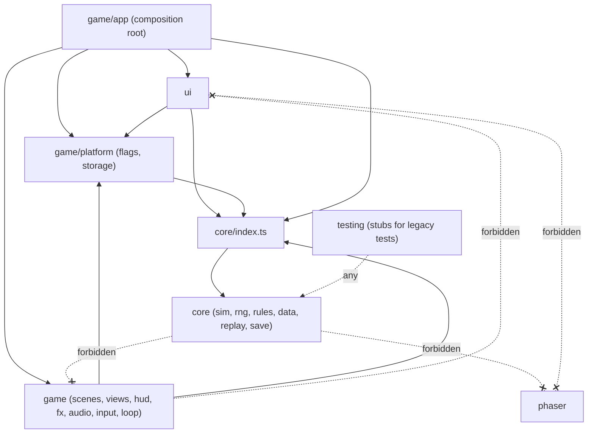
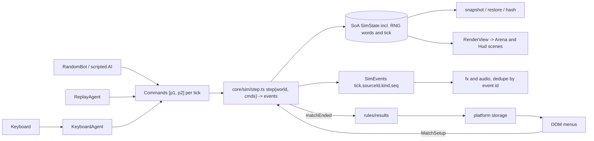
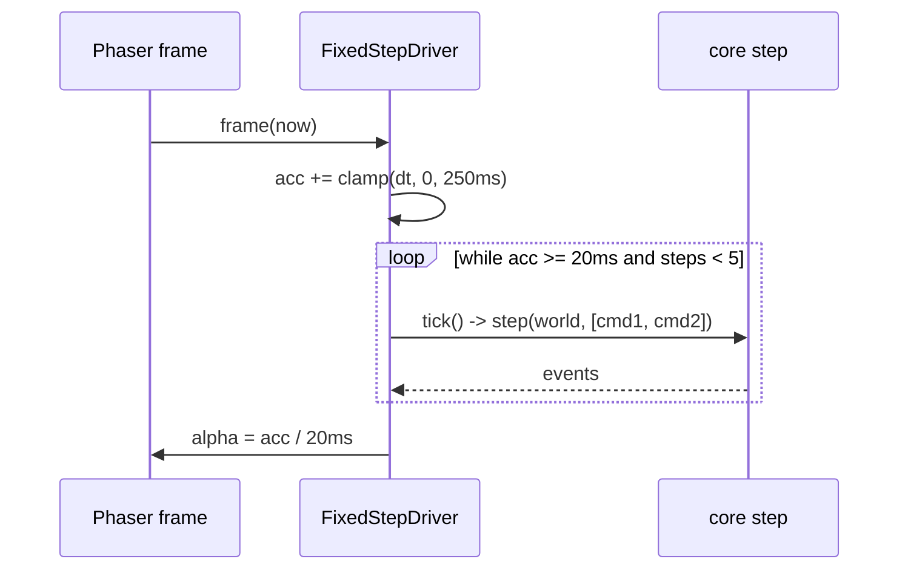

# Architecture

Describes merged code only; anything not yet built is labelled "planned". Determinism rules live in
[DETERMINISM.md](DETERMINISM.md); decisions in [adr/README.md](adr/README.md); file map in [REPO-MAP.md](REPO-MAP.md).

## Goals and non-goals

- Goal: a deterministic 50 Hz simulation in plain TypeScript (`src/core`) with Phaser as a thin renderer on top, so the same
  seed and inputs give the same per-tick hash on every engine ([ADR 0002](adr/0002-deterministic-sim-50hz.md)).
- Non-goals: physics engines (AABB only, [ADR 0005](adr/0005-aabb-no-arcade-physics.md)), gameplay logic in scenes, and
  changing the frozen legacy game in `war/` (it is the parity oracle, [ADR 0014](adr/0014-legacy-as-parity-oracle.md)).

## Layers and import rules

| Layer | Path | May import | Must not import |
|---|---|---|---|
| core | `src/core/` | itself; `valibot` only inside `src/core/save/` | game, ui, testing, phaser, node builtins |
| game | `src/game/` | core via `src/core/index.ts` (or `menu-index.ts` / `lazy-index.ts`, see below) only; phaser | ui, testing (except `src/game/app/`, which may import ui) |
| platform | `src/game/platform/` | core via index; itself | the rest of game, ui |
| ui | `src/ui/` | core via index; `src/game/platform/` | phaser, testing, other game modules |
| testing | `src/testing/` | anything | (nothing in `src` outside it, or test files, may import it) |

`src/core/net/` (lockstep session, packet codec, `Transport` interface) is part of core, so it is pure: no DOM, Phaser, `Date`, game or ui. A real WebRTC `Transport` adapter will live in `src/game/`; the fake link and two-peer harness live in `src/testing/net/`. See [NETCODE.md](NETCODE.md).

Enforced by [.dependency-cruiser.cjs](../.dependency-cruiser.cjs) (rules `core-is-pure`, `core-no-node-builtins`,
`core-only-valibot-in-save`, `core-npm-allowlist`, `ui-layering`, `game-layering`, `core-only-via-index`, `platform-is-leaf`,
`not-to-testing`, `no-circular`) via `pnpm depcruise`, and for core purity also by the ESLint bans in
[eslint.config.js](../eslint.config.js). See [ADR 0017](adr/0017-dependency-cruiser-eslint-boundaries.md).

Core has three public entries. `src/core/index.ts` is the full barrel (sim, agents, replay, net; used by the Arena and the other
lazily loaded Phaser code, by tests and by tools). `src/core/menu-index.ts` is the menu-safe subset (data, rules, save, rng,
flags, plus erased `export type`s): the menu entry graph (`src/ui`, `src/game/app` flow/main/viewer, `src/game/platform`) imports
core only through it, so no sim module is reachable from the entry chunk (`tests/repo/menu-index.test.ts`). `src/core/lazy-index.ts`
is the entry for dynamic `import()` from the menu graph (random bot, replay validate/format, scripted AI): flow, download and the
replay viewer load it at match, download or replay time, and `main.ts` prefetches it once the menu is idle. A module reachable
from the entry's barrel lands in the entry chunk even when only a lazy chunk uses it; that is why the menu graph must not touch
`index.ts`. `vite.config.ts` pins two stable chunks: `core` (data, rules, save, rng, `preloaded` by the menu) and `sim`
(`src/core/sim|agents|replay|net` plus the match recorder, lazy), next to `phaser`. Budgets and numbers: [PERFORMANCE.md](PERFORMANCE.md).

## Data flow

Real files: input in `src/game/input/keyboard-agent.ts`; agents in `src/core/agents/` (`agent.ts`, `random-bot.ts`,
`replay-agent.ts`, `scripted-ai/attack.ts`, `scripted-ai/arcade.ts`); view in `src/core/sim/view.ts`; scenes in `src/game/scenes/`; results in
`src/core/rules/results.ts`; storage in `src/game/platform/storage/`; app flow in `src/game/app/flow.ts`.

## Sim state layout

`src/core/sim/state.ts`. All state is typed arrays with fixed capacity (`MAX_ENTITIES = 64`); entity id equals slot index.

- Per-entity float arrays (`F64_FIELDS`): `x y px py vx vy w h hp maxHp dmgMult healMult speed baseSpeed restCap`
  (`px/py` are the previous tick's position, for render interpolation).
- Per-entity int arrays (`I32_FIELDS`): `kind defId team owner dir flags spawnTick expireTick hitMask`.
- `SimState.team` is the **per-entity** team index (0 = player, 1 = enemy). `SimState.teams` is the **per-team block**
  (`Int32Array`, `TEAM_STRIDE` ints per team: `activeSlot`, `swapCooldownUntil`). Index it as
  `teams[team * TEAM_STRIDE + TeamField.x]`; never alias the two (`tests/repo/no-team-block-alias.test.ts`).
- `SimState.abil`: per-character ability cooldowns and active counts (`ABIL_STRIDE` ints per entity id, index with
  `cooldownIdx(id, slot)` / `countIdx(id, slot)`; slot 0 primary, 1 secondary, 2 Capture). Legacy deep-copies
  `abilitiesInfo` into every character, so a swapped-in character has its own cooldowns.
- `SimState.status`: per-entity status slots (`STATUS_SLOTS` x `STATUS_STRIDE`: id, sourceId, startTick, expireTick,
  magnitude), see `src/core/sim/systems/status.ts`.
- `SimState.world`: scalars `tick`, `nextId`, `flags` (sim-flag bits plus the capture-granted bit), `matchSeed`.
- `SimState.rng`: the 7 RNG streams, 4 words each.
- `SimState.arcade`: the Arcade ruleset block (`ArcadeE`, `ArcadeT`, `ArcadeW` in `state.ts`, layout in
  [FUN-DESIGN.md](FUN-DESIGN.md) section 2.1). **Length 0 in Classic**, so it adds no bytes to the hash or snapshot.
- `EntityFlag` bits: alive, translucent, frozen, captured, benched, dead. Free slots are derived from the alive flag, so the
  allocator (`src/core/sim/alloc.ts`, lowest free id first) needs no extra state. `src/core/sim/world.ts` wraps the state with
  the walkable arena.

`createMatch` (`src/core/sim/match.ts`) builds the tick-0 world from a `MatchSetup`: p1 entities first, then p2, ids in roster
order, RNG streams seeded from `seed`.

## Tick pipeline

`step(world, cmds)` in `src/core/sim/step.ts` runs the `SYSTEMS` list in this fixed order, then increments `tick` and returns
the events. `noop` entries are reserved slots that keep the order stable as systems land. Systems read time through
`now(s)` (`src/core/sim/clock.ts`): `tick` in Classic, the Arcade `gameTick` in Arcade. The freeze gate runs only slot 1
while an Arcade freeze holds `gameTick` (`isFrozen`, never true in Classic); `tick` always advances. In Arcade, melee
and projectile hits go through `applyArcadeHit` (`systems/arcade/hit.ts`), which keeps the Classic damage arithmetic
times the combo scale (`arcade/combo.ts`) and sets the hit-stop freeze, knockback and hit-stun (`arcade/knockback.ts`,
`arcade/stun.ts`), then adds the hyper meter gains of both teams (`arcade/meter.ts`; casts add theirs from the cast
sites through `onArcadeCast`, a no-op in Classic); the Classic lines run
unchanged behind `!isArcade`. The cast sites and movement ask `canAct` (Classic: not frozen; Arcade: also not
stunned and not casting a super), and Arcade movement applies knockback first and holds both axes at the walls. The
`health` slot is `arcadeSuper` (`arcade/super.ts`): `Cmd.super` spends a meter bar for a super (a 40-tick freeze, then
an `effect` entity whose hits go through `applyArcadeHit` as strength 3). Arcade aims 8 ways (`arcade/aim.ts`): movement
stores the dir8 of the held input in the entity's `aim` slot next to the 4-way `dir` (the reels), and the projectile and
melee cast sites read `castDir` (the plain `dir` in Classic); the super band keeps the 4-way `dir`. The Arcade input
buffer (`arcade/buffer.ts`) records press edges in the `input` slot on every tick, frozen ones included; the cast
systems and `arcadeSuper` read their command through `bufferedCmd`, which adds a press that is pending (at most 8 game
ticks old, not used yet) and turns a primary and secondary chord into `Cmd.super` (it returns the raw command in
Classic). A cast marks its slot's press used (`onArcadeCast`), a super start the super press. Arcade matches are best
of 3 (`arcade/round.ts` in the `cleanup` slot): only the `fight` phase lets anyone act or be hit, the KO slow motion
holds every second tick through the same freeze gate (`clockHeld` in `sim/clock.ts`), and the reset between rounds
clears the buffered presses.

| # | System | Status |
|---|---|---|
| 1 | input (`systems/arcade/input.ts`) | Arcade only (returns at once in Classic): press edges for the input buffer on every tick; stun and combo expiry (`recovered`, `comboEnded`) on unfrozen ticks |
| 2 | swap (`systems/swap.ts`) | implemented |
| 3 | movement (`systems/movement.ts`) | implemented |
| 4 | abilities | no-op (planned) |
| 5 | melee (`systems/melee.ts`) | implemented |
| 6 | projectiles (`systems/projectile.ts`) | implemented |
| 7 | capture (`systems/capture.ts`) | implemented |
| 8 | collision | no-op |
| 9 | health (`systems/arcade/super.ts`) | Arcade only (returns at once in Classic): `arcadeSuper`, supers (`superStarted`, `superEnded`) |
| 10 | death (`systems/death.ts`, hp <= 0 decided at end of tick) | implemented |
| 11 | debuffs (`systems/debuffs.ts`) | implemented |
| 12 | status (`systems/status.ts`, timers) | implemented |
| 13 | rest (`systems/rest.ts`, benched healing) | implemented |
| 14 | cleanup (`systems/arcade/round.ts`) | Arcade only (returns at once in Classic): `arcadeRound`, round phases, timer, KO, best of 3, reset between rounds (`roundStarted`, `fight`, `ko`, `timeOver`, `roundEnded`) |
| 15 | end (`systems/end.ts`, match-end check, `matchEnded` event) | implemented; Arcade: after the round that gives a side 2 round wins |

Adding or reordering a system changes every hash: bump `SIM_VERSION` and re-record goldens (see DETERMINISM.md).

## Commands and agents

A `Command` is a `u16` bitset per player per tick (`src/core/sim/commands.ts`: up, down, left, right, primary, secondary,
capture, swap1..4; bits 11..15 reserved in Classic, while Arcade opens 11..13 for dash, guard and super; `inputMaskFor(flags)`
gives the accepted bits for the net session and replay validation). An `Agent` (`src/core/agents/agent.ts`) turns a read-only `ObservationView` into a
`Command`; it must be a pure function of the view plus its own memory and random stream (`AgentRng`, seeded from
`view.matchSeed` and the side). Neither lives in `SimState`, and `collectCommands` only reads the world: `step` is the only
thing that mutates `SimState`. A replay stores the commands, so replays never re-run agents. In Arcade the view also
carries `arcade` (`ArcadeView`: both meters, both stuns, the freeze, both live combos, own super running, the round
phase; only what the HUD shows), which the scripted AI's Arcade layer (`scripted-ai/arcade.ts`) reads; Classic views have no `arcade`, so Classic
agents decide exactly as before.

## Events and stable ids

`src/core/sim/events.ts`. Each step creates an `EventSink` for the current tick; `emit(sourceId, kind, payload)` numbers events
with a per-tick `seq`. The id of an event is `(tick, sourceId, kind, seq)`; it is stable across re-simulation because events are
a pure function of the tick and are never stored in state ([ADR 0009](adr/0009-events-carry-stable-ids.md)). Kinds today:
`moved, blocked, damage, died, swapped, captured, captureFailed, matchEnded` (Classic, kinds 1..30), plus the Arcade-only
`hitStop` (40), `hitConfirmed` (41), `comboEnded` (42), `meterLevel` (49), `superStarted` (50), `superEnded` (51) and
`recovered` (58) ([FUN-DESIGN.md](FUN-DESIGN.md) section 2.1). Consumers (`src/game/fx/event-fx.ts`,
`src/game/audio/audio-manager.ts`) dedupe by this id, so rewinding or re-stepping never doubles an effect. In Arcade,
`EventFx` drives hit feedback from `hitConfirmed` (flash, sparks by strength, damage number) and the `hitStop` after it
(victim jitter until the freeze deadline, shake by strength or KO) and skips the paired `damage`; Classic keeps reacting to
`damage`. `CharacterView` owns the tint and counts rendered frames for the flash; effects hold while the driver is paused.

## RNG streams

`src/core/rng/`: `sfc32.ts` (integer-only generator), `seed.ts` (`fnv1a`, `splitmix32`, `seedSfc32`), `streams.ts`
(`STREAM_NAMES = combat, capture, spawn, meta, cosmetic`, `AGENT_STREAM_NAMES = ai.p1, ai.p2`). `createMatch` seeds the
five sim streams from the match seed and stores them in `SimState.rng`; agents seed their own `ai.pN` stream (`AgentRng`)
outside `SimState`. `combat`, `capture`, `spawn` are reserved for the sim and `meta` is used by out-of-match rules (`rules/new-game.ts`,
`rules/results.ts`, `rules/opponents.ts`, `rules/garrison.ts`), outside the hashed state. See [ADR 0003](adr/0003-sfc32-rng-streams.md).

## Snapshot, restore, hash

- `src/core/sim/snapshot.ts`: `createSnapshotBuf`, `snapshot` and `restore` copy every array with `TypedArray.set` (no
  allocation), and `SnapshotRing` keeps a fixed-depth ring keyed by tick for rewind. `restoreTick` restores the newest
  entry of a tick and drops the entries pushed after it. Each entry can carry a payload (`SnapshotRing<AgentSnapshot>`)
  for state outside `SimState` that must rewind with it. `state.ts` also has the allocating
  `snapshotState`/`restoreState` pair.
- Agent memory (`RandomBot`'s held command, `ScriptedAI`'s movement timers, facing and previous position, the Arcade
  layer's confirm tick and reaction delay, every agent's `AgentRng`) is not in `SimState`. `Agent.save()`/`load()` copy it as plain JSON data, and `saveAgents`/`loadAgents`
  (`src/core/agents/agent.ts`) make the `AgentSnapshot` to store next to the world snapshot, so a bot issues the same
  commands after a restore (`src/core/agents/agent-snapshot.test.ts`).
- `src/core/sim/hash.ts`: FNV-1a 32 over every value as little-endian bytes in `stateArrays` order, read as 32-bit words
  and split with shifts so the platform byte order does not matter; `-0` hashes as `0` and every NaN as the canonical
  words. `assertNoNaN` is a debug check.

## Fixed-step driver

`src/game/loop/fixed-step-driver.ts`. The `FixedStepDriver` takes an injected monotonic clock (the Arena passes
`performance.now`; core never sees a clock), clamps each frame to 250 ms, runs at most 5 ticks of 20 ms per frame, drops the
leftover when the cap is hit, and returns `alpha = acc / 20` for render interpolation. `pauseOnHidden` pauses while the
document is hidden. Pause is simply not stepping, so game time never advances while paused. Pauses are tracked per reason
(`user`, `hidden`, `overlay`, `replay`, `ended`): the sim runs only when no reason holds it, so showing the tab again never
resumes a battle the user paused.

## Replays, save format and flags

- Replays (`src/core/replay/`): `format.ts` (`ReplayHeader`, `ReplayFile`, hash checkpoint every `HASH_INTERVAL = 50` ticks),
  `rle.ts`, `recorder.ts`, `player.ts` (`playReplay` verifies hashes and reports the first divergent tick), `record-bots.ts`.
  The golden fixture is `tests/fixtures/replays/random-vs-random.replay.json`.
- Save format: [SAVE-FORMAT.md](SAVE-FORMAT.md), code in `src/core/save/` (valibot, v0 to v1 migration), storage in
  `src/game/platform/storage/`. `src/core/save/validate.ts` adds semantic checks (known characters, ranges, sizes) that
  `migrate()` runs; `src/core/replay/validate.ts` validates a replay (including RLE run lengths, without decoding) before
  `createMatch`. Neither changes the on-disk formats. The IndexedDB store restores the newest good backup of the last 5 when
  the live save is corrupt, and warns through `notices.ts` (shown by `#storeNotice`) when another tab saved.
- App flow failures: `AppFlow` never leaves the battle screen hung; load, setup and Phaser creation errors show an error
  screen with Back to menu, and a failed post-match save shows the result with a retry. Test builds inject each failure with
  `?ff=failLoad|failSetup|failGame|failSave`.
- Flags: two kinds. Sim flags (`SimFlags` in `src/core/flags.ts`, all default off) change the simulation, so they are part of
  `MatchSetup`, written into the replay header by `encodeFlags` (sorted names) and mirrored into `world[World.flags]`. UI flags
  (`UiFlags` in `src/game/platform/flags.ts`, `?ff=` in dev/test builds only) never affect the sim and are not recorded;
  `getUiFlags` tests the build mode statically, so production bundles do not even contain the parser. A production build
  opts into a preview through a setting instead (Arcade Versus: the `arcadePreview` key of the settings save).

## Scenes and DOM menus

Phaser scenes in `src/game/scenes/`: `Boot`, `Preload`, `Arena` (runs the driver and sim, installs the test probe), `Hud`
(parallel to Arena, reads `RenderView`), `Cinematic` (data-driven by `src/game/cinematics/`). DOM menus (`src/ui/`) own
everything outside a match (router, screens); the composition root `src/game/app/` wires them to scenes. Scenes read the sim
only through the `RenderView` facade in `src/core/sim/view.ts` and never decide gameplay (for example death is a sim system).
`RenderView.arcade()` (undefined in Classic) adds the Arcade read-outs: hit-stop freeze, live combo hits and damage and the
hyper meter per team, stun, invulnerability and the 8-way cast aim per character. In an Arcade match the Arena feeds an `ArcadeHudModel`
(`src/game/hud/arcade-hud.ts`: pooled damage numbers, combo counters, hyper meters) from events and `arcade()`, ages it while the driver
runs, and hands it to `Hud` in `HudData`, which only draws it with pooled texts. The super cinematic is the fx sink's
`superCut`, started by `EventFx` from the super freeze (`hitStop` cause 2, the caster as its source): the Phaser sink
imports `src/game/fx/super-view.ts` on the first super, so Classic never downloads it (its own `super-view` chunk). Per
scene it makes one dim overlay, band, portrait and two texts on first use, runs on the view tick (it holds while paused),
lifts the caster over the dim, punches the camera in about the caster and restores the fit zoom at the end; the frame
plan (`super-cinematic.ts`) is pure. The music duck is the `superStarted` sound cue's.

Arcade Versus (`#arcade`, FUN-DESIGN WP 11) is a separate flow, not part of `AppFlow` (`flow.ts`, the story: garrison,
battle, results, save). `main.ts` adds the route with a dynamic import, so its code is its own `arcade-versus` chunk and
the menu entry stays small and Phaser-free. The screen (`src/game/app/arcade-versus.ts`, DOM in
`src/ui/screens/arcade-versus.ts`) runs picker, battle and results inside the one route: `arcadeLaunch`
(`src/game/app/arcade-setup.ts`) builds a 1v1 `MatchSetup` with `rulesetArcade`, `difficulty: 1`, chapter 1 (no Capture)
and 0 XP, and the core `ScriptedAI` with its Arcade layer as the enemy (Easy drops its super). The Arena needs nothing new:
the Arcade HUD, juice, super key and cinematic follow the world flag. The one Arcade-only view in this chunk is the 8-way
aim arrow (`src/game/fx/aim-view.ts`), handed to the Arena as the launch's `arcadeView` hook: one Graphics drawn once,
moved and turned after each scene update from `RenderView.arcade().aim`, static (no tween, so reduced motion needs no
variant), removed with the scene. The flow has no save store, so it writes no progress,
XP, capture, objectives or garrison (a repo test and a unit test guard it); the only write is the playtest replay, when
recording is on. The route is offered when Settings > Arcade Versus (preview) is ticked (the save's `arcadePreview`) or
with `?ff=arcade` in dev and test builds; otherwise `#arcade` returns to the main menu. A pointer-only Super button over
the arena holds the bound super key for touch players.

## Legacy concept map

| Legacy (Crafty, `war/WEB-INF/private/src/`) | New module |
|---|---|
| character, ability, enemy AI scripts | `src/core/data/`, `src/core/sim/systems/`, `src/core/agents/` |
| `Crafty.e` entity components | SoA arrays in `src/core/sim/state.ts` |
| HUD scripts (`topHUD.js`) | `src/game/hud/`, `src/game/scenes/Hud.ts` |
| scenes (`scenes.js`) | `src/game/scenes/`, `src/game/cinematics/` |
| menus and persistence | `src/ui/`, `src/core/save/`, `src/game/platform/storage/` |

Per-module detail: [legacy/INVENTORY.md](legacy/INVENTORY.md).

## Presentation scaling vs simulation scaling

The simulation is fixed: a logical 1280x720 arena, speeds in px/tick, 50 Hz. Nothing about the window, aspect
ratio, device pixel ratio or the display-size setting reaches `src/core`; an e2e test
(`tests/e2e/responsive.spec.ts`) proves the sim hash after 50 stepped ticks is identical at every viewport.

Presentation adapts in layers (`src/game/boot/viewport.ts`, `presentation.ts`, `src/ui/styles/main.css`):

- **Scale.FIT with CENTER_BOTH, not ENVELOP.** FIT letterboxes, so the whole arena, HUD and action bar are always
  visible with 16:9 preserved; ENVELOP would crop the HUD and action bar on any other aspect ratio. Phaser handles
  window resize, orientation change and fullscreen itself.
- **Resolution.** The backing store is 1280x720 times `pickResolution(devicePixelRatio)` (ceil, capped at 2: 3 costs
  2.25x more pixels for little visible gain). Each scene calls `fitScene` (camera zoom = resolution, centred on the
  logical arena) and Phaser text uses `crisp()`, so scene code and pointer coordinates stay logical. The ratio is read
  once at game creation.
- **HUD placement.** HUD and action bar draw inside the logical canvas, so they are anchored to the letterboxed game
  area by construction. The `#game` box excludes the device safe-area insets (`viewport-fit=cover`).
- **Fullscreen** button (`#fullscreenToggle`) and the F key, both user gestures, only where the browser allows it.
- **Rotate hint** on portrait phones during battle (`#rotateOverlay`): dismissible, and the sim is held while it shows.
- **DOM screens** use `clamp()`-based `em` font sizes, `min()` widths, and 44 px tap targets on `pointer: coarse`.
- **Display-size setting** still scales `#game` through `--canvas-fraction` and composes with all of the above.
- **Action bar clicks** map pointer to logical coordinates through the scale manager and camera, then to the same
  Command bit as the matching key (`KeyboardAgent.press`, one tick).
