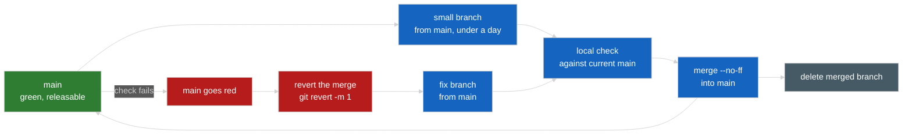

# Branching: trunk-based development with small branches

How a change reaches `main`. `main` is the trunk: every writer branches from it, every branch merges back into it within a day,
and unfinished work lands switched off behind a flag instead of waiting on a branch. It binds every agent, the coordinating
session and the maintainer.



## The trunk

`main` is the default branch and is always green on the local check (below) and releasable. Nothing known to be broken sits on it:
a merge that turns it red is reverted first. A branch is created from the current `main`, never from another branch, and `main`
is never merged into a branch to catch up. If `main` moved, rebase the unpublished branch onto it and re-run the check.

## A branch: size, life and name

- **One work package or one fix per branch**, at most about **400 changed lines of code**, plus the docs and tests that go with
  it. Lines of code exclude Markdown, tests, lockfiles and generated files (see [Measuring it](#measuring-it)).
- **Under a day old** from its first commit to its merge. A branch that outgrows either limit is split behind a feature flag: the
  first half lands switched off (default off), the second turns it on. It is never kept open to wait for its neighbours.
- **Names.** A hand-made branch is `<area>/<slug>`, lowercase and hyphenated (`core/fixed-step-loop`, `docs/branching`). An agent
  worktree is `worktree-<wp-id>` (`worktree-wp3`), or the name the tool gives it. History never relies on a branch name: the
  merge commit's subject says what landed.
- **Branches stay local** unless a backup push is wanted. Merged branches and their worktrees are deleted.

## Landing incomplete work: flags, default off

Unfinished work merges dark. A flag is a plain constant or config entry, off on `main` until its flip.

- **Off means inert:** the new code path is not reached, existing behaviour (the legacy game in `war/`, or the current Phaser
  scene) is unchanged.
- **A flip is its own small commit** on its own branch, and its message names the check that proves it (a test, or a manual
  playthrough step).
- Remove the flag in a later small branch once the flip has stuck.

## Merging

1. **Run the local check against current `main`.** Merge `main` into a scratch checkout of the branch (or temporarily merge the
   branch into a scratch copy of `main`) and run the project's checks there: once the toolchain exists, `npm run typecheck`,
   `npm test` (Vitest) and the build; until then `git diff --check` and a review of the diff. A conflict is resolved by the
   writer rebasing the unpublished branch onto `main`; the check then runs again.
2. **Review the diff**, sized by risk: a quick read for docs and tests, a closer one for simulation code in `src/core`.
3. **`git merge --no-ff <branch>`** on `main`, with the subject

   ```
   Merge <what it does> (<WP id>)
   ```

   for example `Merge fixed-step simulation loop (WP-04)`. Not a squash and not a rebase onto `main`: the merge commit keeps each
   writer commit intact, leaves `main`'s first-parent line one commit per branch (`git log --first-parent main`), reverts as one
   unit (`git revert -m 1`), and its second parent gives the branch's age and size from git alone.
4. **Delete the merged branch** (`git branch -d <branch>`) and its worktree (`git worktree remove`, then `git worktree prune`).

Writers commit on their branch; the coordinating session runs the check and the merge. Pushing, if any, is the coordinator's.

## Hotfix and revert

`main` is bad when the local check fails on it, or a defect is found that a merge introduced. **Revert first, then fix:**

1. `git revert -m 1 <merge>` on `main`, and run the check.
2. Fix on a **new branch from `main`** whose first commit reverts the revert (`git revert <revert-commit>`), then the fix on
   top. Merging the original branch again would bring back nothing.

## Worktrees and scratch

- Agent worktrees live under `<repo>/.claude/worktrees/`, one per branch, removed once merged.
- Scratch files (logs, rendered images, generated output, test patches) live under `~/claudetmp/`, never `/tmp/`.

## Measuring it

From git alone, in the main checkout:

```bash
# merges into main per day, last 14 days
git log --first-parent --merges --since='14 days ago' --date='format-local:%Y-%m-%d' --format='%cd' main | sort | uniq -c
# each merge: age in hours from the branch's first commit, and lines of code (no Markdown, tests, lockfiles, generated files)
git log --first-parent --merges --since='7 days ago' --format='%H %ct' main | while read -r m t; do
  first=$(git log --reverse --format=%at "$m^1..$m^2" | head -1)
  code=$(git diff --numstat "$m^1" "$m" -- . ':(exclude)*.md' ':(exclude,glob)**/tests/**' ':(exclude,glob)**/*.test.*' \
    ':(exclude,glob)**/*.spec.*' ':(exclude,glob)**/package-lock.json' ':(exclude,glob)**/generated/**' \
    | awk '{s += $1 + $2} END {print s + 0}')
  echo "$(git log -1 --format='%h %cs' "$m") age_hours=$(( (t - first) / 3600 )) code_lines=$code"
done
# open branches, oldest first
git branch --no-merged main --sort=committerdate --format='%(committerdate:short) %(refname:short)'
```

The practice holds when every merge is under 24 hours and 400 lines of code and the open list holds nothing older than a day.

## Why not long-lived branches

A long-lived integration branch collects every package, so it grows into one huge diff: its check takes longer, a review sees
everything at once, conflicts and stray conflict markers hide in the volume, and landing it is a single risky event. Small
branches behind default-off flags keep each of those costs to one package: the merge is minutes old when checked, a revert takes
one package out, and a regression has one change to blame.
