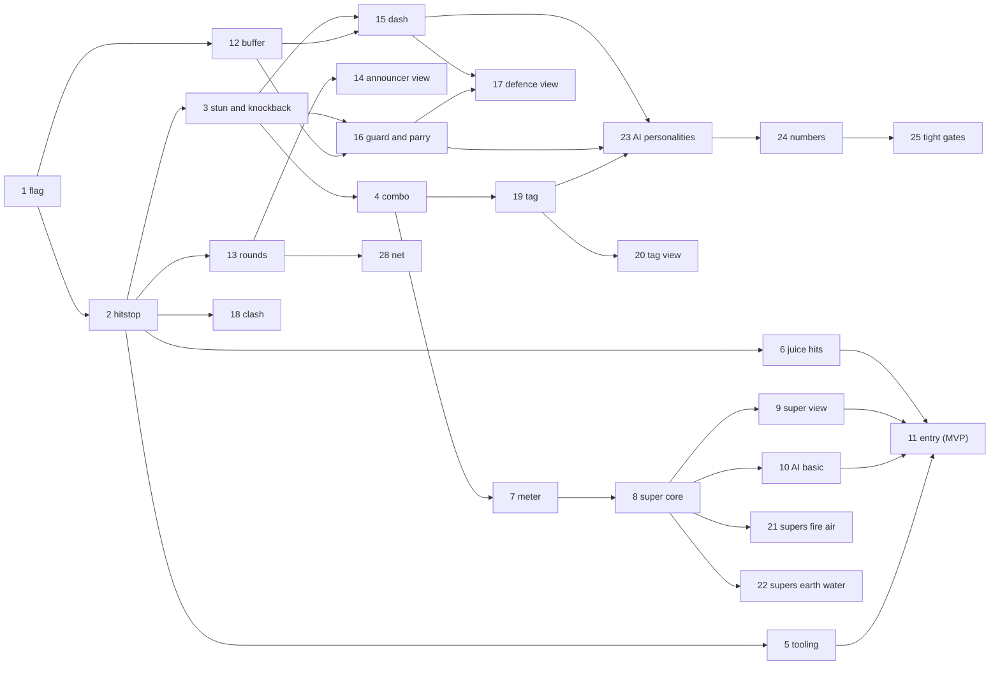

# Fun design: the Arcade ruleset

Status: **WP 1 (`WP-arcade-flag`, the ruleset plumbing), WP 2 (`WP-arcade-hitstop`), WP 3 (`WP-arcade-stun-knockback`), WP 4 (`WP-arcade-combo`), WP 5 (`WP-arcade-tooling`, report-only gate), WP 6 (`WP-arcade-juice-hits`), WP 7 (`WP-arcade-meter`), WP 8 (`WP-arcade-super-core`), WP 9 (`WP-arcade-super-view`), WP 10 (`WP-arcade-ai-basic`) and WP 11 (`WP-arcade-entry`, Arcade Versus on the main menu, playable on the live site: see section 7) are built, so the MVP is playable; after it, WP 12 (`WP-arcade-buffer`), WP 13 (`WP-arcade-rounds`, best of 3 in the sim), WP 14 (`WP-arcade-announcer-view`, the round banners, timer and pips), WP 15 (`WP-arcade-dash`), WP 16 (`WP-arcade-guard-parry`), WP 17 (`WP-arcade-defence-view`: the dash and guard keys, pad buttons and touch buttons, and their effects), WP 27 (`WP-arcade-8way-aim`), WP 29 (`WP-arcade-weather`, sim only) and WP 30 (`WP-arcade-weather-view`: the weather key, pad button and touch button, and its HUD badge, sky tint, particles and called line) are built too; everything else is design.** Owner direction: "make sure the game is fun, and if it is not fun, make it
fun, like Street Fighter vs Capcom". This doc diagnoses the current combat, specifies an opt-in **Arcade** ruleset (fast,
flashy, readable, tag-team, big specials) on top of the deterministic sim, defines measurable fun gates, and cuts the work
into packages. **Classic** (the legacy-parity ruleset, [PARITY.md](PARITY.md)) stays the default and stays bit-identical.

Read first: [ARCHITECTURE.md](ARCHITECTURE.md), [DETERMINISM.md](DETERMINISM.md), [BALANCE.md](BALANCE.md),
[NETCODE.md](NETCODE.md), [GAME-DESIGN.md](GAME-DESIGN.md), [VISUAL-QA.md](VISUAL-QA.md).

Conventions in this doc: 1 tick = 20 ms (50 Hz). "pm" = per mille (integer, 1000 = x1). Every number is a starting value
in a data table (`src/core/data/arcade.ts`, planned), tuned by the metrics in section 4, not by feel alone.

## 1. Diagnosis: why the current game is probably not fun yet

Measured on `main` (SIM_VERSION 2) with `pnpm sim:match --tournament --seeds 4 --json` (level 1, scripted vs scripted,
264 matches): median match length **272 ticks (5.4 s)**, p10 2.7 s, p90 13.8 s; 12 stalemates (4.5%), all in the
melee-only pairs curomo-echo, curomo-treenoc, echo-treenoc; Sindarosa 100%, Ishimi 0%; Tornado 0% of damage; 21% of all
damage lands in the unattributed `melee-or-status` bucket.

1. **A DPS race, not a duel.** A hit is one subtraction: `s.hp[target] -= amount` in
   `src/core/sim/systems/projectile.ts` and `applyHit` in `src/core/sim/systems/melee.ts`. The victim keeps moving and
   firing the same tick: no hit-stun, no knockback, no interrupt. With 100 HP and Fire Blast at 40 damage per 31 ticks
   (`maxActive` 2), three hits end it, so trading hits is always correct and whoever lines up first wins.
2. **Two cooldown-gated buttons and walking.** Every action is a per-slot cooldown on the character
   (`cooldownIdx`, booked `tick + cooldownTicks + 1`; per team before WP-parity-fixes). There are no normals, no cancels, nothing to do between
   cooldowns. Shots go along the 4-way facing only (`facingFor` in `systems/movement.ts`: x wins over y), so aiming means
   standing on the opponent's row or column.
3. **No defensive verbs.** No block, dash, dodge or parry. Defence is two translucency buffs on 6-10 s cooldowns (Fade,
   Translucent Flame) and two passive damage reductions (Adrenaline, Rock Armour).
4. **The opponent is a coin flip.** The shipped game's enemy is a `RandomBot` (`enemyAgent` in `src/game/app/flow.ts`:
   "the scripted AI is not complete yet"). The scripted AI (`src/core/agents/scripted-ai/`) never dodges because it cannot
   see projectiles: `ObservationView` (`src/core/agents/agent.ts`) has only `self`, `opponent` and cooldowns.
5. **Almost no feedback.** `src/game/fx/event-fx.ts` reacts only to `damage`, which only projectiles emit; melee, damage
   over time, heals, buffs and freezes emit nothing (`meleeSystem` docstring). The hit flash is a 60 ms tint that never
   visibly renders (VISUAL-QA V6), the shake is 80 ms at 0.002, sparks are six 3 px dots, projectiles are flat dashes
   (V10). Audio has five cues (`src/game/audio/sound-map.ts`). No damage numbers, no combo or round UI.
6. **Data outliers decide matches.** Sustained damage from `data.json`: Fire Blast and Sonar Blast 67/s against Slime
   Blast 7/s and Ground Shock 8/s ([BALANCE.md](BALANCE.md) class (c)). Tornado and Entangling Vines freeze for 150
   ticks: 3 s in a 5 s match is a death sentence, not a combo starter.
7. **Tag, rest and capture cannot matter at this pace.** The swap cooldown is 250 ticks (`SWAP_COOLDOWN_TICKS`), about the
   median match. Rest heal (`systems/rest.ts`) gives 0.5% max HP per second up to `restCap`, and `performSwap` only
   restores half the gap: benching for 10 s returns 5 HP. Capture (chapter 2+, at most 25% HP) is one hit wide against
   the high-damage races, so it is a race against your own damage with no ceremony.
8. **Stalemates.** Melee-only pairs stand off for 30 s because the legacy reach quirk (`KNOWN-BUG:melee-range-axes`)
   only accepts a melee within about 40 px and the bots never commit.
9. **No structure.** One KO ends the match: no rounds, no timer (the 9000-tick cap is a tooling guard), no announcer,
   no rematch beat. Hit-stop is listed as "planned" in [DETERMINISM.md](DETERMINISM.md).

These are not bugs for Classic: most are legacy behaviour that parity requires. Arcade changes them behind a flag.

## 2. The Arcade feature set

### 2.1 Ruleset plumbing (shared by every feature)

- **Flag.** `SimFlags.rulesetArcade` in `src/core/flags.ts`. The name sorts after `elementalAdvantage`,
  `experimentalPathing` and `experimentalSpawnCurve`, so no existing flag bit moves. `isArcade(s)`
  (`src/core/sim/clock.ts`) reads the world flag bit (hashed state), never a module variable.
- **State.** One new `SimState.arcade: Int32Array`, **length 0 when the flag is off**. `hash()` and `snapshot()` iterate
  `stateArrays`, so a zero-length array adds no bytes and Classic hashes stay identical. Layout (all Int32):
  - per entity (`ARCADE_E = 16` ints x 64): `stunUntil, kbVx, kbVy` (Q4: 1/16 px per tick), `juggle, invulnUntil,
    dashUntil, dashReadyAt, blockUntil, parryUntil, parryLockUntil, guardDrain, comboStunTotal, wallBounced, aim,
    dashDodged, weatherReadyAt` (WP 16 renamed `guardState` and `guardMeter`: `guardDrain` is 1000 minus the guard meter);
  - per team (`ARCADE_T = 17` ints x 2): `meter, comboHits, comboDamageQ4, comboStart, prevCmd, pressTick x 6
    (primary, secondary, dash, guard, super, weather), lastDirPress, lastDir, roundsWon, superState, pressUsed,
    confirmTick`;
  - world (`ARCADE_W = 12`): `gameTick, freezeUntil, freezeKind, round, phase, phaseUntil, roundTimer, slowMoUntil,
    roundWinner, weather, weatherUntil, weatherTeam`.
- **Game clock.** `W.tick` stays the replay and event index and always advances. Arcade adds `gameTick`, which does
  not advance during hit-stop or super freeze and advances every second tick during KO slow-motion (WP 13). Built in WP 1:
  `advanceGameClock` advances it at the end of every unfrozen `step`, so with no freeze set `gameTick == W.tick`. Systems read
  `now(s)` (`W.tick` in Classic, `gameTick` in Arcade) for cooldowns, status timers and the rest-heal modulo. Event ids
  keep `W.tick`, so they stay unique while frozen.
- **Freeze gate.** `step()` runs the `input` slot (now `arcadeInput`) every tick. While `gameTick` is frozen it skips
  every other system. In Classic the gate is never true. Frozen means `W.tick < freezeUntil`: `freezeUntil` is in `W.tick`
  units, because a deadline in `gameTick` would never arrive while `gameTick` stands still.
- **Commands.** Arcade names reserved bits: 11 `dash`, 12 `guard`, 13 `super`, 14 `weather` (WP 29); 15 stays reserved.
  Classic keeps masking 11..15. `inputMaskFor(flags)` replaces the fixed `INPUT_MASK` in `src/core/net/session.ts` and is used by
  replay validation.
- **One hit path.** `applyArcadeHit(world, sink, attackerTeam, attacker, victim, base, abilityDefId, dir)` in
  `src/core/sim/systems/arcade/hit.ts`. In Arcade, `projectile.ts` and `melee.ts` call it instead of subtracting HP. The
  Classic lines stay byte-for-byte as they are, under `if (!isArcade(world))`.
- **Can act.** `canAct(world, id)`: Classic is `!frozen`; Arcade also requires no stun, guard, dash recovery or super
  startup, and phase `fight`. It replaces the frozen checks in the four cast sites (projectile `canFire`, melee `cast`,
  abilities `castSelf`, capture `canCapture`) and in movement.
- **Legacy quirks fixed in Arcade only:** `bounds-y-typo` (knockback needs real walls; since WP-parity-fixes Classic
  holds y too, because the legacy typo turned out to be harmless), `damage-uses-target-mult`
  (tag entrances must use the caster's multiplier), `melee-dead-caster-lingers`, `vines-stacking`,
  `steal-health-translucent`, `ice-shock-ignores-translucent`. Classic keeps them.
- **Arcade events** use kinds 40..69 (Classic uses 1..30). Arcade still emits `damage` (22) for every hit, so existing
  tools keep working, plus the richer `hitConfirmed`.

| Kind | Name | Payload | Emitted by |
|---|---|---|---|
| 40 | `hitStop` | `ticks, cause` (0 hit, 1 parry, 2 super, 3 KO) | arcade/hit, arcade/round |
| 41 | `hitConfirmed` | `target, attacker, ability, strength (0..3), amount, scalePm, combo, dir, counter` | arcade/hit |
| 42 | `comboEnded` | `team, hits, damage` | arcade/input (when the victim's stun ends) |
| 43 | `guarded` | `target, attacker, chip` | arcade/hit |
| 44 | `parried` | `target, attacker, reflected` | arcade/hit |
| 45 | `guardBroken` | `target` | arcade/hit |
| 46 | `dashed` | `dir` | arcade/input |
| 47 | `perfectDodge` | `projectile` | projectile (Arcade branch) |
| 48 | `clash` | `a, b, winner` (-1 = both destroyed) | arcade/clash |
| 49 | `meterLevel` | `team, bars` (only when the bar count changes) | arcade/meter |
| 50 | `superStarted` | `caster, superId` | arcade/super |
| 51 | `superEnded` | `caster` | arcade/super |
| 52 | `tagIn` | `from, to, team, entrance` | swap (Arcade branch) |
| 53 | `roundStarted` | `round` | arcade/round |
| 54 | `fight` | none | arcade/round |
| 55 | `ko` | `team, perfect` | arcade/round |
| 56 | `timeOver` | none | arcade/round |
| 57 | `roundEnded` | `winner, won0, won1` | arcade/round |
| 58 | `recovered` | `id, reason` (0 stun ended, 1 juggle cap, 2 stun cap) | arcade/hit, arcade/input |
| 59 | `weatherChanged` | `weather, prev, team` (the source is the caster; `prev == weather` is a refresh) | arcade/input |
| 60 | `weatherEnded` | `weather` | arcade/input, arcade/round |

System slots in `SYSTEMS` (`src/core/sim/step.ts`) are reused, so Classic order is unchanged: `input` becomes
`arcadeInput` (clock, edges, buffer, stun and combo expiry, dash), `collision` becomes `arcadeClash`, `health` becomes
`arcadeSuper`, `cleanup` becomes `arcadeRound`. Each returns at once in Classic.

### 2.2 Hit-stop (sim)

- Owner: `arcade/hit.ts` sets `freezeUntil = max(freezeUntil, W.tick + 1 + n)` (max, never sum; `W.tick` of the hit, so
  the next `n` ticks are frozen; see the freeze gate in 2.1).
- `n` by strength: light 4, medium 6, heavy 8, super hit 10, parry 10, KO 30. Strength comes from the base damage at
  level 0: light under 15, medium 15-29, heavy 30 or more; melee abilities get one tier more; super hits are strength 3.
  A per-ability override column covers exceptions.
- While frozen, only `arcadeInput` runs: inputs are buffered, nothing moves, no timer advances.
- View only: the victim sprite jitters plus or minus 2 px during the freeze (cosmetic RNG); there is no Phaser
  `timeScale` change.
- Built in WP 2 (`systems/arcade/hit.ts`, table in `data/arcade.ts`): `applyArcadeHit` is the hit path of projectiles
  and melee (Hurricane and Steal Health included; Entangling Vines deals no damage and stays outside it; Tornado's
  0-damage projectile hit is light). It keeps the Classic damage arithmetic and attacker choice, emits `damage`, `hitConfirmed` (`scalePm`
  1000, `combo` 1, `counter` 0 until WP 4) and `hitStop`, and a hit that empties the victim's HP takes the KO stop (30,
  cause 3). Override column: Hurricane is light (multi-hit). `freezeKind` holds the cause of the freeze that set
  the deadline. The `input` slot stays a no-op: the game clock already advances in `step` (WP 1).

### 2.3 Hit-stun, knockback and juggle limits (sim)

- On a hit: `stunUntil = gameTick + stun`, with stun by strength light 12, medium 16, heavy 22, super 26, minus
  `2 * juggle`, but never under 6. A stunned character cannot move or cast. `juggle` counts the hits taken while
  already stunned.
- Knockback is set in Q4 along the projectile's dir8, or for melee the sign of the attacker-to-victim centre delta:
  light 96 (6 px per tick), medium 144, heavy 224, super 256. Movement (Arcade branch) applies `x += kbVx / 16` and
  decays the speed by 16 (1 px per tick) per game tick toward 0. That gives about 21 px for light, 45 for medium and
  105 for heavy. Arena walls are clamped on both axes (bounds-y fixed). The first wall contact in a combo bounces the
  victim at half speed (a wall splat that extends the combo); later contacts stop it.
- **Juggle limit.** At `juggle >= 5` the next hit still deals damage but no stun, and gives `recovered` (reason 1) with
  20 ticks of invulnerability. A hard cap applies too: when `comboStunTotal` exceeds 150 ticks (3 s) the stun ends with
  `recovered` (reason 2). Together they rule out infinites; a property test proves it.
- Classic freezes inside Arcade: Tornado and Entangling Vines freeze for 60 ticks instead of 150 and count as heavy stun
  (they obey the juggle and stun caps). Ground Shock's self-freeze becomes recovery that a confirmed hit can cancel.
- Built in WP 3 (`systems/arcade/stun.ts`, `systems/arcade/knockback.ts`, tables in `data/arcade.ts`): `applyArcadeHit`
  sets knockback and stun after the hit-stop. Stun only extends (`stunUntil` never moves back) and `comboStunTotal`
  sums the extensions, so a stun chain is exactly `comboStunTotal` game ticks; a hit on a free victim starts a new combo
  (juggle, budget and wall bounce reset). Both caps end the stun with `recovered` (after the `hitStop`) and the same 20
  ticks of invulnerability, so a capped combo cannot restart on the next tick; the hit that would pass 150 ticks is the
  one that ends it. Invulnerable characters let projectiles through and are not touched by melee. Knockback replaces
  any left, moves the victim even while stunned, uses `DIR8_X/Y` (diagonals are +-speed on both axes), and the bounce
  halves both axes (truncated) and reverses the wall's axis. The new `wallBounced` entity int marks the bounce. `canAct`
  lives in `arcade/stun.ts`. Tornado's 60-tick stun comes from the hit path (no `frozen` flag, no status slot); Vines
  stuns once per cast without a hit event. Deferred: the Ground Shock recovery cancel arrives with the dash cancel
  (WP 15, done). `recovered` reason 0 came with WP 4.

### 2.4 Combo counter and damage scaling (sim)

- A hit on a victim with `stunUntil > gameTick` raises the attacker team's `comboHits`; any other hit resets it to 1.
  When the victim's stun ends, `arcadeInput` emits `comboEnded {hits, damage}` and clears the counter.
- Scaling by hit index (pm): 1000, 1000, 900, 800, 700, 600, then 500 as the floor. A super that starts a combo is not
  scaled; a super inside a combo has a floor of 600. The damage is `computeDamage(...)` (Classic arithmetic kept) times
  `scalePm / 1000`.
- `counter = 1` when the victim was in its own cast recovery (melee `delayAfterAttack`) or super startup: +1 stun tier,
  shown as "COUNTER".
- Built in WP 4 (`systems/arcade/combo.ts`, `systems/arcade/input.ts`, table in `data/arcade.ts`): the hit path counts
  the hit before its stun, so "stunned" means stunned before this hit; a hit that starts a new combo first ends the
  team's live one with `comboEnded` (so every combo ends exactly once, also when a cap freed the victim earlier in the
  same tick). The victim of a team's combo is the opposing team's controlled character. `comboDamageQ4` sums the
  scaled `hitConfirmed.amount` in Q4; `comboEnded.damage` is that sum / 16. An unscaled hit (1000 pm) keeps the
  Classic value exactly (no `* 1000 / 1000`). The `input` slot runs the expiry on unfrozen ticks only (the game
  clock stands still while frozen, and a frozen step stays silent): `recovered` reason 0 for each live character whose
  stun ran out (a stun is live while `comboStunTotal > 0`; the caps zero it and emit their own `recovered`), then
  `comboEnded` for each team whose victim is free. Counter: the victim has the `frozen` flag, which in Arcade only
  melee `delayAfterAttack` sets (Ground Shock included); the stun is the next tier's (an override such as Tornado's 60
  wins if longer). Since WP 8 a caster whose super is running is countered too. A combo is at most `JUGGLE_LIMIT + 2` = 7 hits (property test).

### 2.5 Hyper meter and one super per race (sim, view)

- Meter per team, 0..3000 (3 bars of 1000), carried across rounds. Gains: dealing damage `floor(dealt * 800 /
  victimMaxHp)` (so a full life bar dealt is 0.8 bars at any level), taking damage `floor(dealt * 600 / victimMaxHp)`,
  each cast +20, a parry +150, a perfect dodge +100, a clash +50 each. Owner: `arcade/meter.ts`, called from the hit path.
- Super input: `Cmd.super` (default keys X / pad RT), or primary and secondary pressed within 3 ticks (from the buffer
  WP on). Needs `meter >= 1000` and `canAct`.
- Sequence: `superStarted` freezes the game for 40 ticks (the cinematic freeze; only the view animates), during which
  the caster is invulnerable. Invulnerability lasts 8 ticks past the freeze. Then the super's hitboxes run as `effect`
  entities with a super def id; `superEnded` follows.
- Four element archetypes; each race gets a named variant (data table, same code):

| Archetype | Shape and rule | Hits x base dmg | Races and variant |
|---|---|---|---|
| Fire: Inferno Beam | Full-width band, 160 px tall, centred on the caster's y, facing side only; 30 active ticks, one hit every 6 | 5 x 12 | Sindarosa "Hellfire Lance" (band 200 px), Lavax "Crimson Tide" (+speed 2 for 150 ticks), Fiara "Phoenix Rise" (heals 10% of damage dealt) |
| Air: Vortex | 480x480 box on the caster; pulls with Q4 knockback toward its centre; 36 ticks, one hit every 6 | 6 x 9 | Cyclonius "Eye of the Storm", Wispera "Siren Gale" (steals 15% as HP), Echo "Phantom Squall" (caster translucent 60 ticks after) |
| Earth: Quake Rings | Three expanding square rings (Ground Shock geometry, 160/320/480 px) at +0/+10/+20 ticks | 3 x 20 | Rokcore "Mountain Breaker" (+armour 50% for 100 ticks), Pax "Titan Slam" (rings 25% larger), Treenoc "Overgrowth" (the last ring roots for 40 ticks, counts as stun) |
| Water: Tidal Wave | A full-height, 120 px wide wall projectile from the caster's edge at 12 px per tick; one hit, then a 40-tick slow | 1 x 50 | Curomo "Glacier Crash" (freeze 30 ticks, counts as stun), Morblass "Hailstorm" (plus 6 Icicles), Ishimi "Slime Tsunami" (wall 180 px wide) |

- Damage scales with `dmgMult` (level) like every ability. The Eternal Void (boss) is not an Arcade pick.
- View only: screen dims to 40% brightness, a portrait cut-in band in the element colour, the super name, camera
  punch-in, a music duck (section 3).
- Built in WP 7 (`systems/arcade/meter.ts`, table in `data/arcade.ts`): the meter is `ArcadeT.meter`. `applyArcadeHit`
  adds both gains last, from the health actually removed (`damageDealt`: overkill caps at the remaining HP, a hit on a
  dead victim gives nothing); the attacker is the source's team. The cast sites (projectile, omni, melee, buff and heal;
  not capture) add +20 once the cooldown is booked, through `meterOnCast`, which returns at once in Classic. `meterLevel`
  carries the new bar count (0..3) when a gain changes it. The parry, perfect-dodge and clash gains are in the table for
  WPs 15, 16 and 18. Nothing spends the meter yet (WP 8).
- Built in WP 8 (`systems/arcade/super.ts` in the `health` slot, table in `data/arcade.ts`): `Cmd.super` (bit 13; Classic
  masks it, and the system returns at once) starts a super while held, like the ability buttons, when the controlled
  character can act, its team has no super running and has 1000 meter. It spends the bar (`meterLevel`), emits
  `superStarted {caster, superId 0}` and then `hitStop {40, cause 2}` (the freeze), and sets `invulnUntil` to 8 game ticks
  past the freeze. Every race gets the generic Elemental Burst (the view tints it by the caster's element): an
  `effect` entity with def `SUPER_DEF` (the index after the abilities), a 160 px band from the caster's centre to the
  wall on its facing side (vertical when facing north or south), active for the 30 game ticks after the freeze, with a
  strength-3 hit of base 12 on every sixth (5 hits, through `applyArcadeHit`; translucent and invulnerable victims are
  missed). The team's `superState` holds the entity id + 1. The caster cannot act until `superEnded {caster}`, and a hit
  on it meanwhile is a counter hit. The super ends after its 30 ticks, when the caster leaves play (KO or bench, on the
  next tick), or at once when its hit KOs the victim (after that hit's KO stop, before `died`). Meter gains from its
  hits apply as for any hit. The super chord (primary and secondary) came with the buffer WP (2.12).

### 2.6 Tag swap, entrance attack and benched recovery (sim)

- Arcade defaults to 2v2 rosters (`MatchSetup.p1/p2` already allow up to 10). The swap keys (`swap1..4`) stay the tag
  keys.
- The swap cooldown is 150 ticks in Arcade (Classic 250). The incoming partner appears **at the outgoing character's
  position** (Classic: the team start x), with 20 ticks of invulnerability, and performs an **entrance attack**: its
  primary ability is cast on the entrance tick for free (no cooldown booked, `tagIn.entrance = 1`).
- **Tag combo:** a tag while the opponent is stunned keeps `comboHits` running (the scaling still applies).
- **Benched recovery keeps the legacy semantics as its base:** on bench, `restCap = hp + (restCap - hp) / 2` (unchanged
  `performSwap`), and benched characters heal toward `restCap` and no further. Arcade changes only the rate: 1% max HP
  every 10 game ticks (5% per second; Classic 0.5% per 50 ticks). The HUD already draws `restCap` as the rest bar; Arcade
  styles it as the "red life" a player can win back by tagging out.
- If the active character is KO'd, the auto-swap (`deathSystem`) brings the partner in with the entrance attack and
  60 ticks of invulnerability, so nobody loses to the arrival.

### 2.7 Dash and dodge (sim)

- Input: `Cmd.dash` (default E / pad RB), or the same direction pressed twice within 12 ticks (rising edges, detected in
  `arcadeInput` from `prevCmd`).
- 12 ticks at 3x `speed` along the held direction (or the facing); invulnerable to projectiles and melee on ticks 2..7;
  6 ticks of recovery; `dashReadyAt = start + 30`. Emits `dashed`.
- **Perfect dodge:** an enemy projectile that overlaps the dasher during the invulnerable ticks gives `perfectDodge` and
  +100 meter (at most once per dash).
- **Cancels:** on a confirmed hit, a dash can cancel the attacker's remaining melee recovery within 10 ticks of the
  confirm (the dash-cancel combo route).
- Built in WP 15 (`systems/arcade/dash.ts`, table in `data/arcade.ts`): `Cmd.dash` is bit 11 (Classic masks it); its
  key (E), pad button (RB) and touch button came with the defence view (WP 17, section 3), and the AI does not dash on purpose yet (WP 23; its
  movement can double-tap by accident: 87 dashes and 21 perfect dodges in the 24 `fun:report` matches). The buffer
  records the dash press like the attacks (8 game ticks, used once); a rising direction edge (the lowest bit when
  several rise) that repeats `lastDir` 0..12 game ticks after the last one is a dash press too, and clears the pair, so
  a third tap starts a new one (held directions are one press). The `input` slot starts the dash on an unfrozen tick
  when the controlled character is free (no stun, super, dash or dash recovery; `fight` phase) and `dashReadyAt` has
  come: dash tick 1 is the start tick, `dashUntil = start + 12`, `dashReadyAt = start + 30`, and `dashed {dir}` gives
  the dir8 of the held input, else the aim (facing and aim are left to movement). Movement steps it at `DIR8 * speed *
  3` per game tick (diagonals +-3x speed on both axes) in `vx`/`vy`, clamped at the walls, with no `moved` event (like
  knockback) and ignoring input; `canAct` is false for the 12 dash ticks and the 6 after (free again at start + 18).
  `isInvulnerable` covers dash ticks 2..7, so projectiles pass and melee misses. An enemy projectile that overlaps the
  dasher on those ticks gives `perfectDodge {projectile}` (from the dasher) and +100 meter, once per dash
  (`dashDodged`). A hit or a stun ends the dash at once (its recovery still follows). Every Arcade hit stores the
  team's `confirmTick`; a dash in cast recovery (the `frozen` flag that only melee `delayAfterAttack` sets in Arcade,
  Ground Shock's included) starts only 0..10 game ticks after it and clears the flag; later, the press waits for the
  recovery to end, within the buffer.

### 2.8 Guard and parry (sim)

- **Guard (hold `Cmd.guard`, default Q / pad LT):** cannot move or cast. Hits take 250 pm chip damage, no hit-stun,
  8 ticks of block-stun, light knockback. A guard meter (0..1000) drains `floor(dealt * 2000 / maxHp)` per blocked hit
  and regenerates 5 per game tick while not guarding. At 0: `guardBroken` and 60 ticks of stun.
- **Parry:** a guard press (rising edge) up to 8 ticks before a hit lands. The hit does no damage, 10 ticks of hit-stop.
  A parried projectile is **reflected**: its dir is reversed and its team and owner become the parrier's. A parried melee
  stuns its attacker for 20 ticks. A whiffed parry (no hit within 8 ticks) locks new parries for 20 ticks (no mashing).
  Owner: `arcade/hit.ts` checks `parryUntil` before applying damage.
- Built in WP 16 (`systems/arcade/guard.ts`, table in `data/arcade.ts`): `Cmd.guard` is bit 12 (Classic masks it); its
  key (Q), pad button (LT) and touch button came with the defence view (WP 17, section 3), the AI guards with WP 23. A character guards while its team
  holds the bit and it could otherwise act (not stunned, block-stunned, dashing or in dash recovery, in a super or in
  melee cast recovery; `fight` phase), and through its block-stun even with the bit released. `canAct` is false while the
  bit is held, but a dash press still starts a dash out of guard (the dash cancels guard; its invulnerable ticks are not
  hit at all). Supers are unblockable and cannot be parried. A guarded hit deals 250 pm of the hit's damage (the
  combo-scale multiply) with `damage` and `guarded {target, attacker, chip}` instead of `hitConfirmed`, keeps the hit's
  strength hit-stop, sets the light knockback and `blockUntil = gameTick + 8`, counts no combo and no confirm (no dash
  cancel), and the meter gains apply to the chip. "Dealt" in the drain is the chip removed:
  `guardDrain += floor(chip * 2000 / maxHp)`, capped at 1000; at 1000 `guardBroken {target}` follows the `hitStop` and
  the 60-tick stun goes through `applyStun` (caps, `recovered`) instead of the block-stun. The controlled character
  regenerates 5 per unfrozen game tick while it does not guard (a benched one keeps its meter until it is back). A guard
  press is buffered like the dash: the `input` slot, after the dash, uses it once the character could act, and opens the
  window `parryUntil = start + 9` (a hit 0..8 game ticks after the start is parried), with the whiff lock
  `parryLockUntil = start + 29`; a press before the lock ends is dropped (so mashing never parries, also inside a live
  window), and a parry clears both. A parry emits `parried {target, attacker, reflected}`, +150 meter and then
  `hitStop {10, cause 1}`, deals nothing and returns 0 (Steal Health heals nothing). A projectile is reflected: `vx`/`vy`
  negated, dir8 `(dir + 4) & 7`, team and owner the parrier's, and its active count moves from the shooter to the
  parrier (when the parrier has that ability), so neither side leaks a bullet; it flies on in the same tick. A melee
  stuns its attacker for 20 through `applyStun`. Entangling Vines deals no damage and stays outside the hit path (2.2),
  so it is not guarded nor parried, like a throw; a guarded Ice Blast still slows.

### 2.9 Elemental clash (sim)

- Today opposing projectiles pass through each other (`projectileSystem` only tests the enemy character). In Arcade,
  `arcadeClash` visits pairs `i < j` of live projectiles from different teams in ascending id order, each projectile in
  at most one clash per tick, and tests AABB overlap.
- The winner follows `elementRelation(attEl, defEl)` from `src/core/data/elements.ts` (the existing cycle fire > air >
  earth > water > fire). The advantaged projectile survives with damage `hp - loserHp / 2`, never below 25% of its own;
  same element or void: both are destroyed. Emits `clash`, +50 meter to each side. Omni bullets and supers' wall
  projectiles take part; capture effects do not.
- At most 2016 pair checks over 64 entities, no allocation.

### 2.10 Rounds, timer, best of 3, KO and announcer (sim events, view text)

- Phases in `arcadeRound`: `intro` 90 ticks (`roundStarted`, then `fight`; no actions), `fight`, `ko` (120 ticks; game
  time at half speed for the first 60, plus a 30-tick KO hit-stop), `roundEnd` 60 ticks, then the next `intro` or the
  match end.
- Round timer: 4500 ticks (90 s), counted in game ticks, so it pauses during freezes. Time over: the team with the higher
  sum of `hp * 1000 / maxHp` over its roster (integer compare) wins; equal gives a draw round, and both score.
- A round ends when a whole team is KO'd. A KO with the winner at full HP is `perfect`. Between rounds everyone is reset
  to full HP and the start positions; meter carries over.
- `endSystem` (Arcade branch) emits the existing `matchEnded` once a team has 2 round wins (draw: both on 2), so
  `rules/results` and the app flow keep working.
- The announcer is view-only: big text "ROUND 1", "FIGHT!", "K.O.", "TIME", "PERFECT", plus lines in the existing
  live region (`src/game/a11y/announcer.ts`). There are no voice assets (out of scope); the punch comes from audio
  layers (section 3).
- Built in WP 13 (`systems/arcade/round.ts` in the `cleanup` slot, table in `data/arcade.ts`): `ArcadeW.phase` is a
  `RoundPhase` (intro 0, fight 1, ko 2, roundEnd 3, over 4). A fresh Arcade world is round 0 in `intro`; the first tick
  starts round 1 (`roundStarted`), and `fight` comes on the 90th tick after it, so actions start on tick 91. Phase
  deadlines (`phaseUntil`, `slowMoUntil`) are `W.tick` values and the round timer counts fight game ticks. Outside
  `fight` nobody can act (`canAct`), swap or be hit (`isInvulnerable`). A wipe (`survivorsOf` 0; both: a draw round)
  emits `ko {team (the KO'd team, -1 for both), perfect}` after `died`; the hit path's KO stop holds the game (a KO that
  no hit caused gets the stop from the round instead), then 60 ticks of slow motion (`isSlowMoHold`: the freeze gate holds
  every second tick, so the game clock and every system run at half speed), and `roundEnded {winner, won0, won1}` 120
  ticks after the stop. Time over emits `timeOver` and `roundEnded` on the same tick. `roundEnd` lasts 60 ticks, then the
  next round resets every character (full HP and rest cap, start position and facing, roster first active, base speed,
  no statuses, cooldowns, active counts, stun or invulnerability, every other entity freed after live combos and
  supers end with their events; meter and round wins carry over) and runs its intro, or the phase becomes `over` and
  `endSystem` emits `matchEnded` with `won0`/`won1` in the same tick. `matchWinner` reads the round wins in Arcade. A KO
  keeps the character's damage multiplier (Classic zeroes it), since the next round brings it back.
  `ObservationView.arcade.phase` gives the AI the phase. The view (announcer, timer) is WP 14, built (section 3).

### 2.11 AI personalities and difficulty (agents, outside SimState)

- An `ObservationView.arcade` extension (only in Arcade): meter, `stunUntil` of both sides, guard meter, phase, and the
  incoming projectiles (up to 8 nearest: x, y, vx, vy, element). It is a read-only copy; agents still never write state.
  Built in WP 10 (`ArcadeView` in `src/core/agents/agent.ts`): both meters, both stuns (game ticks left), the freeze, both
  live combos and the own super; guard meter, phase and projectiles join with their work packages. The Normal layer is
  `ArcadeTactics` (`src/core/agents/scripted-ai/arcade.ts`, shared by the core `ScriptedAI` and the tournament's scripted
  agent in `tools/sim/run-match.ts`): combo cap 3, a step in along the shared axis during the opponent's stun, and a super
  on confirm (opponent stunned, one bar, the band covers the opponent) after a 10-18 tick reaction from `AgentRng`.
- Personalities, as data in `src/core/agents/arcade-ai/personalities.ts` (planned) with shared behaviours:

| Personality | Plan |
|---|---|
| Rushdown | Dashes in, presses primary during the opponent's stun (combo), supers on a confirmed hit |
| Zoner | Keeps 400-700 px, fires on axis, parries projectiles, supers from range (Fire, Water) |
| Turtle | Guards on incoming projectiles, parries, counters from block-stun |
| Tagger | Tags out under 40% HP, tag-combos, uses the entrance attack as an approach |

- Difficulty knobs (per level, drawn from the agent's own `AgentRng`): reaction delay in ticks (Easy 24, Casual 18,
  Normal 14, Hard 8, WTF 4), parry attempt rate (pm: 0, 100, 250, 500, 800), dodge attempt rate (same scale), combo
  length cap (1, 2, 3, 5, 8), super usage (never, random, on confirm, on confirm or anti-tag, optimal).
- Agent memory (reaction queue, plan) goes in `save()`/`load()` for rollback, like `MovementState`.
- Arcade ignores difficulty for stats (it passes `difficulty: 1` to `combatantStats`); difficulty picks the AI knobs
  only, so the fight is fair and readable.
- In the app, Arcade uses the Arcade AI, never `RandomBot`.

### 2.12 Input buffering and generous windows (sim)

- `arcadeInput` records the rising-edge tick of primary, secondary, dash, guard and super per team (`pressTick`), from
  `prevCmd`.
- **Buffer:** an action that cannot run now (cooldown, stun, hit-stop, recovery, intro) runs on the first tick it can if
  it was pressed within 8 ticks (160 ms). A buffered press is used once.
- Windows: super chord 3 ticks, double-tap dash 12 (WP 15), parry 8, dash cancel 10 (WP 15). Every window is in the
  data table and has a unit test at its edge (window - 1, window, window + 1).
- Built in WP 12 (`systems/arcade/buffer.ts`, windows `BUFFER_TICKS` and `SUPER_CHORD_TICKS` in `data/arcade.ts`): the
  `input` slot records rising edges on every tick, frozen ones included, as the game tick plus one in `pressTick`
  (`prevCmd` keeps the last command, masked to the Arcade input bits). Windows count game ticks, so a hit-stop or super
  freeze does not age a press: a press made during a freeze is fresh when the game resumes. The cast systems (abilities,
  melee, projectiles) and `arcadeSuper` read `bufferedCmd`: the raw command plus every pending press of primary,
  secondary and super (pressed 0..8 game ticks ago and not used). A cast marks its slot's press used (`onArcadeCast`,
  which also adds the +20 meter), and a super start the super press, so a press runs once; a held button keeps the old
  hold-to-fire behaviour. The new team int `pressUsed` holds the used presses. Chord: when a primary or secondary edge
  leaves both presses 0..3 game ticks old and the team has a bar and no super running, the pair becomes a super press
  (an edge feeds one chord), and held primary and secondary are masked while it is pending, so the chord is only the
  super (without a bar it stays two attacks). Dash and guard edges are recorded for WPs 15 and 16, which consume them
  (the dash press since WP 15, section 2.7; the guard press, a parry window, since WP 16, section 2.8).
  The Arcade AI drops a press that would complete a chord by accident (`avoidChord`, from the new `ArcadeView.prevCmd`,
  `primaryAge` and `secondaryAge`), so Easy still never supers. Intro-phase buffering came with `canAct`'s phase check
  (WP 13): a press in the last 8 game ticks of an intro runs on the first fight tick; the reset between rounds clears
  `pressTick`, `pressUsed` and the direction presses (`prevCmd` stays, so a held button is no new press).
- **8-way aim:** in Arcade, the facing used for casting is `dir8FromSigns` of the held input (Classic keeps 4-way
  `facingFor`). The projectile view rotates each bullet to its dir8; character reels stay 4-way.
- Built in WP 27 (`systems/arcade/aim.ts`): Arcade movement stores the dir8 of the held input, plus one, in the new
  `ArcadeE.aim` int whenever it updates the 4-way `dir`, so a released input keeps its last aim (0 = no input yet: the
  4-way `dir`, east or west at the start). `castDir` is that aim in Arcade and the plain `dir` in Classic, so Classic
  is bit-identical. Projectiles (range and Ice Blast) fly along it at `DIR8 * speed`: a diagonal is exactly +-speed on
  both axes (no normalisation, as for knockback), and leaves the arena by the legacy top-left test on whichever axis
  goes out first. A diagonal directional melee is a square of side `(w + h) / 2` (Ice Shock 240 x 40: 140) off the
  caster's corner on the aim side; the centred melees (Ground Shock, Hurricane) and the omni fans do not change. Those
  hits knock back along the aim (projectiles) or the centre delta (melee), both 8-way. Bands keep the 4-way facing: the
  Elemental Burst band runs along `dir`, which is the x-wins projection of the aim (a north-east aim fires it east), so
  it stays a well-defined 160 px band; later band supers (Inferno Beam) follow the same rule. The Arcade AI keeps its
  base 4-way shots (it drops a second movement axis when shooting, as Classic's x-wins facing would) and fires a ready
  projectile slot along a diagonal when the opponent sits on it (`diagonalLine`: centre offsets within half the
  opponent's height of each other). The view draws the aim as an arrow 64 px from the player's character (in the
  `arcade-versus` chunk; static, so reduced motion needs no variant), and `rotationForDir` now follows the legacy
  `createBullet` table (`(8 - dir) * 45`: north 270, north-east 315), which also fixes Classic's north and south
  bullets that were drawn pointing backwards.

### 2.13 Arcade numbers that slow the DPS race (data)

The round target is 40-90 s; today one KO takes about 5 s. Starting levers, all in `src/core/data/arcade.ts`, tuned by
section 4 and never by editing legacy data:

- `ARCADE_HP_PM = 3000`: Arcade max HP is 3x legacy (applied in `createMatch`'s Arcade branch).
- Per-ability `damagePm` overrides that pull sustained damage into about 20-40/s: fire-blast 600, sonar-blast 600,
  rock-pellet 700, slime-blast 2000, ground-shock 1800, hurricane 2000, steal-health 1500; everything else 1000.
- Hit-stun, knockback and guard break up the fire rate, and parry and dash give the victim an answer.

### 2.14 Weather (Arcade ability, sim + view)

Owner idea (Pokemon weather moves, WoW pet battle weather): a character can change the weather, and the weather
favours one element. It gives the elements the existing 1.25x chart under-serves a tool of their own, so an unlucky
matchup becomes something to play around instead of a fixed loss.

- **State:** one `weather` slot in `SimState.arcade` (kind, ticks left, owner team); `none` by default. A new weather
  replaces the old one, a recast of the same weather only refreshes it (no stacking).
- **Cast:** a new `Cmd.weather` (Arcade only; its own button, never in Classic's input mask). Each race calls the
  weather of its element: fire **Sun**, water **Rain**, earth **Sandstorm**, air **Gale**, void **Eclipse**. Cooldown
  1500 ticks (30 s), duration 500 ticks (10 s). Casting is a medium recovery and builds a little meter.
- **Effect (data table, one place):** damage of the favoured element x1.2, of its natural counter /1.2, applied after
  the element chart and before combo scaling: Sun fire up / water down; Rain water up / fire down; Sandstorm earth up /
  air down; Gale air up / earth down; Eclipse void up and every other element x1.0 (void stays neutral, it only
  rewards the void side). Rain also puts out burning, Sun melts freeze 10 ticks faster, Sandstorm slows projectile
  speed by 10 percent, Gale pushes knockback 10 percent further (each a data row, off in the first slice).
- **Fairness:** both teams feel the weather; the favoured side is whoever matches it, so counter-weather is a real
  answer (the weak side can swap weather with its own cast once off cooldown). Weather never changes who wins a
  mirror match.
- **View:** a weather icon and timer in the HUD (pattern and text, not colour alone), a light sky tint and a few
  pooled particles, an announcer line ("Sunshine!"); reduced motion drops particles only.
- **AI:** later; the scripted AI casts its own weather when it is off cooldown and the matchup is unfavourable.
- **Metrics:** share of matches with at least one cast, win-rate change per race with and without weather (the point
  is to narrow the spread between elements without making one weather mandatory).
- Built in WP 29 (`systems/arcade/weather.ts`, table in `data/arcade.ts`; sim only, the view is WP 30 and the AI later):
  `Cmd.weather` is bit 14 (Classic masks it), buffered like the dash (press slot 5). The `input` slot, after the dash
  and guard passes, first ends a weather whose `weatherUntil` has come (`weatherEnded {weather}`), then team 0 and then
  team 1 cast on a pending press when the controlled character `canAct` and its `weatherReadyAt` has come: the slot
  becomes `weather` = the kind of the caster's element (1 Sun, 2 Rain, 3 Sandstorm, 4 Gale, 5 Eclipse),
  `weatherUntil = gameTick + 500`, `weatherTeam` = the caster's team; `weatherReadyAt = gameTick + 1500` (per
  character, like the ability cooldowns; a 2v2 team has one weather per member); +50 meter;
  `weatherChanged {weather, prev, team}`. A replacement has no `weatherEnded`; on a same-tick tie team 1's cast wins.
  The recovery is the 16 game ticks after the cast (read from `weatherReadyAt`): `isFree` is false and a hit on the
  caster is a counter hit. Damage: `applyArcadeHit` runs the Classic `computeDamage`, then `weatherDamage` by the
  attacker's element (favoured `* 1200 / 1000`, counter `* 1000 / 1200`, which is exactly /1.2 up to one IEEE rounding,
  not an 833 pm approximation; anything else untouched), then the combo or chip scale; it covers every Arcade hit
  (projectiles, melee, supers, guarded chip), not damage over time or heals. The round reset ends the weather
  (`weatherEnded` before `roundStarted`) and clears every weather cooldown (the entity block reset). Secondary effects
  are `WEATHER_EFFECTS` rows with `WEATHER_EFFECTS_ON = false`: no system reads them yet.
- Measured (scratch run of `funReport --all`, 8 seeds, 528 Arcade matches, scripted vs scripted, the AI wrapped to
  press weather whenever it can): with no weather the per-race win-rate spread is 82.9 pp (Ishimi 10.2%, Pax 8.0%,
  Sindarosa 90.9%); with both sides casting it is 85.2 pp (4.4 casts per match, median match 29.4 s vs 29.7 s). With
  only one race casting, its own win rate moves: Treenoc +22.7 pp, Ishimi +18.2, Fiara +11.4, Lavax +11.4, Pax +11.3,
  Sindarosa +9.1, Rokcore +6.9, Echo +1.2, Morblass +1.2, Wispera -1.1, Curomo -4.6, Cyclonius -8.0 (the blind
  always-cast policy pays the recovery at bad moments). The AI that casts on an unfavourable matchup is later work.

**New abilities:** the owner also allows new abilities in general. New abilities are Arcade-only data behind the
Arcade flag (Classic keeps the legacy kit); each needs a design row here before it is built (use the add-ability skill).

## 3. Presentation juice (view only)

Every item below reads `RenderView` (extended with `arcade()`: meter, combo, round, timer, phase, stun, invulnerable)
and Arcade events, deduped by event id as today (`EventDeduper`). Classic never emits Arcade events, so Classic visuals
are unchanged by construction. Phaser `timeScale` is never used for gameplay timing.

| Effect | Trigger | Spec | Cost (LOC, perf) | Reduced motion and accessibility |
|---|---|---|---|---|
| Hit flash (fixes V6) | `hitConfirmed` | `setTintFill(0xffffff)` for 2 render frames, then the element tint for 4 | 30, none | Kept (no motion); full-screen flashes capped at 3 per second (WCAG 2.3.1) |
| Hit sparks | `hitConfirmed` | Element-coloured sprite burst at the contact point, 6/10/16/24 particles by strength, pooled | 80, 1 pool of 64 | One static 100 ms spark, no particles |
| Hit-stop jitter | `hitStop` | Victim sprite plus or minus 2 px per frame while frozen | 20 | Off |
| Screen shake | strength | medium 60 ms 0.002, heavy 100 ms 0.004, super 250 ms 0.008, KO 300 ms 0.01 (via `shakeFor`) | 15 | Off (existing rule) |
| Damage numbers | `hitConfirmed` | Integer floats up 24 px over 500 ms; scaled hits greyed; "COUNTER" tag | 70, pooled text | Fade in place; a setting hides them |
| Combo UI | `hitConfirmed`, `comboEnded` | "N HITS" plus damage on the attacker's side, pops at 3/5/8 | 60 | No pop; stays 1 s |
| Hyper meter | `RenderView.arcade().meter` | 3-segment bar under the HUD with the bar count as a number; flashes when full | 60 | Number and pattern, not only colour (as `bars.ts`) |
| Red life | `restCap` | Existing rest bar recoloured and labelled | 10 | Label plus dash pattern |
| Super cinematic | `superStarted` | 40-tick dim to 40%, element band cut-in with portrait and name | 120 | Cut-in fades instead of sliding; dim kept |
| Camera punch-in | `superStarted`, `ko` | Zoom 1.0 to 1.15 on the caster over 150 ms, back over 300 ms | 30 | Off |
| KO slow-motion | phase `ko` | The sim slows (game time half speed); view adds a white flash and desaturation | 30 | Sim timing kept (same for everyone); no flash or zoom |
| Trails (fixes V10; built in WP 17) | projectiles, `dashed` | 3 afterimages at alpha 0.5/0.3/0.15 and an additive glow on projectiles | 60 | No afterimages; glow kept for readability |
| Clash burst | `clash` | Two-colour ring, winner element on top | 30 | Static ring |
| Announcer text | round events | Large centred text, 600 ms scale-in | 50 | No scale-in; live-region lines always |
| Audio punch layers | strength events | Existing `damage` cue plus a synthesized low thump (WebAudio oscillator, 60 ms, gain by strength), plus or minus 5% pitch from the cosmetic RNG; parry "ping"; music duck on super and KO (`DUCK_MS`) | 90 | Every audio cue has a visual counterpart; mute (Ctrl-M) covers all layers |
| Input feedback | own command | A 1-frame press flash on the action-bar slot even when the action is buffered | 20 | Kept |

Juice budget: at most 1 ms of main-thread time per frame for fx at 1280x720 on a mid laptop (`?ff=fps`), no per-frame
allocations in fx update loops (pools), and the `phaser` chunk within the size budget in `tools/ci/size-budget.json`.

Built in WP 6 (`WP-arcade-juice-hits`, view only): `RenderView.arcade()` (freeze, live combo hits and damage per team, stun
and invulnerability; undefined in Classic; meter, round, timer and phase join with their packages) and `element` on
`RenderCharacter`. `EventFx` (`src/game/fx/event-fx.ts`) takes Arcade hits from `hitConfirmed` and skips the paired
`damage`: a flash, a damage number and sparks in the attacker's element colour (6/10/16/24 by strength, from a pool of
64); the following `hitStop` from the same source and tick jitters the victim until the freeze deadline and shakes by
strength (light none) or with the KO shake. The jitter alternates plus and minus 2 px per rendered frame (no RNG). The
flash fix (V6, both rulesets): `CharacterView` owns the tint and counts rendered frames (white fill 2, then the hit tint 4,
over the frozen tint); the cause was a 60 ms wall-clock timer on a faint multiply tint ([VISUAL-QA.md](VISUAL-QA.md) V6).
Classic keeps its six particles, 80 ms shake and `0xff7777` hit tint. Damage numbers and combo counters live in
`src/game/hud/arcade-hud.ts` (pooled model, 16 numbers; fed and aged by the Arena, drawn by `Hud.ts` with pooled texts);
numbers fan out so a multi-hit volley stays readable; the combo shows from 2 hits under the attacker's bars. Every effect
holds while the sim is paused, so e2e steps and visual captures see it. Not built yet: the setting that hides damage
numbers, the 3-per-second cap (no full-screen flash exists yet), and the clash row (WP 18; the trails came with WP 17). For testing,
`?ff=arenaDemo,arcade` (dev and test builds) runs the bot demo with the Arcade ruleset.

Built in WP 7 (`WP-arcade-meter`): `RenderView.arcade().meter` and the hyper meter in `Hud.ts` (model and geometry in
`arcade-hud.ts`): three 56 x 10 px segments under the HUD toward the centre (since WP 14 at y 124, team 0 ending and
team 1 starting 32 px out from its health bar's inner end), full segments solid, the filling one dashed, the bar count as a number beside it (`3 MAX`
when full). A full meter pulses its fill once a second; with reduced motion it stays steady.

Built in WP 9 (`WP-arcade-super-view`): the super cinematic and the Arcade super input. `EventFx` turns the super freeze
(`hitStop` cause 2, whose source is the caster) into the sink's `superCut` (no shake; a stop now shakes only when its own
hit explains it, so the freeze cannot reuse an earlier hit's strength). The Phaser sink loads `src/game/fx/super-view.ts`
on the first super (its own chunk, so Classic and the Arena chunk pay only the import call) and plays the plan of
`super-cinematic.ts` on the view tick until the freeze deadline: a black overlay to 60% (40% brightness) faded over
100 ms, the caster lifted above it, a 160 px band in the caster's element colour sliding in from the caster's side over
150 ms (ease-out) with the caster's portrait, `ELEMENTAL BURST` (72 px) and the element word (52 px; about 17 and 12 px on
the 390x844 phone canvas), placed under the fighters unless the caster is in that strip, fading out over the last 200 ms,
and a camera punch-in to 1.15 about the caster over 150 ms and back over 300 ms. Reduced motion: no slide (the band fades
in) and no punch-in; dim, band, name and element stay. The `superStarted` sound cue (`whoosh`) ducks the music for
`DUCK_MS`. Input: the **Super (Arcade)** binding (plain X; Shift-X stays the tester cheat) and pad RT (`ARCADE_PAD`; Classic
keeps RT as the fourth swap) send `Cmd.super` only when the `KeyboardAgent` runs an Arcade match. The band of the super's
hitboxes is not drawn yet (its hits show as sparks); the race names come with WPs 21 and 22.

Built in WP 14 (`WP-arcade-announcer-view`, view only): `RenderView.arcade()` adds `round`, `phase`, `timer` and
`roundsWon` (read-outs only; the sim and its hashes are unchanged). The Arena loads `src/game/hud/round-view.ts` (its own
lazy chunk `round-view`, so Classic never downloads it; the Arena pays only the import call) in every Arcade match,
replays included, and feeds it each tick's events; it draws into the Hud scene, so the Arena camera's shake and super
punch-in never move it. The rules are pure (`round-announcer.ts`, `RoundAnnouncer`): `roundStarted` shows "ROUND n"
("FINAL ROUND" at 1-1) for the intro, `fight` "FIGHT!" for 50 ticks, `ko` "K.O." ("DOUBLE K.O." for both, "PERFECT"
under it), `timeOver` "TIME", `roundEnded` the result under it ("YOU WIN ROUND 1", "YOU LOSE ROUND 2", "ROUND 3 DRAW";
the main line becomes "PERFECT" after a perfect KO) and `matchEnded` "VICTORY", "DEFEAT" or "DRAW" with the score
("2 - 1"). Banners are 96 px (48 px sub line) at the centre, timed on the view tick (they hold while paused), and scale in
from 2x over 600 ms (ease-out); reduced motion shows them at full size. A view that loads after the first tick catches up
with the intro from `RenderView.arcade()`. The top centre, between the health bars, has the round timer (44 px, whole
seconds, 2 digits; light red from 10 s, an extra cue) and two round-win pips per side under it (filled when won, hollow
otherwise). The hyper meters moved down to y 124 and 32 px out from the bars' inner ends, clear of the health text and
of the timer column. Live-region lines go through the Arena's throttled `Announcer` (see
[ACCESSIBILITY.md](ACCESSIBILITY.md)); the shared match-end line carries the round score. Objects are made once per match
(two banner texts, the timer text, one pip Graphics) with one Hud `update` listener, all removed with the Arena or the Hud.
Not built: the KO white flash and desaturation, the KO camera punch-in and music cut (WP 26), voice.

Built in WP 17 (`WP-arcade-defence-view`, view and input only): `RenderView.arcade()` adds `guard(id)` (the guard meter,
0..1000) and `guarding(id)` (read-outs only; the sim and its hashes are unchanged). Input: the **Dash (Arcade)** (E) and
**Guard (Arcade)** (Q; Shift-Q stays the tester cheat) bindings, rebindable with the conflict check, and pad RB and LT
in `ARCADE_PAD` (Classic keeps them as the second and third swap), sent only when the `KeyboardAgent` runs an Arcade match;
Arcade Versus adds touch Guard and Dash buttons above the Super button. View: `src/game/fx/defence-view.ts`, its own lazy
chunk `defence-view` that `round-view` mounts in every Arcade match (replays included) and feeds each tick's events; the
rules are pure (`defence-fx.ts`, `DefenceFx`, events deduped by tick and seq). `dashed`: three afterimages of the
dasher's sprite, 2 ticks apart, at alpha 0.5 / 0.3 / 0.15 in its element colour, fading 6 ticks after the dash.
Projectile trails (V10): three dots 2, 4 and 6 ticks behind every projectile, alpha 0.5 / 0.3 / 0.15, in the element
colour of the shooter's team (a reflected projectile switches) with a white core; the existing halo is the glow.
Guarding (`guarding`): a pale blue bubble with a white rim around the fighter; the guard bar (64 x 7 px, quarter notches,
orange at 30% or less) under it while guarding or refilling. `guarded`: 6 chip sparks. `parried`: a 120 ms white disc,
a gold ping ring (0.5x to 1.4x the fighter over 260 ms), "PARRY" over the parrier, 8 sparks on a reflected projectile,
and a live line. `guardBroken`: 14 shards, an orange ring, "GUARD BREAK" and a live line. `perfectDodge`: a white ring
and "DODGE". Reduced motion keeps the shield, bar, words (not rising), rings (static), the flash and one static spark,
and drops the afterimages, trails, flying sparks and shards. Effects run on the view tick, so they hold while paused.
Per match: two Graphics, six afterimage Images and four Texts, made on first use; sparks, rings and trails live in
typed arrays (no per-frame allocation); one Arena `postupdate` listener, all removed with the Arena. Not built: the parry
ping and guard sounds (WP 26 audio layers), clash bursts (WP 18).

Built in WP 30 (`WP-arcade-weather-view`, view and input only): `RenderView.arcade()` adds `weather` (the `Weather` kind,
0 none) and `weatherLeft` (game ticks left), read-outs only (the sim and its hashes are unchanged); `src/core/index.ts`
also exports `Weather`, `WEATHER_ELEMENTS` and `WEATHER_TICKS`. Input: the **Weather (Arcade)** binding (plain R),
rebindable with the conflict check, and pad X in `ARCADE_PAD` (Classic maps no X, so no Classic button changes), sent
only when the `KeyboardAgent` runs an Arcade match; Arcade Versus adds a touch Weather button above the Dash button.
View: `src/game/fx/weather-view.ts`, its own lazy chunk `weather-view` that `round-view` mounts in every Arcade match
(replays included) and feeds each tick's events (it passes them on to the defence view); the rules are pure
(`weather-fx.ts`, `WeatherFx`, events deduped by tick and seq). The badge, tint and particles follow the read-out, so a
weather up before the view mounted shows at once; the called line and live lines follow `weatherChanged` and
`weatherEnded`. HUD badge (Hud scene, centred under the hyper meters at y 146): a dark plate with the weather's glyph
(a sun with rays, three drops, blown sand lines, wind lines, an eclipsed sun), its word and whole seconds left (`SUN 10`,
`RAIN 9`, `SAND`, `GALE`, `ECLIPSE`; up to 1.4x on a phone) and a time bar with a notch every 2 s. Sky tint (Arena,
over the background and under the fighters): warm 13% for Sun, blue 20% for Rain, sandy 20%, pale 12% for Gale, and a
38% dim for Eclipse, fading in over 25 view ticks after a cast and out over the last 25 game ticks. Particles (over the
fighters, under the shields; one Graphics redrawn per frame from a pure, repeatable path per index, no RNG): five swaying
sun rays from the top-left corner, 28 rain streaks, 32 sand grains, 12 wind streaks, 10 dark eclipse motes rising, each
with a dark rim so it reads on light and dark arenas. Called line: "Sunshine!", "Rain!", "Sandstorm!", "Gale!",
"Eclipse!" (64 px in the weather's colour, at y 244 between the badge and the round banners) for 75 view ticks, scaling
in from 1.8x over 15 and fading over the last 15; a refresh calls it again. Live lines: "You called Rain: water hits
harder, fire softer.", "The enemy called Eclipse: void hits harder.", "You renewed the Sunshine.", "The Gale is over.".
Reduced motion keeps the badge, a steady tint and the line at full size, and drops the particles, the tint fade and the
scale-in. Per match, on the first weather: two Arena Graphics, one Hud Graphics and two Hud Texts; one Arena
`postupdate` listener; all removed with the Arena or the Hud. Eclipse has no Arcade race yet (void races are not
offered), so its e2e and visual captures put it up through the test probe `arena.setWeather`. Not built: weather
sounds (WP 26 audio layers), the AI cast, and a cooldown read-out for the weather key.

## 4. Fun metrics (automatable)

All metrics come from event streams, so the same code measures bot tournaments, golden replays and human playtest
replays. Targets apply to the **Arcade tournament**: scripted Arcade AI Normal vs Normal, 2v2 random pairs for the
nightly run and 1v1 for the PR sample, level 1.

| Metric | Definition | Target | Gate |
|---|---|---|---|
| Round length | `roundEnded.tick - fight.tick`, in seconds of `W.tick` | median 40-90 s, p10 >= 25 s, p90 <= 120 s | PR loose (30-120 s median), nightly tight |
| Time-over rate | rounds ending in `timeOver` | <= 15% | nightly |
| Stalemate rate | 1500 game ticks with no HP change | 0 | PR |
| First-hit time | first `hitConfirmed` after `fight` | median <= 4 s | nightly |
| Time to kill | per character: entering to KO, in seconds | median 15-45 s; no pairing median under 8 s | nightly |
| Hits per combo | `comboEnded.hits` | median 2-4, p90 <= 8, max never over the cap (property test) | PR (cap), nightly (shape) |
| Damage-source diversity | per race, `1 / sum(p^2)` over damage share by `hitConfirmed.ability` (super and entrance count as sources) | >= 2.0, top source <= 70% | nightly |
| Ability coverage | share of matches where a race uses each of its abilities, super, dash and tag | >= 90% each (dash and tag >= 1 per round) | PR (>= 1 use each), nightly (90%) |
| Comeback rate | rounds won by a team that trailed by >= 30 points of roster HP % at some point | 15-35% | nightly |
| Lead changes | sign changes of the roster HP % difference per round | median >= 1 | nightly |
| Tag usage | `tagIn` per round (2v2) | median >= 1; tag combo in >= 50% of matches | nightly |
| Super usage | `superStarted` per round per side; supers that land at least 1 hit | median >= 1; hit rate 30-70% | nightly |
| Defence usage (Hard AI) | `parried` + `perfectDodge` + `guarded` per match | >= 3 | nightly |
| Clash rate | `clash` per round | median >= 1 | nightly |
| Race balance | per-race win rate over 66 pairings x 16 seeds | every race in 35-65%; element matrix cells in 35-65% | nightly (tight), PR (no race at 0% or 100%, no allowlist) |
| Feedback coverage | every `hitConfirmed` gives at least one flash, spark and sound call (fake sinks) | 100% | PR unit test |
| Input-to-feedback latency | ticks from the command tick to the first event it causes; for a hit, cast tick to `hitConfirmed` minus flight time | dash and guard 0 ticks, parry 0, melee startup per data; buffered actions <= 1 tick after they become legal | PR (sim), e2e (probe) |
| Visual latency | key down to the first changed frame, from `performance.now` marks in a test build | median <= 50 ms on a GPU machine (manual); SwiftShader only checks that it happens | manual or nightly report |
| Determinism | Arcade golden replays verify in Node, Chromium, Firefox and WebKit | exact | PR (`pnpm test`, `test:browser`) |

How each is measured with existing tools, and what is new:

- `pnpm sim:match` / `tools/sim/run-match.ts`: add `--ruleset arcade`, `--team-size 2`, `--ai-level`; pass the flag
  through `MatchSetup.flags`. Arcade's `hitConfirmed.ability` removes the approximate `melee-or-status` bucket.
- New `tools/sim/fun-metrics.ts`: a pure reducer `(events per tick, final state) -> FunMetrics`, used by `run-match`,
  by a new `pnpm fun:report` (writes `out/fun-report.json`) and by `pnpm fun:compare` against
  `tests/fixtures/fun/arcade-baseline.json` (bands, not exact values).
- `pnpm balance:compare` stays Classic-only; a new `tests/fixtures/balance/arcade-baseline.json` and
  `balance.ts --ruleset arcade` track Arcade win rates separately.
- PR gate: new `tests/repo/fun-gate.test.ts`, next to `balance-gate.test.ts`: 66 pairings x 2 seeds 1v1, hard
  invariants only (stalemate 0, no timeout over 25%, juggle cap respected, every ability, super, dash and tag used at
  least once, no race at 0% or 100%, median round 30-120 s, re-run identical). It must stay under 15 s.
- Nightly: `.github/workflows/nightly.yml` adds `fun:compare` and the Arcade balance compare, and uploads
  `fun-report.json`.
- Replays: `pnpm replay:verify` works unchanged. A new `pnpm fun:report --replay <file>` re-simulates a human playtest
  replay and prints the same metrics, so owner playtests and bot runs are comparable.
- e2e: extend `ArenaProbe` (`src/game/platform/test-hook.ts`) with `events(n)` (the last n event kinds and ticks) and
  `arcade()` (meter, combo, phase, timer). New `tests/e2e/arcade.spec.ts`: start an Arcade match with `?ff=arcade`, step
  scripted inputs, assert `hitConfirmed` and the fx calls in the same tick, a super's freeze length, and a round
  transition.
- Visual QA: new captured states `arena-arcade-hitstop`, `-combo`, `-super-freeze`, `-ko`, `-round-intro`, `-guard`,
  reviewed against checklist item 7 in [VISUAL-QA.md](VISUAL-QA.md).

## 5. Work packages

Each package is one branch from `main`, at most about 400 LOC including tests, behind `rulesetArcade` (sim) or `?ff=arcade`
(UI), merged with `Merge <what> (WP-arcade-<id>)`. "Sim" packages touch `src/core` and run the determinism-reviewer;
"view" packages touch `src/game` and run the phaser-code-reviewer. Every sim package bumps `SIM_VERSION` (section 6).

### MVP: the first fun slice

The MVP is hit-stop, knockback and stun, a combo counter, hit sparks and one super, playable from the menu against an AI
that uses them, and measurable by `fun:report`.

| # | WP | Kind | Scope and files | Tests | Risks |
|---|---|---|---|---|---|
| 1 | `WP-arcade-flag` (done) | sim | `rulesetArcade` in `flags.ts`; `SimState.arcade` (length 0 when off) in `state.ts` and `createMatch`; `isArcade`, `now(s)` clock helper replacing `W.tick` reads in every system; freeze gate in `step.ts`; `inputMaskFor(flags)` in `commands.ts`, `net/session.ts`, `replay/validate.ts`; `src/core/data/arcade.ts` skeleton | Classic goldens: hashes identical; new `classic-hash-pins` test; flag-bit order test (old names keep their bits); arcade state length 0 when off; snapshot round trip with the flag on | The `now()` refactor touches every system: it must be mechanical, proven by the goldens and the balance baseline (0 delta) |
| 2 | `WP-arcade-hitstop` (done) | sim | `systems/arcade/hit.ts` (strength, hit-stop, `hitConfirmed`, Arcade `damage`); Arcade branches in `projectile.ts` and `melee.ts`; `arcadeInput` clock | Freeze length per strength; events keep unique ids while frozen; cooldowns do not elapse while frozen; Classic untouched | Melee hits and DoT also need the hit path; Hurricane multi-hit |
| 3 | `WP-arcade-stun-knockback` (done) | sim | stun, Q4 knockback, wall clamp and bounce (bounds-y fixed in Arcade), juggle and stun caps, `canAct` in the 4 cast sites and movement, Tornado and Vines caps | Distances per strength; wall bounce once; property test: no stun chain over 150 ticks under random commands (`sim.property.test.ts` style) | Freeze abilities feel weak or still abusive; tune in data |
| 4 | `WP-arcade-combo` (done) | sim | combo counter, scaling, counter hits, `comboEnded`, `recovered` | Scaling table, reset rules, combo end tick | None big |
| 5 | `WP-arcade-tooling` (done: report-only gate plus super and combo coverage from WP 10; `--ai-level` is reserved until WP 23, `fun:compare` and `--replay` are later) | tools | `run-match --ruleset/--team-size/--ai-level`, `tools/sim/fun-metrics.ts`, `fun:report`, `fun-gate.test.ts` (report-only at first), `record-golden --ruleset arcade`, first Arcade golden `tests/fixtures/replays/arcade-1v1.replay.json` | Reducer unit tests on synthetic events; golden verifies | Gate runtime on CI |
| 6 | `WP-arcade-juice-hits` (done) | view | `RenderView.arcade()`; `event-fx.ts` strength-scaled sparks, working flash (V6), jitter, shake; damage numbers and combo UI in `src/game/hud/` + `Hud.ts` | Fake-sink tests: feedback coverage 100%, reduced motion drops motion only | V6 cause is not known yet (budget a spike) |
| 7 | `WP-arcade-meter` (done) | sim+view | `arcade/meter.ts` gains, `meterLevel`; meter bar in the HUD | Gain per rule at level 1 and 10 (level-independent); bar pattern cues | Meter too fast or too slow: watch super usage |
| 8 | `WP-arcade-super-core` (done) | sim | `Cmd.super`; `arcade/super.ts`: freeze 40, invulnerability, generic "Elemental Burst" (the Fire Inferno Beam shape, tinted by element) for all 12 races; `superStarted`/`superEnded` | Freeze and invulnerability ticks, cost, hits and scaling floor, KO during super | One shape for all races is an MVP shortcut |
| 9 | `WP-arcade-super-view` (done) | view | dim, cut-in, camera punch-in, duck, Arcade bindings (X / pad RT) in `bindings.ts`, `gamepad.ts` | Reduced-motion plan tests; binding conflict tests | Readability of the cut-in at 390x844 |
| 10 | `WP-arcade-ai-basic` (done: Normal only; "meter full" means one bar, the super cost, since a full 3-bar meter is rarely reached in today's short rounds) | agents | `ObservationView.arcade`; core `ScriptedAI` presses during the opponent's stun and supers on confirm when the meter is full | Agent snapshot round trip; the tournament uses supers (coverage) | AI too strong once it combos: cap at Normal |
| 11 | `WP-arcade-entry` (done: also opt-in from Settings > Preview > "Arcade Versus (preview)", stored as `arcadePreview` in the settings save, because `?ff=` only works in dev and test builds; AI level Easy or Normal, where Easy is the Normal AI that never supers until WP 23; route `#arcade` in its own lazy chunk; a touch Super button) | app+ui | "Arcade Versus" on the main menu behind `?ff=arcade` (UI flag): pick 1 race each, AI level; `MatchSetup` with `rulesetArcade`, `difficulty: 1`; no XP, capture or save writes; the replay recorder records the flag; Arcade AI as the enemy | e2e `arcade.spec.ts` smoke: start, hit, super, match end | Keep flow.ts story paths untouched |

MVP done means `pnpm fun:report --ruleset arcade` prints every section 4 metric that the MVP features can produce, the
PR gate holds its invariants, and the owner can play it (section 7).

### After the MVP (in order)

| # | WP | Kind | Scope | Depends on |
|---|---|---|---|---|
| 12 | `WP-arcade-buffer` (done: section 2.12; windows count game ticks) | sim | Input buffer 8 ticks, super chord 3, edge tests | 1 |
| 13 | `WP-arcade-rounds` (done: section 2.10) | sim | Phases, timer, best of 3, KO slow-motion, time-over rule, `matchEnded` after 2 wins, round events | 2 |
| 14 | `WP-arcade-announcer-view` (done: section 3; also the timer and round pips, and the canvas centred vertically, VISUAL-QA V1) | view | Round intro, timer HUD, KO, TIME, PERFECT text, live-region lines | 13 |
| 15 | `WP-arcade-dash` (done: section 2.7; binding in 17, AI in 23) | sim | Dash, double-tap, invulnerable ticks, perfect dodge, dash cancel | 3, 12 |
| 16 | `WP-arcade-guard-parry` (done: section 2.8; binding in 17, AI in 23) | sim | Guard, chip, guard meter, break, parry, reflection, whiff lock | 3, 12 |
| 17 | `WP-arcade-defence-view` (done: section 3; also the dash and guard keys, pad buttons and touch buttons, the guard bar and the live lines) | view | Dash afterimages, projectile trails (V10), guard and parry sparks, parry ping | 15, 16 |
| 18 | `WP-arcade-clash` | sim+view | Projectile clash by element, clash burst | 2 |
| 19 | `WP-arcade-tag` | sim | 2v2 setup, swap 150, entrance at the outgoing position, entrance attack, tag combo, rest rate, KO entrance | 3, 4 |
| 20 | `WP-arcade-tag-view` | view+ui | Entrance flash, red-life styling, 2-pick Arcade menu | 19, 11 |
| 21 | `WP-arcade-supers-fire-air` | sim+data | Inferno Beam and Vortex archetypes and their 6 race variants | 8 |
| 22 | `WP-arcade-supers-earth-water` | sim+data | Quake Rings and Tidal Wave archetypes and their 6 race variants | 8 |
| 23 | `WP-arcade-ai-personalities` | agents | Personalities, difficulty knobs, dodge and parry from projectile observation | 10, 15, 16, 19 |
| 24 | `WP-arcade-numbers` | data | HP pm, damage pm overrides, Arcade balance baseline | 5, 23 |
| 25 | `WP-arcade-gates-tight` | tools+CI | Nightly fun:compare bands, Arcade balance compare, visual states, latency marks | 24 |
| 26 | `WP-arcade-audio-layers` | view | Synth thump, pitch variation, KO music cut | 6 |
| 27 | `WP-arcade-8way-aim` (done: section 2.12; bands keep the 4-way facing) | sim+view | Arcade-only 8-way aim: cast facing is `dir8FromSigns` of the held input (Classic keeps 4-way `facingFor`, bit-identical); diagonal projectiles, melee arcs and bands from the 8-way facing, aim indicator in the HUD, AI aims diagonally; characters keep 4-way reels | 3 |
| 27b | `WP-arcade-quirks` | sim | Remaining Arcade quirk fixes | 3 |
| 29 | `WP-arcade-weather` (done: sim only; section 2.14) | sim+data | Section 2.14: `Cmd.weather`, per-element weather, damage modifiers, cooldown and duration, events | 3, 7 |
| 30 | `WP-arcade-weather-view` (done; section 3) | view | Weather icon, timer, sky tint, particles, announcer line | 29 |
| 28 | `WP-arcade-net` | net | Flags and simVersion in the planned control-channel handshake, `inputMaskFor` per session, two-peer Arcade lockstep test | 1, 13 |

Packages 26 and 27 hang off 6 and 3 and can go anywhere after them. 28 packages in total: 11 in the MVP, 17 after it.

### Out of scope

- Any change to Classic rules, data, AI or visuals (except the shared V6 and V10 fixes if a separate WP chooses to).
- Arcade in the story campaign: XP, capture, chapters, saves. Arcade Versus writes nothing to the save.
- Online play UI, rollback and ranked play (only the handshake rule in WP 28).
- New character art or animation reels (hit-stun uses a tint and a tilt), voice-acted announcer, new races, jumping or
  air juggles (the arena is top-down; "juggle" means stun-combo count here), an assist call without a swap (bit 15 stays
  reserved for it; bit 14 became `weather`), training mode and frame data display.

## 6. Keeping Classic parity and determinism

- **Flag plumbing.** `rulesetArcade` goes through `MatchSetup.flags` into `encodeFlags` (replay header) and
  `flagBits` (world flags); `decodeFlags` already throws on unknown names, so an Arcade replay never loads as Classic in
  an older build. The name sorts last, so `flagBit` of every existing flag is unchanged (pinned by a test).
- **Hash identity.** Classic adds no bytes to the hash (`arcade` length 0), runs no new code path (every Arcade branch is
  behind `isArcade`), and keeps its system order (Arcade systems fill no-op slots and return at once). Proofs on every
  Arcade WP: both Classic goldens (`random-vs-random`, `random-2v2-ch3`) keep their `hashes` and `finalHash`; the
  Classic balance baseline shows 0 delta; every parity test cited in [PARITY.md](PARITY.md) passes unchanged.
- **SIM_VERSION policy.** Follow the existing contract literally: every Arcade sim WP bumps `SIM_VERSION`, and its comment
  says "Arcade only; Classic hashes unchanged". The Classic goldens get a **header-only** diff (`simVersion`); a new
  `tests/repo/classic-hash-pins.test.ts` compares their hash arrays to a pinned list, so a Classic hash change cannot hide
  inside a version bump. Arcade goldens are re-recorded in the same commit with the reason.
- **Goldens and baselines.** Classic: `tests/fixtures/replays/*.replay.json` and `tests/fixtures/balance/baseline.json`
  are untouched except the header version. Arcade: new `arcade-*.replay.json` files (1v1 from WP 5, 2v2 from WP 19),
  replayed in all three browsers by `tests/browser/determinism.browser.test.ts`; `arcade-baseline.json` and
  `tests/fixtures/fun/arcade-baseline.json` from WP 24.
- **Determinism details.** Arcade counters are Int32 (meter, stun, Q4 knockback); damage keeps the Classic float
  arithmetic plus a single `* scalePm / 1000`. No transcendentals (the knockback direction comes from `DIR8_X/Y` or
  signs). No new RNG draws in the sim; AI randomness stays in `AgentRng`. Iteration is in id order (clash pairs `i < j`).
  No allocation in per-tick Arcade code (the per-tick allocation test applies).
- **Netcode.** The planned control channel must compare `simVersion` and the `encodeFlags` string before tick 0 and
  refuse a mismatch. The session's input mask comes from the flags (Classic still masks bits 11..15). Hit-stop and super
  freezes are sim state, so lockstep is unaffected (ticks and inputs still flow; actions buffer) and a later rollback
  re-simulates them for free. Fx dedupe works because event ids use `W.tick`.
- **Risks.**
  1. The `now()` refactor in WP 1 is the only change that touches Classic code lines. It must be a pure substitution,
     reviewed with the goldens and pins.
  2. A shared helper changed for Arcade could drift Classic. Rule: Arcade never edits a Classic line; it branches before
     it.
  3. Each sim WP bumps the version, so old local playtest replays stop loading (already the policy; the replay store
     keeps 5).
  4. Command bit reuse: bit 14 is `weather` (WP 29); bit 15 stays reserved for a future assist call.
  5. Design risk: stun plus freeze abilities could make infinites. The juggle and stun caps and the property test guard
     against it.
  6. The fun gates can be gamed by tuning bots instead of the game. Rule: a WP that changes the AI and the gates must not
     loosen a band in the same change.

## 7. Ten-minute owner playtest

Setup on the live site (https://hchan.github.io/tamingTheElements/): open **Settings**, tick **Preview > Arcade Versus
(preview)** and **Record playtests (kept on this device only)**, press **Save**. The main menu now has **Arcade Versus**
under Continue: pick your race, the AI's race and the AI level (Easy never supers; Normal is the cap for now), then
**Fight!**. Move with WASD or the arrows, abilities on their keys or the action bar, the super on **X** (gamepad RT, or the
**Super** button bottom right on touch). A match is best of 3 rounds (a KO or the 90 s timer ends a round; the round announcer and timer view come with WP 14); the results show the round score and offer **Rematch**,
**Change fighters**, **Download replay** (when recording) and **Main Menu**. Arcade Versus never writes the save (no XP,
capture, objectives or garrison change); untick the setting to get the Classic menus back. In a dev build,
`pnpm dev` and `/?ff=arcade,record,fps` give the same entry without the setting. The recorder keeps the last 5 replays in
IndexedDB; download them from the results or from Settings > Replay viewer (`#replay`).

| Time | Do | Look for |
|---|---|---|
| 0:00-1:30 | One **Classic** battle (Sindarosa vs anyone) | Baseline feeling |
| 1:30-3:30 | **Arcade Versus** 1v1, same races, AI Normal | Does a hit feel like a hit (stop, spark, push)? |
| 3:30-5:00 | Arcade, try to: land 3 hits in a combo, build a bar, fire the super | Is the combo counter readable, is the super a moment? |
| 5:00-7:00 | Arcade 2v2 (once WP 19 is in), tag out at low HP and tag in mid-combo | Does red life make tagging tempting? |
| 7:00-9:00 | Best of 3 vs AI Hard | Do you want a rematch after a loss? |
| 9:00-10:00 | Fill in the scorecard | |

Scorecard (1 to 5 each, Classic and Arcade): "I understood why I got hit", "Hits felt heavy", "I felt clever at least
once", "The AI felt like a person", "I wanted another round". Plus yes or no: "Something felt cheap", with the round
and roughly when, so the replay can be found.

Hand over: the downloaded replays and the scorecard. The coordinator runs `pnpm replay:verify <file>` and
`pnpm fun:report --replay <file>` and compares the human numbers (round length, first hit, combos, supers, comeback) with
the bot tournament. Arcade passes the playtest when it beats Classic on at least 4 of 5 questions and "another round" is
4 or more.
