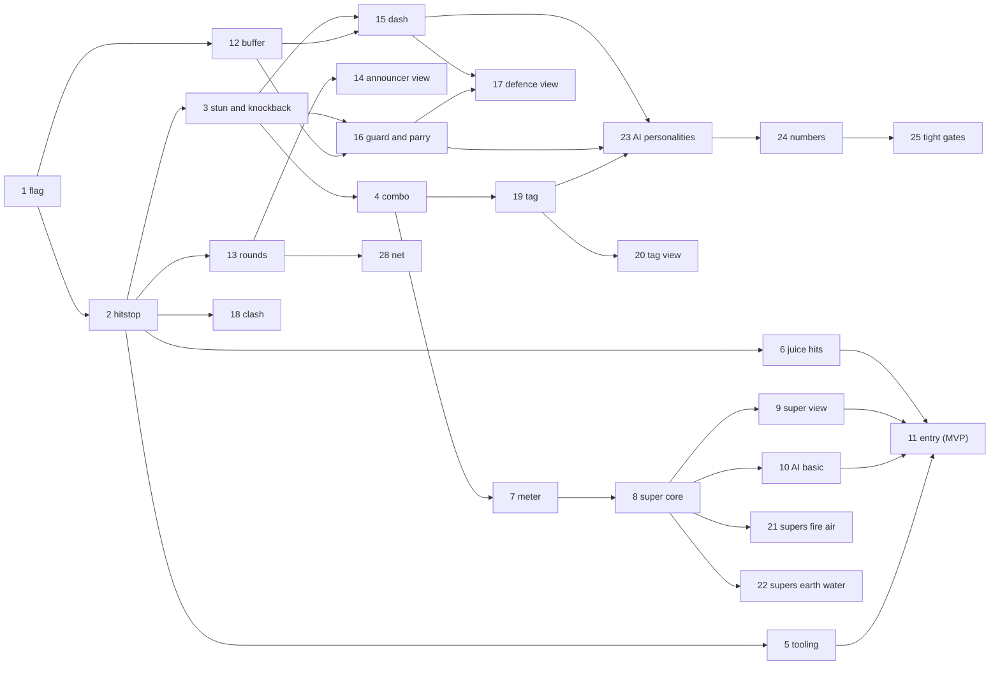

# Fun design: the Arcade ruleset

Status: **WP 1 (`WP-arcade-flag`, the ruleset plumbing), WP 2 (`WP-arcade-hitstop`), WP 3 (`WP-arcade-stun-knockback`), WP 4 (`WP-arcade-combo`), WP 5 (`WP-arcade-tooling`, report-only gate), WP 6 (`WP-arcade-juice-hits`), WP 7 (`WP-arcade-meter`), WP 8 (`WP-arcade-super-core`), WP 9 (`WP-arcade-super-view`), WP 10 (`WP-arcade-ai-basic`) and WP 11 (`WP-arcade-entry`, Arcade Versus on the main menu, playable on the live site: see section 7) are built, so the MVP is playable; after it, WP 12 (`WP-arcade-buffer`), WP 13 (`WP-arcade-rounds`, best of 3 in the sim), WP 14 (`WP-arcade-announcer-view`, the round banners, timer and pips), WP 15 (`WP-arcade-dash`), WP 16 (`WP-arcade-guard-parry`), WP 17 (`WP-arcade-defence-view`: the dash and guard keys, pad buttons and touch buttons, and their effects), WP 18 (`WP-arcade-clash`: projectile clash by element and its burst), WP 27 (`WP-arcade-8way-aim`), WP 29 (`WP-arcade-weather`, sim only) and WP 30 (`WP-arcade-weather-view`: the weather key, pad button and touch button, and its HUD badge, sky tint, particles and called line), WP 23 (`WP-arcade-ai-personalities`: personalities, Easy/Normal/Hard, parry, dodge, guard, dashes and weather in the AI), WP 24 (`WP-arcade-numbers`: Arcade life, damage, stun and cooldown numbers, section 2.13, and the Arcade balance baseline) WP 26 (`WP-arcade-audio-layers`: synthesised hit, defence, clash, super, weather and round cues and the KO music cut) WP 19 (`WP-arcade-tag`, sim only: the 2v2 tag team, its entrance attack, KO entrance and bench recovery, section 2.6) and WP 20 (`WP-arcade-tag-view`: the 1v1 or 2v2 pick in Arcade Versus, the team HUD with red life and the tag cooldown, the TAG! call and entrance flash, the touch Tag button and the 2v2 results; section 3) and WP 35 (`WP-arcade-weather-charge`: weather needs a charge, section 2.14) and the Arcade playfield insets (`WP-arcade-playfield-bounds`: fighters stay out of the HUD) and WP 31 (`WP-arcade-terrain`, sim only: stage element patches, section 2.15) and WP 32 (`WP-arcade-terrain-view`: the patch art, backdrop, buff badge and block spark) are built too; everything else is design.** Owner direction: "make sure the game is fun, and if it is not fun, make it
fun, like Street Fighter vs Capcom". This doc diagnoses the current combat, specifies an opt-in **Arcade** ruleset (fast,
flashy, readable, tag-team, big specials) on top of the deterministic sim, defines measurable fun gates, and cuts the work
into packages. **Classic** (the legacy-parity ruleset, [PARITY.md](PARITY.md)) stays the default and stays bit-identical.

Read first: [ARCHITECTURE.md](ARCHITECTURE.md), [DETERMINISM.md](DETERMINISM.md), [BALANCE.md](BALANCE.md),
[NETCODE.md](NETCODE.md), [GAME-DESIGN.md](GAME-DESIGN.md), [VISUAL-QA.md](VISUAL-QA.md).

Conventions in this doc: 1 tick = 20 ms (50 Hz). "pm" = per mille (integer, 1000 = x1). Every number is a starting value
in a data table (`src/core/data/arcade.ts`, planned), tuned by the metrics in section 4, not by feel alone.

## 1. Diagnosis: why the current game is probably not fun yet

Measured on `main` (SIM_VERSION 2) with `pnpm sim:match --tournament --seeds 4 --json` (level 1, scripted vs scripted,
264 matches): median match length **272 ticks (5.4 s)**, p10 2.7 s, p90 13.8 s; 12 stalemates (4.5%), all in the
melee-only pairs curomo-echo, curomo-treenoc, echo-treenoc; Sindarosa 100%, Ishimi 0%; Tornado 0% of damage; 21% of all
damage lands in the unattributed `melee-or-status` bucket.

1. **A DPS race, not a duel.** A hit is one subtraction: `s.hp[target] -= amount` in
   `src/core/sim/systems/projectile.ts` and `applyHit` in `src/core/sim/systems/melee.ts`. The victim keeps moving and
   firing the same tick: no hit-stun, no knockback, no interrupt. With 100 HP and Fire Blast at 40 damage per 31 ticks
   (`maxActive` 2), three hits end it, so trading hits is always correct and whoever lines up first wins.
2. **Two cooldown-gated buttons and walking.** Every action is a per-slot cooldown on the character
   (`cooldownIdx`, booked `tick + cooldownTicks + 1`; per team before WP-parity-fixes). There are no normals, no cancels, nothing to do between
   cooldowns. Shots go along the 4-way facing only (`facingFor` in `systems/movement.ts`: x wins over y), so aiming means
   standing on the opponent's row or column.
3. **No defensive verbs.** No block, dash, dodge or parry. Defence is two translucency buffs on 6-10 s cooldowns (Fade,
   Translucent Flame) and two passive damage reductions (Adrenaline, Rock Armour).
4. **The opponent is a coin flip.** (Fixed 2026-11-10: `enemyAgent` in `src/game/app/flow.ts` now returns the scripted AI at
   medium level; it was a `RandomBot` that stood still. Classic campaign fights are harder: owner to review.) The scripted AI (`src/core/agents/scripted-ai/`) never dodges because it cannot
   see projectiles: `ObservationView` (`src/core/agents/agent.ts`) has only `self`, `opponent` and cooldowns.
5. **Almost no feedback.** `src/game/fx/event-fx.ts` reacts only to `damage`, which only projectiles emit; melee, damage
   over time, heals, buffs and freezes emit nothing (`meleeSystem` docstring). The hit flash is a 60 ms tint that never
   visibly renders (VISUAL-QA V6), the shake is 80 ms at 0.002, sparks are six 3 px dots, projectiles are flat dashes
   (V10). Audio has five cues (`src/game/audio/sound-map.ts`). No damage numbers, no combo or round UI.
6. **Data outliers decide matches.** Sustained damage from `data.json`: Fire Blast and Sonar Blast 67/s against Slime
   Blast 7/s and Ground Shock 8/s ([BALANCE.md](BALANCE.md) class (c)). Tornado and Entangling Vines freeze for 150
   ticks: 3 s in a 5 s match is a death sentence, not a combo starter.
7. **Tag, rest and capture cannot matter at this pace.** The swap cooldown is 250 ticks (`SWAP_COOLDOWN_TICKS`), about the
   median match. Rest heal (`systems/rest.ts`) gives 0.5% max HP per second up to `restCap`, and `performSwap` only
   restores half the gap: benching for 10 s returns 5 HP. Capture (chapter 2+, at most 25% HP) is one hit wide against
   the high-damage races, so it is a race against your own damage with no ceremony.
8. **Stalemates.** Melee-only pairs stand off for 30 s because the legacy reach quirk (`KNOWN-BUG:melee-range-axes`)
   only accepts a melee within about 40 px and the bots never commit.
9. **No structure.** One KO ends the match: no rounds, no timer (the 9000-tick cap is a tooling guard), no announcer,
   no rematch beat. Hit-stop is listed as "planned" in [DETERMINISM.md](DETERMINISM.md).

These are not bugs for Classic: most are legacy behaviour that parity requires. Arcade changes them behind a flag.

## 2. The Arcade feature set

### 2.1 Ruleset plumbing (shared by every feature)

- **Flag.** `SimFlags.rulesetArcade` in `src/core/flags.ts`. The name sorts after `elementalAdvantage`,
  `experimentalPathing` and `experimentalSpawnCurve`, so no existing flag bit moves. `isArcade(s)`
  (`src/core/sim/clock.ts`) reads the world flag bit (hashed state), never a module variable.
- **State.** One new `SimState.arcade: Int32Array`, **length 0 when the flag is off**. `hash()` and `snapshot()` iterate
  `stateArrays`, so a zero-length array adds no bytes and Classic hashes stay identical. Layout (all Int32):
  - per entity (`ARCADE_E = 16` ints x 64): `stunUntil, kbVx, kbVy` (Q4: 1/16 px per tick), `juggle, invulnUntil,
    dashUntil, dashReadyAt, blockUntil, parryUntil, parryLockUntil, guardDrain, comboStunTotal, wallBounced, aim,
    dashDodged, weatherReadyAt` (WP 16 renamed `guardState` and `guardMeter`: `guardDrain` is 1000 minus the guard meter);
  - per team (`ARCADE_T = 18` ints x 2): `meter, comboHits, comboDamageQ4, comboStart, prevCmd, pressTick x 6
    (primary, secondary, dash, guard, super, weather), lastDirPress, lastDir, roundsWon, superState, pressUsed,
    confirmTick, weatherCharge`;
  - world (`ARCADE_W = 12`): `gameTick, freezeUntil, freezeKind, round, phase, phaseUntil, roundTimer, slowMoUntil,
    roundWinner, weather, weatherUntil, weatherTeam`.
- **Game clock.** `W.tick` stays the replay and event index and always advances. Arcade adds `gameTick`, which does
  not advance during hit-stop or super freeze and advances every second tick during KO slow-motion (WP 13). Built in WP 1:
  `advanceGameClock` advances it at the end of every unfrozen `step`, so with no freeze set `gameTick == W.tick`. Systems read
  `now(s)` (`W.tick` in Classic, `gameTick` in Arcade) for cooldowns, status timers and the rest-heal modulo. Event ids
  keep `W.tick`, so they stay unique while frozen.
- **Freeze gate.** `step()` runs the `input` slot (now `arcadeInput`) every tick. While `gameTick` is frozen it skips
  every other system. In Classic the gate is never true. Frozen means `W.tick < freezeUntil`: `freezeUntil` is in `W.tick`
  units, because a deadline in `gameTick` would never arrive while `gameTick` stands still.
- **Commands.** Arcade names reserved bits: 11 `dash`, 12 `guard`, 13 `super`, 14 `weather` (WP 29); 15 stays reserved.
  Classic keeps masking 11..15. `inputMaskFor(flags)` replaces the fixed `INPUT_MASK` in `src/core/net/session.ts` and is used by
  replay validation.
- **One hit path.** `applyArcadeHit(world, sink, attackerTeam, attacker, victim, base, abilityDefId, dir)` in
  `src/core/sim/systems/arcade/hit.ts`. In Arcade, `projectile.ts` and `melee.ts` call it instead of subtracting HP. The
  Classic lines stay byte-for-byte as they are, under `if (!isArcade(world))`.
- **Can act.** `canAct(world, id)`: Classic is `!frozen`; Arcade also requires no stun, guard, dash recovery or super
  startup, and phase `fight`. It replaces the frozen checks in the four cast sites (projectile `canFire`, melee `cast`,
  abilities `castSelf`, capture `canCapture`) and in movement.
- **Playfield insets (WP-arcade-playfield-bounds, built):** the Arcade arena is not the full canvas. `arcadePlayfield()`
  (`src/core/data/arcade.ts`) is the rectangle x 0..1920 (`ARCADE_ARENA_WIDTH`, 1.5 screens since WP 38d), y 200..640: top inset 200 (the bars block 100, the hyper meters
  to y 134 and the weather badge plate, which reaches y 196 on a phone), bottom inset 80 (the action bar, `BAR_Y` 640), in
  integer logical px; the canvas scales to the window, so they hold at every size. `createMatch` gives it to the world, so the
  movement and dash clamp, knockback clamp and bounce, projectile expiry, the super band and the AI walls (`ScriptedAI`)
  all use it, and the Arcade start row is its centre (`ARCADE_START_Y` 380); a tag entrance appears at the outgoing spot,
  already inside. `tests/repo/arcade-playfield-hud.test.ts` asserts the insets against the HUD constants so they cannot drift; section
  2.15's patches use the same rectangle. Classic keeps the legacy arena (y 100..720) for parity. SIM_VERSION 19.
- **Panning arena (WP 38, built):** the Arcade playfield is 1920 wide and the view stays 1280x720, so a camera pans
  (SF2 style). Spawns sit on the centred 1280 span (x 480 and 1360), so round start looks as before. The camera is view
  only (`src/game/fx/arena-camera.ts` pure rules, `arena-pan.ts` Phaser glue; no sim state, no hash): it follows the
  midpoint of the two live fighters (active fighter per team in 2v2), keeps each at least 160 px inside the visible edge by
  zooming out down to 0.8 (1600 px visible), clamps the view to the world so walls show and no void appears, and eases
  exponentially (snaps on a round reset or a jump over 400 px). Reduced motion: snap, zoom fixed at 1. Fighters farther
  apart than 1280 px are still both on screen (the clamp, not a sim limit, keeps them in view); screen walls would be a sim
  change and are not built. The super cinematic composes on top (`applyCamera`, `viewBox`); the HUD is its own scene so
  it does not move. Classic never pans (1280 arena, fit camera). Browser test: `tests/e2e/arcade-pan.spec.ts`.
- **Legacy quirks fixed in Arcade only:** `bounds-y-typo` (knockback needs real walls; since WP-parity-fixes Classic
  holds y too, because the legacy typo turned out to be harmless), `damage-uses-target-mult`
  (tag entrances must use the caster's multiplier), `melee-dead-caster-lingers`, `vines-stacking`,
  `steal-health-translucent`, `ice-shock-ignores-translucent`, and since WP 19 `rest-heal-enemy-in-play` (only benched
  characters heal) and `bullet-count-on-active` (a bullet hit releases its shooter's count, so a tag cannot strand it).
  Classic keeps them.
- **Arcade events** use kinds 40..69 (Classic uses 1..30). Arcade still emits `damage` (22) for every hit, so existing
  tools keep working, plus the richer `hitConfirmed`.

| Kind | Name | Payload | Emitted by |
|---|---|---|---|
| 40 | `hitStop` | `ticks, cause` (0 hit, 1 parry, 2 super, 3 KO) | arcade/hit, arcade/round |
| 41 | `hitConfirmed` | `target, attacker, ability, strength (0..3), amount, scalePm, combo, dir, counter` | arcade/hit |
| 42 | `comboEnded` | `team, hits, damage` | arcade/input (when the victim's stun ends) |
| 43 | `guarded` | `target, attacker, chip` | arcade/hit |
| 44 | `parried` | `target, attacker, reflected` | arcade/hit |
| 45 | `guardBroken` | `target` | arcade/hit |
| 46 | `dashed` | `dir` | arcade/input |
| 47 | `perfectDodge` | `projectile` | projectile (Arcade branch) |
| 48 | `clash` | `a, b, winner` (-1 = both destroyed), `x, y` (overlap centre), `ea, eb` (`ELEMENTS` indices) | arcade/clash |
| 49 | `meterLevel` | `team, bars` (only when the bar count changes) | arcade/meter |
| 50 | `superStarted` | `caster, superId` | arcade/super |
| 51 | `superEnded` | `caster` | arcade/super |
| 52 | `tagIn` | `from, to, team, entrance` (1 when the entrance attack was cast) | swap (Arcade branch, `arcade/tag.ts`) |
| 53 | `roundStarted` | `round` | arcade/round |
| 54 | `fight` | none | arcade/round |
| 55 | `ko` | `team, perfect` | arcade/round |
| 56 | `timeOver` | none | arcade/round |
| 57 | `roundEnded` | `winner, won0, won1` | arcade/round |
| 58 | `recovered` | `id, reason` (0 stun ended, 1 juggle cap, 2 stun cap) | arcade/hit, arcade/input |
| 59 | `weatherChanged` | `weather, prev, team` (the source is the caster; `prev == weather` is a refresh) | arcade/input |
| 60 | `weatherEnded` | `weather` | arcade/input, arcade/round |

System slots in `SYSTEMS` (`src/core/sim/step.ts`) are reused, so Classic order is unchanged: `input` becomes
`arcadeInput` (clock, edges, buffer, stun and combo expiry, dash), `collision` becomes `arcadeClash`, `health` becomes
`arcadeSuper`, `cleanup` becomes `arcadeRound`. Each returns at once in Classic.

### 2.2 Hit-stop (sim)

- Owner: `arcade/hit.ts` sets `freezeUntil = max(freezeUntil, W.tick + 1 + n)` (max, never sum; `W.tick` of the hit, so
  the next `n` ticks are frozen; see the freeze gate in 2.1).
- `n` by strength: light 4, medium 6, heavy 8, super hit 10, parry 10, KO 30. Strength comes from the base damage at
  level 0: light under 15, medium 15-29, heavy 30 or more; melee abilities get one tier more; super hits are strength 3.
  A per-ability override column covers exceptions.
- While frozen, only `arcadeInput` runs: inputs are buffered, nothing moves, no timer advances.
- View only: the victim sprite jitters plus or minus 2 px during the freeze (cosmetic RNG); there is no Phaser
  `timeScale` change.
- Built in WP 2 (`systems/arcade/hit.ts`, table in `data/arcade.ts`): `applyArcadeHit` is the hit path of projectiles
  and melee (Hurricane and Steal Health included; Entangling Vines deals no damage and stays outside it; Tornado's
  0-damage projectile hit is light). It keeps the Classic damage arithmetic and attacker choice, emits `damage`, `hitConfirmed` (`scalePm`
  1000, `combo` 1, `counter` 0 until WP 4) and `hitStop`, and a hit that empties the victim's HP takes the KO stop (30,
  cause 3). Override column: Hurricane is light (multi-hit). `freezeKind` holds the cause of the freeze that set
  the deadline. The `input` slot stays a no-op: the game clock already advances in `step` (WP 1).

### 2.3 Hit-stun, knockback and juggle limits (sim)

- On a hit: `stunUntil = gameTick + stun`, with stun by strength light 32, medium 38, heavy 44, super 48 (12, 16, 22, 26 before WP 24, section 2.13), minus
  `2 * juggle`, but never under 6. A stunned character cannot move or cast. `juggle` counts the hits taken while
  already stunned.
- Knockback is set in Q4 along the projectile's dir8, or for melee the sign of the attacker-to-victim centre delta:
  light 96 (6 px per tick), medium 144, heavy 224, super 256. Movement (Arcade branch) applies `x += kbVx / 16` and
  decays the speed by 16 (1 px per tick) per game tick toward 0. That gives about 21 px for light, 45 for medium and
  105 for heavy. Arena walls are clamped on both axes (bounds-y fixed). The first wall contact in a combo bounces the
  victim at half speed (a wall splat that extends the combo); later contacts stop it.
- **Juggle limit.** At `juggle >= 5` the next hit still deals damage but no stun, and gives `recovered` (reason 1) with
  20 ticks of invulnerability. A hard cap applies too: when `comboStunTotal` exceeds 150 ticks (3 s) the stun ends with
  `recovered` (reason 2). Together they rule out infinites; a property test proves it.
- Classic freezes inside Arcade: Tornado and Entangling Vines freeze for 60 ticks instead of 150 and count as heavy stun
  (they obey the juggle and stun caps). Ground Shock's self-freeze becomes recovery that a confirmed hit can cancel.
- Built in WP 3 (`systems/arcade/stun.ts`, `systems/arcade/knockback.ts`, tables in `data/arcade.ts`): `applyArcadeHit`
  sets knockback and stun after the hit-stop. Stun only extends (`stunUntil` never moves back) and `comboStunTotal`
  sums the extensions, so a stun chain is exactly `comboStunTotal` game ticks; a hit on a free victim starts a new combo
  (juggle, budget and wall bounce reset). Both caps end the stun with `recovered` (after the `hitStop`) and the same 20
  ticks of invulnerability, so a capped combo cannot restart on the next tick; the hit that would pass 150 ticks is the
  one that ends it. Invulnerable characters let projectiles through and are not touched by melee. Knockback replaces
  any left, moves the victim even while stunned, uses `DIR8_X/Y` (diagonals are +-speed on both axes), and the bounce
  halves both axes (truncated) and reverses the wall's axis. The new `wallBounced` entity int marks the bounce. `canAct`
  lives in `arcade/stun.ts`. Tornado's 60-tick stun comes from the hit path (no `frozen` flag, no status slot); Vines
  stuns once per cast without a hit event. Deferred: the Ground Shock recovery cancel arrives with the dash cancel
  (WP 15, done). `recovered` reason 0 came with WP 4.

### 2.4 Combo counter and damage scaling (sim)

- A hit on a victim with `stunUntil > gameTick` raises the attacker team's `comboHits`; any other hit resets it to 1.
  When the victim's stun ends, `arcadeInput` emits `comboEnded {hits, damage}` and clears the counter.
- Scaling by hit index (pm): 1000, 1000, 900, 800, 700, 600, then 500 as the floor. A super that starts a combo is not
  scaled; a super inside a combo has a floor of 600. The damage is `computeDamage(...)` (Classic arithmetic kept) times
  `scalePm / 1000`.
- `counter = 1` when the victim was in its own cast recovery (melee `delayAfterAttack`) or super startup: +1 stun tier,
  shown as "COUNTER".
- Built in WP 4 (`systems/arcade/combo.ts`, `systems/arcade/input.ts`, table in `data/arcade.ts`): the hit path counts
  the hit before its stun, so "stunned" means stunned before this hit; a hit that starts a new combo first ends the
  team's live one with `comboEnded` (so every combo ends exactly once, also when a cap freed the victim earlier in the
  same tick). The victim of a team's combo is the opposing team's controlled character. `comboDamageQ4` sums the
  scaled `hitConfirmed.amount` in Q4; `comboEnded.damage` is that sum / 16. An unscaled hit (1000 pm) keeps the
  Classic value exactly (no `* 1000 / 1000`). The `input` slot runs the expiry on unfrozen ticks only (the game
  clock stands still while frozen, and a frozen step stays silent): `recovered` reason 0 for each live character whose
  stun ran out (a stun is live while `comboStunTotal > 0`; the caps zero it and emit their own `recovered`), then
  `comboEnded` for each team whose victim is free. Counter: the victim has the `frozen` flag, which in Arcade only
  melee `delayAfterAttack` sets (Ground Shock included); the stun is the next tier's (an override such as Tornado's 60
  wins if longer). Since WP 8 a caster whose super is running is countered too. A combo is at most `JUGGLE_LIMIT + 2` = 7 hits (property test).

### 2.5 Hyper meter and one super per race (sim, view)

- Meter per team, 0..3000 (3 bars of 1000), carried across rounds. Gains: dealing damage `floor(dealt * 800 /
  victimMaxHp)` (so a full life bar dealt is 0.8 bars at any level), taking damage `floor(dealt * 600 / victimMaxHp)`,
  each cast +20, a parry +150, a perfect dodge +100, a clash +50 each. Owner: `arcade/meter.ts`, called from the hit path.
- Super input: `Cmd.super` (default keys X / pad RT), or primary and secondary pressed within 3 ticks (from the buffer
  WP on). Needs `meter >= 1000` and `canAct`.
- Sequence: `superStarted` freezes the game for 40 ticks (the cinematic freeze; only the view animates), during which
  the caster is invulnerable. Invulnerability lasts 8 ticks past the freeze. Then the super's hitboxes run as `effect`
  entities with a super def id; `superEnded` follows.
- Four element archetypes; each race gets a named variant (data table, same code):

| Archetype | Shape and rule | Hits x base dmg | Races and variant |
|---|---|---|---|
| Fire: Inferno Beam | Full-width band, 160 px tall, centred on the caster's y, facing side only; 30 active ticks, one hit every 6 | 5 x 12 | Sindarosa "Hellfire Lance" (band 200 px), Lavax "Crimson Tide" (+speed 2 for 150 ticks), Fiara "Phoenix Rise" (heals 10% of damage dealt) |
| Air: Vortex | 480x480 box on the caster; pulls with Q4 knockback toward its centre; 36 ticks, one hit every 6 | 6 x 9 | Cyclonius "Eye of the Storm", Wispera "Siren Gale" (steals 15% as HP), Echo "Phantom Squall" (caster translucent 60 ticks after) |
| Earth: Quake Rings | Three expanding square rings (Ground Shock geometry, 160/320/480 px) at +0/+10/+20 ticks | 3 x 20 | Rokcore "Mountain Breaker" (+armour 50% for 100 ticks), Pax "Titan Slam" (rings 25% larger), Treenoc "Overgrowth" (the last ring roots for 40 ticks, counts as stun) |
| Water: Tidal Wave | A full-height, 120 px wide wall projectile from the caster's edge at 12 px per tick; one hit, then a 40-tick slow | 1 x 50 | Curomo "Glacier Crash" (freeze 30 ticks, counts as stun), Morblass "Hailstorm" (plus 6 Icicles), Ishimi "Slime Tsunami" (wall 180 px wide) |

- Damage scales with `dmgMult` (level) like every ability. The Eternal Void (boss) is not an Arcade pick.
- View only: screen dims to 40% brightness, a portrait cut-in band in the element colour, the super name, camera
  punch-in, a music duck (section 3).
- Built in WP 7 (`systems/arcade/meter.ts`, table in `data/arcade.ts`): the meter is `ArcadeT.meter`. `applyArcadeHit`
  adds both gains last, from the health actually removed (`damageDealt`: overkill caps at the remaining HP, a hit on a
  dead victim gives nothing); the attacker is the source's team. The cast sites (projectile, omni, melee, buff and heal;
  not capture) add +20 once the cooldown is booked, through `meterOnCast`, which returns at once in Classic. `meterLevel`
  carries the new bar count (0..3) when a gain changes it. The parry, perfect-dodge and clash gains are in the table for
  WPs 15, 16 and 18. Nothing spends the meter yet (WP 8).
- Built in WP 8 (`systems/arcade/super.ts` in the `health` slot, table in `data/arcade.ts`): `Cmd.super` (bit 13; Classic
  masks it, and the system returns at once) starts a super while held, like the ability buttons, when the controlled
  character can act, its team has no super running and has 1000 meter. It spends the bar (`meterLevel`), emits
  `superStarted {caster, superId 0}` and then `hitStop {40, cause 2}` (the freeze), and sets `invulnUntil` to 8 game ticks
  past the freeze. Every race gets the generic Elemental Burst (the view tints it by the caster's element): an
  `effect` entity with def `SUPER_DEF` (the index after the abilities), a 160 px band from the caster's centre to the
  wall on its facing side (vertical when facing north or south), active for the 30 game ticks after the freeze, with a
  strength-3 hit of base 12 on every sixth (5 hits, through `applyArcadeHit`; translucent and invulnerable victims are
  missed). The team's `superState` holds the entity id + 1. The caster cannot act until `superEnded {caster}`, and a hit
  on it meanwhile is a counter hit. The super ends after its 30 ticks, when the caster leaves play (KO or bench, on the
  next tick), or at once when its hit KOs the victim (after that hit's KO stop, before `died`). Meter gains from its
  hits apply as for any hit. The super chord (primary and secondary) came with the buffer WP (2.12).

### 2.6 Tag swap, entrance attack and benched recovery (sim)

- Arcade defaults to 2v2 rosters (`MatchSetup.p1/p2` already allow up to 10). The swap keys (`swap1..4`) stay the tag
  keys.
- The swap cooldown is 150 ticks in Arcade (Classic 250). The incoming partner appears **at the outgoing character's
  position** (Classic: the team start x), with 20 ticks of invulnerability, and performs an **entrance attack**: its
  primary ability is cast on the entrance tick for free (no cooldown booked, `tagIn.entrance = 1`).
- **Tag combo:** a tag while the opponent is stunned keeps `comboHits` running (the scaling still applies).
- **Benched recovery keeps the legacy semantics as its base:** on bench, `restCap = hp + (restCap - hp) / 2` (unchanged
  `performSwap`), and benched characters heal toward `restCap` and no further. Arcade changes only the rate: 1% max HP
  every 10 game ticks (5% per second; Classic 0.5% per 50 ticks). The HUD already draws `restCap` as the rest bar; Arcade
  styles it as the "red life" a player can win back by tagging out.
- If the active character is KO'd, the auto-swap (`deathSystem`) brings the partner in with the entrance attack and
  60 ticks of invulnerability, so nobody loses to the arrival.
- Built in WP 19 (`systems/swap.ts` and `systems/rest.ts` Arcade branches, `systems/arcade/tag.ts`, table in
  `data/arcade.ts`): Arcade 2v2 is a `MatchSetup` with two-hero rosters (the 2-pick menu came with WP 20, section 3). A tag (the swap keys,
  held like Classic) needs the active character free as well as out of cast recovery (`isFree`: not stunned,
  block-stunned, dashing, in a super or in weather recovery), so a stunned character cannot tag out of a combo, and books
  `TAG_COOLDOWN_TICKS` = 150 game ticks (also after a KO auto-swap). The partner takes the outgoing character's spot,
  facing and 8-way aim; `tagEntrance` makes it invulnerable 20 game ticks (60 after a KO) and casts its primary at once
  through the ordinary cast path (cast meter, press, active count) with the cooldown deadline written back, so the
  entrance is free and a running cooldown keeps running. A primary that is a buff or heal (Pax, Rokcore, Echo, Fiara) is
  that self-cast; a partner that cannot act (guard held) or is at its active cap enters without it (`tagIn.entrance` 0).
  Events: Classic `swapped`, then `tagIn {from, to, team, entrance}`. The combo counter is per team and the victim of a
  combo is the opponent's active character, so a tag while the opponent is stunned continues the combo (the entrance hit
  counts and scales). Benched recovery: `REST_HEAL_PM` = 10 pm of max HP every `REST_HEAL_EVERY` = 10 game ticks
  toward the unchanged rest cap (red life), benched only. A round ends only when every hero of a side is down
  (`survivorsOf` counts the bench); the round reset restores both heroes (HP, rest cap, start spot, the first one
  active) and clears the tag cooldown. Meter is per team and carries over; a super's caster cannot tag (not free), and
  its super still ends if it is KO'd. AI (`ArcadeTactics`, no new memory or draws): free, unthreatened and with the tag
  ready, it tags (`Cmd.swap1`) when its HP is under 350 pm and its partner's is more than 250 pm higher.
- **Swap press (input and view, no sim change):** a swap is an edge, not a held key. The `KeyboardAgent` latches a press
  (key, pad button or slot click) until the next sim tick, so a tap shorter than a tick is never lost; one press is one
  swap, so holding the key neither chains a second tag when the 150-tick cooldown ends nor re-fires on OS key repeat. A
  swap sent on a tick where the game clock did not advance (hit-stop or KO slow-motion hold skip the swap system) is sent
  again, for up to 25 observations. When the view shows the press will be refused, `swap-notice.ts` puts a line above the
  action bar for 1.6 s ("Swap ready in 2.4s", "Can't swap: frozen" / "stunned" / "round not started" / "no partner to
  tag in"): text, not colour alone, and no fade with reduced motion. A refusal for dash, super or guard is not in the view
  and shows no line. The active hero's avatar sits flush with the end of its main bar (same gap on both sides, top edge
  level with the bar).

### 2.7 Dash and dodge (sim)

- Input: `Cmd.dash` (default E / pad RB), or the same direction pressed twice within 12 ticks (rising edges, detected in
  `arcadeInput` from `prevCmd`).
- 12 ticks at 3x `speed` along the held direction (or the facing); invulnerable to projectiles and melee on ticks 2..7;
  6 ticks of recovery; `dashReadyAt = start + 30`. Emits `dashed`.
- **Perfect dodge:** an enemy projectile that overlaps the dasher during the invulnerable ticks gives `perfectDodge` and
  +100 meter (at most once per dash).
- **Cancels:** on a confirmed hit, a dash can cancel the attacker's remaining melee recovery within 10 ticks of the
  confirm (the dash-cancel combo route).
- Built in WP 15 (`systems/arcade/dash.ts`, table in `data/arcade.ts`): `Cmd.dash` is bit 11 (Classic masks it); its
  key (E), pad button (RB) and touch button came with the defence view (WP 17, section 3), and the AI dashes on purpose since WP 23
  (section 2.11; before it only double-tapped by accident: 87 dashes and 21 perfect dodges in the 24 `fun:report` matches). The buffer
  records the dash press like the attacks (8 game ticks, used once); a rising direction edge (the lowest bit when
  several rise) that repeats `lastDir` 0..12 game ticks after the last one is a dash press too, and clears the pair, so
  a third tap starts a new one (held directions are one press). The `input` slot starts the dash on an unfrozen tick
  when the controlled character is free (no stun, super, dash or dash recovery; `fight` phase) and `dashReadyAt` has
  come: dash tick 1 is the start tick, `dashUntil = start + 12`, `dashReadyAt = start + 30`, and `dashed {dir}` gives
  the dir8 of the held input, else the aim (facing and aim are left to movement). Movement steps it at `DIR8 * speed *
  3` per game tick (diagonals +-3x speed on both axes) in `vx`/`vy`, clamped at the walls, with no `moved` event (like
  knockback) and ignoring input; `canAct` is false for the 12 dash ticks and the 6 after (free again at start + 18).
  `isInvulnerable` covers dash ticks 2..7, so projectiles pass and melee misses. An enemy projectile that overlaps the
  dasher on those ticks gives `perfectDodge {projectile}` (from the dasher) and +100 meter, once per dash
  (`dashDodged`). A hit or a stun ends the dash at once (its recovery still follows). Every Arcade hit stores the
  team's `confirmTick`; a dash in cast recovery (the `frozen` flag that only melee `delayAfterAttack` sets in Arcade,
  Ground Shock's included) starts only 0..10 game ticks after it and clears the flag; later, the press waits for the
  recovery to end, within the buffer.

### 2.8 Guard and parry (sim)

- **Guard (hold `Cmd.guard`, default Q / pad LT):** cannot move or cast. Hits take 250 pm chip damage, no hit-stun,
  8 ticks of block-stun, light knockback. A guard meter (0..1000) drains `floor(dealt * 8000 / maxHp)` (2000 before WP 24) per blocked hit
  and regenerates 5 per game tick while not guarding. At 0: `guardBroken` and 60 ticks of stun.
- **Parry:** a guard press (rising edge) up to 8 ticks before a hit lands. The hit does no damage, 10 ticks of hit-stop.
  A parried projectile is **reflected**: its dir is reversed and its team and owner become the parrier's. A parried melee
  stuns its attacker for 20 ticks. A whiffed parry (no hit within 8 ticks) locks new parries for 20 ticks (no mashing).
  Owner: `arcade/hit.ts` checks `parryUntil` before applying damage.
- Built in WP 16 (`systems/arcade/guard.ts`, table in `data/arcade.ts`): `Cmd.guard` is bit 12 (Classic masks it); its
  key (Q), pad button (LT) and touch button came with the defence view (WP 17, section 3), the AI guards and parries since WP 23 (section 2.11). A character guards while its team
  holds the bit and it could otherwise act (not stunned, block-stunned, dashing or in dash recovery, in a super or in
  melee cast recovery; `fight` phase), and through its block-stun even with the bit released. `canAct` is false while the
  bit is held, but a dash press still starts a dash out of guard (the dash cancels guard; its invulnerable ticks are not
  hit at all). Supers are unblockable and cannot be parried. A guarded hit deals 250 pm of the hit's damage (the
  combo-scale multiply) with `damage` and `guarded {target, attacker, chip}` instead of `hitConfirmed`, keeps the hit's
  strength hit-stop, sets the light knockback and `blockUntil = gameTick + 8`, counts no combo and no confirm (no dash
  cancel), and the meter gains apply to the chip. "Dealt" in the drain is the chip removed:
  `guardDrain += floor(chip * 8000 / maxHp)`, capped at 1000; at 1000 `guardBroken {target}` follows the `hitStop` and
  the 60-tick stun goes through `applyStun` (caps, `recovered`) instead of the block-stun. The controlled character
  regenerates 5 per unfrozen game tick while it does not guard (a benched one keeps its meter until it is back). A guard
  press is buffered like the dash: the `input` slot, after the dash, uses it once the character could act, and opens the
  window `parryUntil = start + 9` (a hit 0..8 game ticks after the start is parried), with the whiff lock
  `parryLockUntil = start + 29`; a press before the lock ends is dropped (so mashing never parries, also inside a live
  window), and a parry clears both. A parry emits `parried {target, attacker, reflected}`, +150 meter and then
  `hitStop {10, cause 1}`, deals nothing and returns 0 (Steal Health heals nothing). A projectile is reflected: `vx`/`vy`
  negated, dir8 `(dir + 4) & 7`, team and owner the parrier's, and its active count moves from the shooter to the
  parrier (when the parrier has that ability), so neither side leaks a bullet; it flies on in the same tick. A melee
  stuns its attacker for 20 through `applyStun`. Entangling Vines deals no damage and stays outside the hit path (2.2),
  so it is not guarded nor parried, like a throw; a guarded Ice Blast still slows.

### 2.9 Elemental clash (sim)

- Today opposing projectiles pass through each other (`projectileSystem` only tests the enemy character). In Arcade,
  `arcadeClash` visits pairs `i < j` of live projectiles from different teams in ascending id order, each projectile in
  at most one clash per tick, and tests AABB overlap.
- The winner follows `elementRelation(attEl, defEl)` from `src/core/data/elements.ts` (the existing cycle fire > air >
  earth > water > fire). The advantaged projectile survives with damage `hp - loserHp / 2`, never below 25% of its own;
  same element or void: both are destroyed. Emits `clash`, +50 meter to each side. Omni bullets and supers' wall
  projectiles take part; capture effects do not.
- At most 2016 pair checks over 64 entities, no allocation.
- Built in WP 18 (`systems/arcade/clash.ts` in the `collision` slot, table in `data/arcade.ts`): after the projectiles
  moved, hit and fired, `arcadeClash` visits live `EntityKind.projectile` entities (range shots, omni fans, Ice Blast;
  capture and super hitboxes are `effect` entities and never clash) in pairs `i < j`, skips same-team pairs and tests the
  box interiors (touching edges do not clash). A projectile's element is its owner's, so a parried projectile (2.8)
  clashes as the parrier's, with the parrier's team; one that hit a character this tick is already gone. Each projectile
  is in at most one clash per tick (two 32-bit masks): a survivor meets the next overlapping enemy on the next tick.
  `elementRelation` of the owners' elements: `adv` keeps the first, `dis` the second; the same element, void and the two
  neutral pairs (fire and earth, air and water) destroy both. The survivor's damage (`hp`, Float64 as in Classic) becomes
  `max(hp - loserHp / 2, hp / 4)` (`CLASH_LOSER_DIV`, `CLASH_FLOOR_DIV`). Rounding: no integer rounding; the divisions
  are by powers of two, so exact, and only the IEEE subtraction rounds (Fireball and Sonar Blast keep growing or decaying
  from the new value). A destroyed projectile is freed and gives its active count back to its owner (as on leaving the
  arena). `clash {a, b, winner, x, y, ea, eb}` (source `a`; the overlap centre in whole pixels, `Math.round`, and the
  `ELEMENTS` indices, for the view), then +50 meter to each side (`meterLevel` when a bar fills). Hit-stop: a clash sets
  none, and the `collision` slot is behind the freeze gate, so nothing clashes (or moves) while a hit-stop, parry or super
  freeze holds; a parry's reflection and its clash can share the parry's tick (the freeze starts on the next). Classic:
  the slot returns at once and projectiles pass through each other, as in legacy. The scripted golden
  `arcade-weather.replay.json` has a cancel (void against air) and a fire-over-air win whose Fireball flies on and lands.

### 2.10 Rounds, timer, best of 3, KO and announcer (sim events, view text)

- Phases in `arcadeRound`: `intro` 90 ticks (`roundStarted`, then `fight`; no actions), `fight`, `ko` (120 ticks; game
  time at half speed for the first 60, plus a 30-tick KO hit-stop), `roundEnd` 60 ticks, then the next `intro` or the
  match end.
- Round timer: 4500 ticks (90 s), counted in game ticks, so it pauses during freezes. Time over: the team with the higher
  sum of `hp * 1000 / maxHp` over its roster (integer compare) wins; equal gives a draw round, and both score.
- A round ends when a whole team is KO'd. A KO with the winner at full HP is `perfect`. Between rounds everyone is reset
  to full HP and the start positions; meter carries over.
- `endSystem` (Arcade branch) emits the existing `matchEnded` once a team has 2 round wins (draw: both on 2), so
  `rules/results` and the app flow keep working.
- The announcer is view-only: big text "ROUND 1", "FIGHT!", "K.O.", "TIME", "PERFECT", plus lines in the existing
  live region (`src/game/a11y/announcer.ts`). There are no voice assets (out of scope); the punch comes from audio
  layers (section 3).
- Built in WP 13 (`systems/arcade/round.ts` in the `cleanup` slot, table in `data/arcade.ts`): `ArcadeW.phase` is a
  `RoundPhase` (intro 0, fight 1, ko 2, roundEnd 3, over 4). A fresh Arcade world is round 0 in `intro`; the first tick
  starts round 1 (`roundStarted`), and `fight` comes on the 90th tick after it, so actions start on tick 91. Phase
  deadlines (`phaseUntil`, `slowMoUntil`) are `W.tick` values and the round timer counts fight game ticks. Outside
  `fight` nobody can act (`canAct`), swap or be hit (`isInvulnerable`). A wipe (`survivorsOf` 0; both: a draw round)
  emits `ko {team (the KO'd team, -1 for both), perfect}` after `died`; the hit path's KO stop holds the game (a KO that
  no hit caused gets the stop from the round instead), then 60 ticks of slow motion (`isSlowMoHold`: the freeze gate holds
  every second tick, so the game clock and every system run at half speed), and `roundEnded {winner, won0, won1}` 120
  ticks after the stop. Time over emits `timeOver` and `roundEnded` on the same tick. `roundEnd` lasts 60 ticks, then the
  next round resets every character (full HP and rest cap, start position and facing, roster first active, base speed,
  no statuses, cooldowns, active counts, stun or invulnerability, every other entity freed after live combos and
  supers end with their events; meter and round wins carry over) and runs its intro, or the phase becomes `over` and
  `endSystem` emits `matchEnded` with `won0`/`won1` in the same tick. `matchWinner` reads the round wins in Arcade. A KO
  keeps the character's damage multiplier (Classic zeroes it), since the next round brings it back.
  `ObservationView.arcade.phase` gives the AI the phase. The view (announcer, timer) is WP 14, built (section 3).

### 2.11 AI personalities and difficulty (agents, outside SimState)

- **Harder Normal/Hard (2026-11):** plan rates are higher and Hard reacts faster (4 plus a draw below 3 ticks); Easy is unchanged. Zoner/Turtle that see no HP change for `ARCADE_AI_STALE_TICKS` (400 ticks) play Rushdown (dash in, charge), so the AI never stalls a match (`pnpm fun:report` stalemate 0%). A sidestep, a free super without a confirm, a retreat dash and a Zoner charge were tried and dropped (retreat dashes caused stalemates; the rest did not fit the sim size budget). `pnpm ai:duel` pits the AI against the frozen previous one (`tools/sim/arcade-ai-v1`): about 54% on Hard. The AI is outside the sim, so no SIM_VERSION bump and no golden changes.

- An `ObservationView.arcade` extension (only in Arcade): meter, `stunUntil` of both sides, guard meter, phase, and the
  incoming projectiles (up to 8 nearest: x, y, vx, vy, element). It is a read-only copy; agents still never write state.
  Built in WP 10 (`ArcadeView` in `src/core/agents/agent.ts`): both meters, both stuns (game ticks left), the freeze, both
  live combos and the own super; guard meter, phase and projectiles join with their work packages. The Normal layer is
  `ArcadeTactics` (`src/core/agents/scripted-ai/arcade.ts`, shared by the core `ScriptedAI` and the tournament's scripted
  agent in `tools/sim/run-match.ts`): combo cap 3, a step in along the shared axis during the opponent's stun, and a super
  on confirm (opponent stunned, one bar, the band covers the opponent) after a 10-18 tick reaction from `AgentRng`.
- Personalities, as data with shared behaviours (built in WP 23 in `src/core/agents/scripted-ai/arcade-ai.ts`, see the
  last bullet; Tagger waits for tag, WP 19):

| Personality | Plan |
|---|---|
| Rushdown | Dashes in, presses primary during the opponent's stun (combo), supers on a confirmed hit |
| Zoner | Keeps 400-700 px, fires on axis, parries projectiles, supers from range (Fire, Water) |
| Turtle | Guards on incoming projectiles, parries, counters from block-stun |
| Tagger | Tags out under 40% HP, tag-combos, uses the entrance attack as an approach |

- Difficulty knobs (per level, drawn from the agent's own `AgentRng`): reaction delay in ticks (Easy 24, Casual 18,
  Normal 14, Hard 8, WTF 4), parry attempt rate (pm: 0, 100, 250, 500, 800), dodge attempt rate (same scale), combo
  length cap (1, 2, 3, 5, 8), super usage (never, random, on confirm, on confirm or anti-tag, optimal).
- Agent memory (reaction queue, plan) goes in `save()`/`load()` for rollback, like `MovementState`.
- Arcade ignores difficulty for stats (it passes `difficulty: 1` to `combatantStats`); difficulty picks the AI knobs
  only, so the fight is fair and readable.
- In the app, Arcade uses the Arcade AI, never `RandomBot`.
- Built in WP 23 (`WP-arcade-ai-personalities`; `ArcadeTactics` in `scripted-ai/arcade.ts`, tables and threat geometry
  in `scripted-ai/arcade-ai.ts`, which the barrel does not re-export so the bundle inlines them). `ArcadeView` gained
  `shots` (every live enemy projectile in entity id order with its per-game-tick velocity, rather than the 8 nearest
  with an element: the AI needs no more), `dashIn` and `weatherIn` (game ticks until its own dash and weather are
  ready); no guard meter yet. The layer draws from its own `ai.arcade.pN` stream. Three levels (`ARCADE_AI_KNOBS`; the
  tools' `--ai-level` 1..2 is Easy, 3 Normal, 4..5 Hard): reaction delay 20 + 0..8 (mean 24), 10 + 0..8 (14) and
  6 + 0..4 (8) ticks; parry scale 0, 500 and 1000 pm and dodge and guard scale 300, 600 and 1000 pm of the
  personality's rates; combo cap 1, 3 and 5; supers never, on confirm, on confirm; parry timing 2 + 0..9, 2 + 0..8
  and 2 + 0..5 game ticks before the hit (the window is 8, so Normal whiffs 2 in 9 and Hard never: success is bounded
  by the reaction, the plan rate and that timing); Rushdown dash-in rate 10, 25 and 50 pm per tick. Personalities
  (`ARCADE_AI_STYLES`, parry/dodge/guard pm): Rushdown 300/500/100, dashes in when the opponent is more than 360 px away
  (|dx| + |dy|), inside its combos too; Zoner 500/300/100, spacing left to the base AI's kiting; Turtle 400/100/400. A
  race at an elemental disadvantage plays Turtle; otherwise the personality is drawn once from the match seed. Defence:
  the soonest hit among the shots within 40 game ticks (`impactIn`) is a threat; once per threat the layer draws its
  reaction and a plan, then (free, reaction passed) parries by pressing and holding guard at the drawn distance,
  dodges by dashing towards the opponent 7 ticks before the hit (through the shot on the dash's invulnerable ticks; a
  guard press while the dash is not ready) or guards from 20 ticks away. Melee is not predicted (a melee box hits the
  tick after the cast, faster than any reaction). Weather: free, unthreatened, weather ready and its element at a
  disadvantage. The menu offers Easy, Normal and Hard (Easy is the Easy row now, not the Normal AI without supers).
  The tournament's chasing melee AI flips its off-line side when the wall leaves no room there, in Arcade only (a dash
  could pin it against the bottom wall and stall the round). Measured with `pnpm fun:report --all --seeds 4` (264
  matches, Normal, before and after): stalemates 0% and 0%; median round 10.7 s and 11.4 s; median match 29.4 s and
  32.7 s; hits per combo median 1 and 1, p90 4 and 5; dashes 1144 and 1609; guarded 0 and 677; parried 0 and 455;
  perfect dodges 241 and 345; weather casts 0 and 276; supers 677 and 730. Easy (`--ai-level 1`) and Hard (4): no
  stalemate, median rounds 9.9 s and 12.6 s, defence events 349 and 3765, no supers on Easy.

### 2.12 Input buffering and generous windows (sim)

- `arcadeInput` records the rising-edge tick of primary, secondary, dash, guard and super per team (`pressTick`), from
  `prevCmd`.
- **Buffer:** an action that cannot run now (cooldown, stun, hit-stop, recovery, intro) runs on the first tick it can if
  it was pressed within 8 ticks (160 ms). A buffered press is used once.
- Windows: super chord 3 ticks, double-tap dash 12 (WP 15), parry 8, dash cancel 10 (WP 15). Every window is in the
  data table and has a unit test at its edge (window - 1, window, window + 1).
- Built in WP 12 (`systems/arcade/buffer.ts`, windows `BUFFER_TICKS` and `SUPER_CHORD_TICKS` in `data/arcade.ts`): the
  `input` slot records rising edges on every tick, frozen ones included, as the game tick plus one in `pressTick`
  (`prevCmd` keeps the last command, masked to the Arcade input bits). Windows count game ticks, so a hit-stop or super
  freeze does not age a press: a press made during a freeze is fresh when the game resumes. The cast systems (abilities,
  melee, projectiles) and `arcadeSuper` read `bufferedCmd`: the raw command plus every pending press of primary,
  secondary and super (pressed 0..8 game ticks ago and not used). A cast marks its slot's press used (`onArcadeCast`,
  which also adds the +20 meter), and a super start the super press, so a press runs once; a held button keeps the old
  hold-to-fire behaviour. The new team int `pressUsed` holds the used presses. Chord: when a primary or secondary edge
  leaves both presses 0..3 game ticks old and the team has a bar and no super running, the pair becomes a super press
  (an edge feeds one chord), and held primary and secondary are masked while it is pending, so the chord is only the
  super (without a bar it stays two attacks). Dash and guard edges are recorded for WPs 15 and 16, which consume them
  (the dash press since WP 15, section 2.7; the guard press, a parry window, since WP 16, section 2.8).
  The Arcade AI drops a press that would complete a chord by accident (`avoidChord`, from the new `ArcadeView.prevCmd`,
  `primaryAge` and `secondaryAge`), so Easy still never supers. Intro-phase buffering came with `canAct`'s phase check
  (WP 13): a press in the last 8 game ticks of an intro runs on the first fight tick; the reset between rounds clears
  `pressTick`, `pressUsed` and the direction presses (`prevCmd` stays, so a held button is no new press).
- **8-way aim:** in Arcade, the facing used for casting is `dir8FromSigns` of the held input (Classic keeps 4-way
  `facingFor`). The projectile view rotates each bullet to its dir8; character reels stay 4-way.
- Built in WP 27 (`systems/arcade/aim.ts`): Arcade movement stores the dir8 of the held input, plus one, in the new
  `ArcadeE.aim` int whenever it updates the 4-way `dir`, so a released input keeps its last aim (0 = no input yet: the
  4-way `dir`, east or west at the start). `castDir` is that aim in Arcade and the plain `dir` in Classic, so Classic
  is bit-identical. Projectiles (range and Ice Blast) fly along it at `DIR8 * speed`: a diagonal is exactly +-speed on
  both axes (no normalisation, as for knockback), and leaves the arena by the legacy top-left test on whichever axis
  goes out first. A diagonal directional melee is a square of side `(w + h) / 2` (Ice Shock 240 x 40: 140) off the
  caster's corner on the aim side; the centred melees (Ground Shock, Hurricane) and the omni fans do not change. Those
  hits knock back along the aim (projectiles) or the centre delta (melee), both 8-way. Bands keep the 4-way facing: the
  Elemental Burst band runs along `dir`, which is the x-wins projection of the aim (a north-east aim fires it east), so
  it stays a well-defined 160 px band; later band supers (Inferno Beam) follow the same rule. The Arcade AI keeps its
  base 4-way shots (it drops a second movement axis when shooting, as Classic's x-wins facing would) and fires a ready
  projectile slot along a diagonal when the opponent sits on it (`diagonalLine`: centre offsets within half the
  opponent's height of each other). The view draws the aim as an arrow 64 px from the player's character (in the
  `arcade-versus` chunk; static, so reduced motion needs no variant), and `rotationForDir` now follows the legacy
  `createBullet` table (`(8 - dir) * 45`: north 270, north-east 315), which also fixes Classic's north and south
  bullets that were drawn pointing backwards.

### 2.13 Arcade numbers that slow the DPS race (data)

The round target is 25-60 s (section 4 asks 40-90 s); before WP 24 one round took about 12 s. Built in WP 24
(`WP-arcade-numbers`), data only, Classic untouched (its goldens differ only in the `simVersion` header, the Classic
balance baseline moved +0.0 pp on every race):

- **Per race life and damage** (`ARCADE_RACE_NUMBERS` in `src/core/sim/arcade-numbers.ts`, next to the sim so it ships in
  the sim chunk, not the menu's core chunk): `[hpPm, damagePm]` per race. Arcade max HP is `floor(maxHealth * hpPm /
  1000)` (`createMatch`'s Arcade branch); an ability hit deals `damagePm / 1000` of the Classic value, after the weather
  and before the combo scale (`applyArcadeHit`); the shared super is not scaled. Races outside the table (the dummy) get
  4000 / 1000. The Eternal Void, not a pick but the World Tour's final boss, has its own row since SIM_VERSION 25: 580 /
  1000, a lone 580 HP boss at the Tour's 0 XP (4000 before, which no AI team beat; set with the boss probe, section 2.18).
  The design's first idea (a flat 3x life and per-ability damage) was replaced by per-race
  pairs found by the tournament: each race's power moved by `(0.5 / winRate) ^ 0.6-0.8` per pass and was split evenly
  between life and damage, so every race keeps a life-to-damage ratio of about 4 and round length does not depend on
  the pairing.

| Race | hpPm | damagePm | Win rate before | After (16 seeds) |
|---|---|---|---|---|
| curomo | 6140 | 1420 | 39.2% | 50.6% |
| cyclonius | 4490 | 1010 | 52.3% | 50.6% |
| echo | 6360 | 1840 | 23.9% | 47.2% |
| fiara | 5140 | 1750 | 48.9% | 46.9% |
| ishimi | 6180 | 1550 | 32.4% | 57.1% |
| lavax | 3320 | 870 | 56.8% | 53.1% |
| morblass | 3370 | 930 | 80.7% | 45.5% |
| pax | 5870 | 1580 | 9.1% | 50.9% |
| rokcore | 2470 | 690 | 86.9% | 43.2% |
| sindarosa | 2620 | 650 | 70.5% | 50.0% |
| treenoc | 8470 | 1640 | 24.4% | 56.8% |
| wispera | 3490 | 800 | 75.0% | 48.3% |

- **Hit-stun** 32 / 38 / 44 / 48 by strength (was 12 / 16 / 22 / 26, `HIT_STUN_TICKS`): the projectile cooldowns are 15-30
  game ticks, so a shorter stun ended before a follow-up could land and the median combo was 1 hit. The juggle and stun
  caps (section 2.3) still bound every chain.
- **Guard drain** 8000 pm (was 2000, `GUARD_DRAIN_PM`): the drain is a share of the guard's max HP, which is now about 4x
  the damage that hits it, so 4 x 2000 keeps the number of blocked hits that breaks a guard.
- **Two cooldown overrides** (`ARCADE_COOLDOWN_TICKS`, `cooldownTicksFor`; projectile slots): Fireball 26 (Classic 30) and
  Crimson Fire 18 (Classic 20). Fiara against Sindarosa and Lavax against Rokcore fired at the same cadence along the
  start row, so every shot met the other in a clash that destroyed both and the match stood still (every round-robin
  stalemate was in these pairs).

Measured with `pnpm fun:report --ruleset arcade --all --seeds 8` (528 matches, scripted Arcade AI at Normal, its personality
drawn per match), before / after: round length median 12.5 / 45.4 s (p10 8.7 / 29.1, p90 22.1 / 74.5), time over 0.0 /
1.6%, hits per combo median 1 / 2 (p90 5 / 6), first hit median 2.0 / 2.0 s, stalemates 0.9 / 0.2%, best and worst race
86.9 / 9.1% (spread 77.8 pp) before and 57.4 / 41.5% (15.9 pp) after; the 16-seed baseline
(`tests/fixtures/balance/arcade-baseline.json`, 1056 matches) has 57.1 / 43.2% (13.9 pp) and 3 stalemates. At AI Hard
the spread is 23.9 pp (39.8-63.6%, 8 seeds; two Fiara-Ishimi matches hit the 18000-tick cap); at Easy (no supers, combo cap 1, little defence) it is 71.6 pp (Curomo 90%, Cyclonius 18%): Easy is not tuned. What is left: the
3 stalemates are Ishimi parrying every Rock Pellet or Crimson Fire and the reflections clashing with the next shot (an AI
habit; the round timer ends it in play), and Treenoc's 8470 life is large because its kit (Vines deal nothing, Branches
are melee) is weak in the AI's hands. Feel (does 45 s feel long, do 32-tick light stuns feel sticky) needs the owner's
playtest (section 7).

### 2.14 Weather (Arcade ability, sim + view)

Owner idea (Pokemon weather moves, WoW pet battle weather): a character can change the weather, and the weather
favours one element. It gives the elements the existing 1.25x chart under-serves a tool of their own, so an unlucky
matchup becomes something to play around instead of a fixed loss.

- **State:** one `weather` slot in `SimState.arcade` (kind, ticks left, owner team); `none` by default. A new weather
  replaces the old one, a recast of the same weather only refreshes it (no stacking).
- **Weather power (owner, 2026-11-10):** weather is not available from the start. Each team has a weather charge (its own
  bar, separate from the super meter) that starts empty and must fill before the cast is unlocked. Ranged heroes charge it
  by pressing attack buttons (each cast adds), melee heroes charge it just by walking and running (distance moved).
  Casting spends the full charge; the 30 s cooldown is replaced by the charge. Numbers are data rows (threshold, gain per
  cast, gain per walked pixel); start so that a normal fight unlocks weather around the middle of a round. See WP 35.
  Built in WP 35 (`WP-arcade-weather-charge`, SIM_VERSION 19), decisions: the charge is per TEAM (a 2v2 team shares one
  bar and one swap does not lose it), 0..1000 per mille (`ArcadeT.weatherCharge`), and it **resets to 0 at every round
  start** (it does not carry; the round reset empties it with the rest of the round state). Ranged vs melee comes from
  the controlled hero's PRIMARY ability kind: `range` and `omni` (`WEATHER_RANGED_KINDS`) are ranged, everything else
  (melee, buff, heal, debuff: Curomo, Treenoc, Pax, Rokcore, Echo, Fiara, Morblass) is melee-class. A ranged hero gains
  `WEATHER_CHARGE_CAST` (30) per primary or secondary cast (`onArcadeCast`); a melee-class hero gains
  `WEATHER_CHARGE_STEP` (4) per tick it walks or runs (a `moved` tick: not blocked by a wall, not a dash, not stunned);
  the other source gives nothing. `WEATHER_CHARGE_FULL` (1000) unlocks the cast; a cast spends all of it and the cooldown
  is now a `WEATHER_COOLDOWN_TICKS` = 50 lockout (a held key cannot double-cast; `weatherReadyAt` keeps the 16-tick
  recovery). Measured (`pnpm fun:report --ruleset arcade --seeds 8`, scripted vs scripted): the charge is full a median of
  22.8 s into a round for ranged heroes and 22.0 s for melee-class ones (round median 41 to 43 s, so about the middle;
  Ishimi, whose primary is a 10 s omni, is the slow one at about 62 s); weather casts per match fell from 1.51 to 0.79
  because the AI now also waits for the charge (first cast in a round, median 28.6 s ranged, 27.2 s melee, against 3.9 s
  and 3.5 s); the Arcade balance compare moved at most 4.5 pp (Sindarosa 50.0 to 45.5; the spread of 43.2 to 57.1 became
  45.2 to 55.7), so the Arcade baseline was re-recorded. The scripted AI (`ObservationView.arcade.weatherCharge`) casts only
  when the charge is full; `RenderView.arcade().weatherCharge` is `[team 0, team 1]` for the HUD.
- **Cast:** a new `Cmd.weather` (Arcade only; its own button, never in Classic's input mask). Each race calls the
  weather of its element: fire **Sun**, water **Rain**, earth **Sandstorm**, air **Gale**, void **Eclipse**. Cooldown
  1500 ticks (30 s), duration 500 ticks (10 s). Casting is a medium recovery and builds a little meter.
- **Effect (data table, one place):** damage of the favoured element x1.2, of its natural counter /1.2, applied after
  the element chart and before combo scaling: Sun fire up / water down; Rain water up / fire down; Sandstorm earth up /
  air down; Gale air up / earth down; Eclipse void up and every other element x1.0 (void stays neutral, it only
  rewards the void side). Rain also puts out burning, Sun melts freeze 10 ticks faster, Sandstorm slows projectile
  speed by 10 percent, Gale pushes knockback 10 percent further (each a data row, off in the first slice).
- **Fairness:** both teams feel the weather; the favoured side is whoever matches it, so counter-weather is a real
  answer (the weak side can swap weather with its own cast once off cooldown). Weather never changes who wins a
  mirror match.
- **View:** a weather icon and timer in the HUD (pattern and text, not colour alone), a light sky tint and a few
  pooled particles, an announcer line ("Sunshine!"); reduced motion drops particles only.
- **AI:** built in WP 23 (section 2.11): the scripted AI casts its own weather when it is off cooldown and the matchup is unfavourable.
- **Metrics:** share of matches with at least one cast, win-rate change per race with and without weather (the point
  is to narrow the spread between elements without making one weather mandatory).
- Built in WP 29 (`systems/arcade/weather.ts`, table in `data/arcade.ts`; sim only, the view is WP 30 and the AI later):
  `Cmd.weather` is bit 14 (Classic masks it), buffered like the dash (press slot 5). The `input` slot, after the dash
  and guard passes, first ends a weather whose `weatherUntil` has come (`weatherEnded {weather}`), then team 0 and then
  team 1 cast on a pending press when the controlled character `canAct` and its `weatherReadyAt` has come: the slot
  becomes `weather` = the kind of the caster's element (1 Sun, 2 Rain, 3 Sandstorm, 4 Gale, 5 Eclipse),
  `weatherUntil = gameTick + 500`, `weatherTeam` = the caster's team; `weatherReadyAt = gameTick + 1500` (WP 35
  made it a 50-tick lockout and gated the cast by the team's weather charge, see 2.14 above; per
  character, like the ability cooldowns); +50 meter;
  `weatherChanged {weather, prev, team}`. A replacement has no `weatherEnded`; on a same-tick tie team 1's cast wins.
  The recovery is the 16 game ticks after the cast (read from `weatherReadyAt`): `isFree` is false and a hit on the
  caster is a counter hit. Damage: `applyArcadeHit` runs the Classic `computeDamage`, then `weatherDamage` by the
  attacker's element (favoured `* 1200 / 1000`, counter `* 1000 / 1200`, which is exactly /1.2 up to one IEEE rounding,
  not an 833 pm approximation; anything else untouched), then the combo or chip scale; it covers every Arcade hit
  (projectiles, melee, supers, guarded chip), not damage over time or heals. The round reset ends the weather
  (`weatherEnded` before `roundStarted`) and clears every weather cooldown (the entity block reset). Secondary effects
  are `WEATHER_EFFECTS` rows with `WEATHER_EFFECTS_ON = false`: no system reads them yet.
- Measured (scratch run of `funReport --all`, 8 seeds, 528 Arcade matches, scripted vs scripted, the AI wrapped to
  press weather whenever it can): with no weather the per-race win-rate spread is 82.9 pp (Ishimi 10.2%, Pax 8.0%,
  Sindarosa 90.9%); with both sides casting it is 85.2 pp (4.4 casts per match, median match 29.4 s vs 29.7 s). With
  only one race casting, its own win rate moves: Treenoc +22.7 pp, Ishimi +18.2, Fiara +11.4, Lavax +11.4, Pax +11.3,
  Sindarosa +9.1, Rokcore +6.9, Echo +1.2, Morblass +1.2, Wispera -1.1, Curomo -4.6, Cyclonius -8.0 (the blind
  always-cast policy pays the recovery at bad moments). The AI that casts on an unfavourable matchup came with WP 23.

**New abilities:** the owner also allows new abilities in general. New abilities are Arcade-only data behind the
Arcade flag (Classic keeps the legacy kit); each needs a design row here before it is built (use the add-ability skill).

### 2.15 Stage terrain: element patches (Arcade, sim + view)

Owner idea (2026-11-10): the arena background is one of the four elements (fire, water, earth, air; the legacy art already
has `background/{fire,water,earth,air}.png`), and random patches of that element lie on the floor. A hero of the SAME
element gets a bonus while standing on a patch. Stages are Archon-style terrain with the fighting-game stage idea.

- **Stage:** the first stage is chosen by the match seed (void and the plain backdrops have no patches). After that the
  stage follows the weather (owner, 2026-11-10: each elemental can change the weather): casting Sun turns the stage to
  fire (new fire patches, same symmetric rules), Rain to water, Sandstorm to earth, Gale to air, and the backdrop changes
  with it. Owner decision (2026-11-10): a weather change swaps BOTH the damage modifiers (section 2.14) and the terrain
  patches. Rules: the new patches are re-seeded symmetric, never overlap a hero (inflated by the hero size) or a
  projectile in flight; the swap has a short telegraph (30 ticks of fade) so nothing changes under a hero's feet without
  warning; a recast of the same weather only refreshes the timer and keeps the patches; when a weather ends the stage
  keeps its last patches (only the modifiers end) until the next cast.
- **Patches:** 3 to 5 rectangles per round, placed from the seeded RNG at the round start, point-symmetric about the arena
  centre so neither side gets a better layout, never overlapping the spawn points, never closer than a hero width to each
  other or the walls, so nothing can trap a hero. State in `SimState.arcade` (kind, rects), integer geometry only.
- **Fire patch:** a fire hero standing in it deals double damage (owner: "200%... double", so x2, data row 2000 per mille).
  Later idea, not in the first slice: an opponent standing in a fire patch burns.
- **Water patch:** a water hero in it heals 1 HP per second (every 50 ticks). Scale it per mille of max HP, and let the
  data row decide (the owner's 1 HP per second is the default for a 100 HP hero).
- **Earth patch:** a solid rock: heroes of other elements cannot enter it (movement is clamped like a wall), an earth hero
  walks over it, and projectiles stop at it (owner decision 2026-11-10: rock stops projectiles; a shot that hits a rock
  ends there, with a small spark; an earth hero's own shots pass over its rocks). Rocks give cover, so the symmetric layout
  and the no-trap spacing matter.
- **Air patch:** an air hero in it moves at double speed (x2, data row 2000 per mille); it does not stack with a dash (the
  larger applies).
- **Stacking:** all modifiers multiply with the weather and element chart, then are capped (data row, default x2.5 total)
  so Sun plus a fire patch cannot blow up a round.
- **View:** each patch has a distinct pattern and a text/icon label (not colour alone), a soft element glow, a small
  pooled particle effect; reduced motion drops the particles. HUD shows a small buff badge while a hero stands in a patch.
- **AI:** later; the scripted AI walks to its own-element patch when idle and avoids rock it cannot cross.
- **Metrics:** share of time heroes stand on patches, win-rate per race on each stage (the stage must not decide the match).
- **Classic:** untouched; terrain is Arcade-only and behind `rulesetArcade`.

Built in WP 31 (`WP-arcade-terrain`, sim only, SIM_VERSION 21), decisions: the state is the world slots `stage` (a weather
kind: 1 fire, 2 water, 3 earth, 4 air), `swapAt`/`swapTo` (the telegraph), `terrainGen` (layouts drawn) and `patchCount` with up
to 5 integer rectangles, plus a per-team `inPatch` flag for the enter/leave events. "A dedicated RNG stream" is one fresh sfc32
per layout draw, `seedSfc32(matchSeed, 'terrain.<n>')` with `n` the stored counter, so the five `SimState.rng` streams (and so
every Classic hash) are untouched and the whole state is one integer. The layout (`arcade/terrain-layout.ts`): 3 to 5 patches,
sides 80..160 px in steps of 20, point-symmetric about the playfield centre (an optional centre patch, the rest mirrored pairs),
every patch one hero width (80 px) from the playfield edge, from each other and from every spawn, hero and projectile on the
field; the spawn zones leave only the middle band free, so a short draw is redrawn up to 8 times (a draw of 3 is the usual
result, 4 or 5 about 6 percent of draws). Rules and rows (`src/core/sim/arcade-numbers.ts`, `TERRAIN_*`): the hero's CENTRE
inside a patch is "standing on it", and only a hero of the stage's element gets the effect; the controlled (active) hero decides,
so a tag changes the rule. Fire x2 damage (2000 pm) after the weather; water heals 10 pm of max HP (1 HP at 100 HP) on every
50th game tick of the fight; air x2 walking speed (2000 pm; a dash keeps its own larger x3, so nothing stacks); earth is a rock
for the other elements: every step (input, dash, knockback) that would newly enter one is undone like a wall (a hero already
inside, such as a tag-in on an earth hero's spot, walks out freely), and a shot of a non-earth owner that touches a rock is
removed with `projectileBlocked {x, y}` (its cast count is released); an earth hero's own shots and body pass. The total of
element chart, weather and terrain is capped at 2500 pm of the plain hit (`capDamage`: never below the chart-and-weather value;
the weather and chart alone reach 1.5 at most, so only the fire patch can hit it), and the speed modifier at 2500 pm. A weather
cast (kinds 1 to 4; eclipse has no terrain) starts `terrainSwap {stage, ticks: 30}`; the swap lands 30 game ticks later with a
new layout (`terrainChanged {stage, count}`); the same weather again keeps the patches, a cast back to the standing stage
cancels a pending swap, and a weather that ends keeps the last patches. Round start redraws the layout (a pending swap lands
first). Events: `terrainChanged` 61, `terrainSwap` 62, `patchEntered` 63, `patchLeft` 64 (`{team, stage}`), `patchHeal` 65
(`{amount}`), `projectileBlocked` 66. Not built: AI use of patches (basic rock avoidance only). The 2v2 tune is WP-arcade-2v2-tune (below). The view is WP 32 (below). Known cost: an earth stage
often puts a rock on the middle row (the centre patch sits on the fighters' row), and the scripted AI first neither walked round it nor fired over it, so Arcade
stalemates rose (balance:compare stalemates 4 to 92 of 1056 matches). Basic rock avoidance is in `ArcadeTactics` (`ObservationView.arcade.rocks`:
the earth patches for a fighter that cannot cross them): a move that would enter a rock, or an attack along a line a rock cuts, starts a
30-tick slide along the other axis towards the nearer free side (up or left on a tie), and the stalemates are 7 of 1056.

Built in WP 32 (`WP-arcade-terrain-view`, view only; `src/game/fx/terrain-fx.ts` pure rules and `terrain-view.ts`, its own lazy
`terrain-view` chunk the Arena mounts in every Arcade match): from `RenderArcade.stage`, `swapLeft`, `swapTo`, `patchCount` and
`patches` (the only core change: read-outs in `sim/view.ts`, plus `arcadePlayfield` exported). Each patch is a rectangle with its own
PATTERN (flame tongues, wavy lines, staggered bricks, swirls) and a word above it (`FIRE x2`, `WATER +HP`, `ROCK`, `AIR x2`), never
colour alone, with a soft glow that pulses; earth patches are drawn raised and solid (a lit brick top, a dark front face, a shadow
beyond the footprint, the footprint being the sim's collision box). Four pooled ambient particles per patch (embers, droplets, dust,
wind streaks). The backdrop image follows the stage element (over the hero's). A pending swap fades the old patches to 35 percent (a
rock still blocks until it lands) while the next backdrop fades in over the 30 ticks; the new layout then fades in from 35 percent.
The HUD buff badge (left of the weather badge: `FIRE x2`, `HEAL`, `AIR x2`, `ROCK PASS` with an element icon) shows while the
player's hero is of the stage element with its centre in a patch (the sim rule); a heal pulses it. A rock-blocked shot draws an
eight-ray spark. Live lines: "The stage will turn to fire." (telegraph), "The stage turns to fire." (landing), "You stand on a fire
patch: damage doubled.", "Rock blocks the shot.". Reduced motion drops the particles, the glow pulse, the fades and the spark's
growth and keeps the patterns, words, badge and spark. Also fixed here: the 8-way aim arrow hides when it would leave the
playfield's vertical band (it drew over the action bar for a fighter on the bottom edge). Visual QA states `arcade-terrain-*`.

### 2.16 Sprite sheets: diagonals, more frames and poses (view, assets)

Today every character sheet has right/left/up/down frame sets (left mirrors right), 80x80 frames, built by
`tools/assets/build-assets.ts` from `imgWorkArea` (layered GIMP sources) into `public/assets/img` and a manifest.
Plan, cheapest first:

1. **Procedural pose layer (no new art; built in WP 33, `WP-arcade-pose-layer`):** diagonals reuse the nearest side frame flipped, with a lean (small rotation)
   and the dir8 aim arrow; anticipation/impact poses via squash-and-stretch, bob, tint, afterimages and hit-reel tweens
   (view only, pooled, reduced-motion safe).
   Built in WP 33 (view only, lazy `pose-layer` chunk, `src/game/views/pose-layer.ts` and `pose-math.ts`): the walk frame is
   chosen by distance walked on screen (30 px per frame, the old 8 fps at base speed) so feet match speed at any refresh rate;
   leans (4 degrees sideways, 7 on diagonals) towards the heading and aim, start squash, stop rebound, idle breathing (Classic
   and Arcade); in Arcade also cast squash-and-stretch, hurt tilt, guard crouch, dash stretch (with the existing afterimages), KO
   fall (a pooled ghost), victory hop and tag-in slide, all driven by events and state the view already receives (a cast is a
   projectile first seen at its caster); reduced motion keeps frames and the tag-in fade only. Projectiles: shortest-arc rotation
   easing, a 60 ms spawn ease-in, a 130 ms fade-out ghost; camera shake decays quadratically. Measured: on-screen step of a
   constant-speed walker deviates under 1e-12 px per render frame at 50 to 165 Hz through the real `FixedStepDriver` (unit
   tests); `phaser-config` 16993 to 16998 B (budget 17000), `pose-layer` 3662 B (budget 3772); `visual:pacing` p99 50 ms before
   and 16.8 or 66.7 ms after (SwiftShader noise). Not done: a trail-length rework (the dots are already sampled per tick) and
   easing of rings and pops (they already ease out). Real-device feel is unverified.
2. **Sheet spec and pipeline:** a documented atlas layout (80x80 frames; actions idle, walk, cast, hurt, guard, dash, KO, victory, tag-in x 8
   directions), a packer in `tools/assets` that builds the atlas and manifest from per-frame PNGs, validation tests (frame counts, sizes)
   and legacy art as the fallback for any missing row.
   Built in WP 34, reworked in `WP-sheet-spec-v2` (tools and tests only; no sim, view or art change). The first layout was a fixed
   320x5760 grid of 72 rows; that exceeds the 4096 px texture limit of many phone GPUs, is 7.4 MB decoded per character (about 55 MB for
   21) and mostly empty. Now: the pure spec is `src/game/assets/sheet-spec.ts` (so the view can import it; `tools/assets/sheet-spec.ts`
   re-exports it): frames per action (idle 4, walk 4, cast 4, hurt 2, guard 2, dash 3, KO 4, victory 4, tag-in 4), the directions E, SE, S,
   SW, W, NW, N, NE, `layoutAtlas`, the manifest types, `frameRect` and `resolveRow`. One atlas per character holds only the rows that have
   art, in canonical order (action block, then direction), packed left to right in 80 px shelves that wrap at `ATLAS_MAX` = 2048 px (width
   is the widest shelf, height the shelf count; a row wider than 2048 or shelves taller than 2048 are packer errors). `png-lite.ts` is the
   dependency-free PNG decode/encode (level-9 zlib), so the bytes depend only on the pixels and a given set of frames always gives the
   same file. `pack-sheets.ts` (`pnpm assets:sheets`, `--check` fails on stale outputs) reads per-frame PNGs from
   `imgWorkArea/sheets/<sprite>/<action>/<dir>/<NN>.png` plus a `license.txt` per character (required once any frame exists) and writes
   `public/assets/img/sheets/<sprite>.png` and `src/game/assets/sheets.generated.json` (the spec, and per character the url, sha256,
   licence, atlas width and height, and for each packed row its `action/dir` key and the top-left corner of every frame). A row is
   all-or-nothing (right frame count, 80x80). **Fallback order** (`resolveRow`): (1) the character's own row for that action and direction;
   (2) the mirrored east-side row, drawn flipped (W from E, NW from NE, SW from SE; the east side is never mirrored from the west);
   (3) legacy art (`legacyFallback()`: E/NE/SE play the legacy right strip, W/NW/SW the left strip mirrored as today, N/S the up/down strips
   where the legacy sprite has them; walk plays the strip, other actions hold frame 0 for the pose layer). Weight: at most 600 KB per
   atlas and 12 MB for all, checked by `pnpm size:check` (`sheets` in `tools/ci/size-budget.json`, measured on `dist/assets/img/sheets`;
   zero today) and by the packer for the per-file limit. 21 characters are covered (the 80px legacy map sprites); today all 21 are pure
   fallback, 0 atlases exist. `tests/repo/sprite-sheets.test.ts` covers spec, atlas layout (wrap, determinism, oversize errors), rectangle
   lookup, fallback order, validation errors, reproducibility and the committed outputs.
3. **New art:** drawn by the owner or an artist, or generated; every new asset needs a licence note in the manifest.
   Needs an owner decision on who makes the art.
   **View side, built in `WP-sheet-view` (no art, no visible change while the manifest has no atlas):**
   - The lookup is pure `resolveFrame(sprite, action, dir8, t)` in `src/game/assets/sheet-frames.ts`, with no Phaser. It
     returns the texture key `sheet:<sprite>`, the frame `<action>/<dir>#<i>`, the rectangle and the flip, or `legacy`.
     Fallback is as `resolveRow`. Results are built once per slot, so the per-frame path allocates nothing.
   - Frame timing per action (`FRAME_TIMING`):
     - idle loops at 450 ms per frame.
     - walk steps once per 30 px walked, like the legacy strip.
     - The one-shot rows hold their last frame and fit inside the procedural pose they replace: cast 220, hurt 300,
       dash 200, tag-in 320, KO 700 ms.
     - victory loops.
   - Loading: `pose-sheets.ts` (`SheetBook`) loads `assets/<url>` lazily, the first time a character of the current match
     is seen, and only when the manifest has an atlas for it. With the committed manifest nothing is ever requested. The
     frames are registered on the texture, and a later match reuses them.
   - Drawing: the pose layer draws the sheet row in priority order: event pose (cast, hurt, dash, tag-in, victory), victory
     team, guard, walk, idle. On a sheet row it turns off the procedural lean, breathing and stride bounce, because the art
     carries them.
   - Still applied on sheet rows: the start squash, stop rebound, guard crouch, event squash and offsets, and hit-stop
     jitter.
   - The KO ghost plays the `ko` row instead of the rotation fall.
   - Any row that falls back to legacy draws exactly what it drew before, with its lean and bob.
   - Tests: unit tests in `sheet-frames.test.ts` and `pose-layer.test.ts`. The e2e `tests/e2e/sprite-sheets.spec.ts` uses
     a test-only manifest (`window.__TTE_SHEETS__`, read by dev and test builds only) and a fixture atlas generated in the
     test and served by `page.route`. Neither is in `public/` or the build.
   - Size: `pose-layer` 5749 to 7827 B gzip, budget 7900. The manifest and the lookup code join the pose-layer chunk
     group, so there is no extra request. `phaser-config` grew 3 B (budget 21970), because its preload list now includes
     the index chunk.

#### Rig and bake (tools only, no art; `WP-rig-bake`, ADR-0019)

Drawing 9 actions x 5 directions per character by hand is the costly part of step 3. A cutout rig cuts that down: the artist
draws the body parts once per direction (or once, reused), and keyframe curves pose them. `tools/assets/bake-rig.ts`
(`pnpm assets:bake [--check]`) bakes a rig offline into the per-frame PNGs that `pnpm assets:sheets` packs. Nothing is
skinned at runtime, so the view, the size budgets and the sheet fallback are unchanged.

- **Input** `imgWorkArea/rigs/<sprite>/`, where `<sprite>` is a sheet character (`sheetCharacters()`):
  - `rig.json` has `dirs`, `parts` and `actions`, plus an optional `extends`.
    - `dirs` lists the authored directions, from E, SE, S, N and NE. W, SW and NW are rejected, because `resolveRow` mirrors
      them at runtime.
    - `parts` lists `{id, parent?, png, pivot, at, z?, hide?, views?}`. `pivot` is in the part's own pixels. `at` places the
      pivot in the parent's pivot space, or in the 80x80 frame for a root part. `z` sets the draw order. `views` holds
      per-direction overrides of any of `png`, `pivot`, `at`, `z` and `hide`.
    - `actions` maps each action to `{frames, curves}`. `frames` must equal the sheet spec. `curves` gives per part `rot`
      (integer degrees, clockwise), `dx` and `dy` (pixels), and `sx` and `sy` (percent), with one integer per frame.
  - `parts/*.png` holds the part images.
  - `keys/<action>/<dir>/<NN>.png` is optional. These hand-painted 80x80 frames replace the baked frame.
  - `license.txt` is required, but may come from a base.
  - Rigs named `_<name>` are abstract bases and are never baked. A variant (`"extends": "_base"`) merges parts by id (fields
    and views), replaces actions by name, and takes `dirs` from the nearest rig that sets them. Part images are looked up in
    the rig first, then in its bases.
- **Output**:
  - `imgWorkArea/sheets/<sprite>/<action>/<dir>/<NN>.png` and `license.txt`, for the authored directions only.
  - `imgWorkArea/rigs/bake.lock.json`, holding sha256 of every input and output per rig plus the bake version.
  - `--check` fails, writing nothing, when the lock or any frame differs or a frame from the last bake is left over.
  - After a bake, run `pnpm assets:sheets`.
- **Determinism**: the bytes depend only on the inputs. There is no host maths:
  - Angles are integer degrees through a literal Q14 sine table.
  - Transforms are Q16 integer affine matrices: world = parent · T(at + d) · R(rot) · S(sx, sy).
  - Each output pixel centre is inverse-mapped to the nearest part pixel.
  - Alpha is composited in integers.
  - The output is encoded with `png-lite`.
- **Errors**: the schema is validated in code, and every error names the file and the JSON path. Covered: unknown keys,
  mirrored or unknown directions, frame counts off the spec, curve lengths and ranges, unknown parents or parent cycles,
  `extends` that is unknown or cyclic, missing part images or licences, keys for frames the rig does not bake, and
  stray files.
- **Gate**: `tests/repo/bake-rig.test.ts` runs the real `--check`, which is cheap while there are no rigs. The test also
  covers:
  - determinism (twice and in any input order, plus a pinned lock hash);
  - rotation about a pivot on a known pixel pattern;
  - keys;
  - `extends`;
  - schema errors;
  - stale detection, using the synthetic fixture in `tests/fixtures/rigs/`.

  No rig and no art ship yet. Bump `BAKE_VERSION` when the algorithm changes on purpose.

- **Cut-assist** (`WP-rig-assist`, `tools/rig-assist/`, offline, outside the gate and CI, not shipped, no `package.json` change):
  `cut.py` cuts a legacy sprite frame into rig parts. The artist gives per-part click points (`points.json`), SAM 2 makes the
  masks, and the script makes them exactly disjoint, grows each part 8 to 12 px beneath the parts drawn above it (edge-extend
  fill, no diffusion), and writes `parts/*.png` plus a `rig.json` skeleton with suggested pivots (centroid of the contact with the
  parent). A `--no-sam` mode takes hand-drawn polygons, and `selftest.py` checks it with numpy and pillow only. The output is a
  starting point: pivots, curves and a truthful `license.txt` are still hand work. See its README.

### 2.17 Charge (new Arcade melee ability, sim + view + AI)

Owner idea (2026-11-10): a melee ability called "Charge" that runs straight up to the opponent, like the World of
Warcraft warrior's Charge. It gives melee heroes a gap closer, the way weather and supers give other heroes tools.

- **Who:** Arcade-only action for heroes whose primary ability is melee (the same ranged/melee rule as the weather charge).
  Own input bit (masked in Classic), key H (F is the fullscreen toggle) / pad R3 by default, rebindable, with a touch button (`#arcadeCharge`).
  **Numbered action row:** the Arcade actions also have number keys beside their letters, 5 Charge, 6 Weather, 7 Dash, 8 Guard, 9 Super
  (Tag and Tag 2 are 3 and 4), and the touch buttons wear them (`5 Charge`, with the ready state in words: `ready`, a percentage or seconds;
  Dash, Guard and Charge have no read-out yet). Digit5 is also Swap 3, the fourth hero a Classic party has: in Arcade (at most three
  heroes) `key-map` reads Digit5 as Charge, in Classic it stays Swap 3, bit for bit. The Charge button is left out when none of the
  player's heroes is melee; the other buttons keep their numbers. Saves that already name an action keep their own keys.
- **Move:** the hero rushes toward the opponent along the straight line (8-way snapped, 12 ticks at 5x speed, up to 360 px),
  stopping when it touches the opponent. Not invulnerable (unlike dash); it is interrupted by a stun or freeze, and it
  stops at walls, the playfield edge and rocks (earth hero walks over its own rocks). It cannot start while stunned,
  frozen, mid-cast or in hit-stop.
- **On arrival:** a short stun on the target (20 ticks, counted as a hit-stun so it feeds combos), a small hit (data row,
  light strength), meter gain (40). As built there is no free primary on arrival: it did not fit the `sim` chunk budget, so the charger
  presses its own follow-up (the 20-tick stun is long enough for the combo).
- **Cooldown:** 300 ticks (6 s), data rows for speed, range, stun and cooldown.
- **Counterplay:** guard blocks the stun (chip damage only), a parry reflects it (the charger is stunned), a dash with
  its invulnerability frames dodges it, a projectile hit mid-charge interrupts it, a rock stops it.
- **View:** speed lines and a short afterimage trail (the dash effects, tinted), impact spark, "CHARGE!" call, an
  aria-live line; reduced motion keeps the call and drops the trail.
- **AI:** melee personalities (Rushdown) charge when the distance is above a threshold and the opponent is not
  guarding or about to cast; Easy never charges. As built: Rushdown presses it when ready and the foe is 200 px or more
  away (Manhattan, `CHARGE_AI_MIN_DIST`), when free and with no threat; `ArcadeView.chargeIn` is -1 for a ranged hero.
- **Metrics:** charges per match, share that connect, win-rate per race (melee races must not dominate).

### 2.18 World Tour: eight fights, then the Void (Arcade, view + app, owner request 2026-11-11)

Owner direction: like Street Fighter II, a tour of the world: pick a hero, beat eight opponents in a fixed ladder, then fight the
final boss, the Eternal Void. Design (not built yet):

- **3v3 always (owner, 2026-11-11):** the player brings a team of 3 heroes (as in Classic's garrison) and every opponent is a team of 3. This
  needs a sim change: Arcade tag (section 2.6) is 2v2 today, so a 3-per-side tag (swap to either bench member, KO entrance, bench
  recovery, team HUD, AI) is a prerequisite WP (Opus, SIM_VERSION bump, Arcade-only, Classic bit-identical). 3v3 is the Tour's format;
  Arcade Versus and Online may offer 1v1, 2v2 and 3v3 later.
- **Player vs Player (WP-pvp-3heroes):** local two-player and Online are a 1v1 duel where each player brings 3 heroes (3v3 tag team, both humans
  tagging: P1 on 3/4, P2 on V/Comma, online on 3/4); the Team select still offers 1v1 and 2v2 locally. Arcade vs AI is unchanged.
- **Locations:** the tour visits at least four element locations, Fire, Earth, Water and Air (a stage backdrop and the stage's terrain element, 2.15,
  match the location), and at least one opponent at each location has that element. Each stop is a best-of-3 match against a 3-hero team.
  Remaining stops are drawn from the seed. The map pins are those locations (not flags per race).
- **Ladder:** 8 opponent teams, in order Easy, Normal, Normal, Normal, Hard, Hard, Hard, then the Void. The four element stops come
  first in a seed-shuffled order, then four more drawn from the seed; the 8th is the hero's elemental rival. Every team has a lead of the
  location's element. The Void is the final boss, alone (the boss probe ruled out two shades), with the Arcade boss numbers (2.13: 580 HP,
  legacy damage; see "Void tuned" below).
- **Presentation:** a world-map screen between fights (a stage backdrop per race, the next opponent highlighted, a "stage N of 9" line), the
  versus splash, and an ending card after the Void. A loss offers Continue (replay that fight, up to 3 times) then Game Over.
  Reduced motion and keyboard, pad and touch all reach every button.
- **State:** the run (hero, seed, stage, continues) lives in memory and in a small separate localStorage key so a reload resumes; it never
  touches the Classic save (the section 1 out-of-scope rule stands). Same seed, same tour (deterministic ladder from `rng`).
- **Work packages (proposed):** WP-tour-model (pure ladder and run state in `src/game/app`, unit tests), WP-tour-view (map, splash, ending, e2e).
  Needs no new art: the map is drawn procedurally.

#### Boss probe results (Tour WP1, 2026-11-11)

`tools/sim/boss-probe.ts` (`pnpm exec tsx tools/sim/boss-probe.ts [seeds] [voidHpPm]`; one added `rosterB` option in `run-match.ts`, no core,
golden or baseline change). A scripted 3-hero Arcade team (lead Fiara, Rokcore, Curomo or Cyclonius; partners as in `--team-size 3`) against
the Eternal Void, 6 seeds (sides swapped on odd seeds), 12 configurations per row group (4 leads x AI level 1 / 3 / 4, which is Easy / Normal /
Hard and drives both sides), best of 3. "Void+2" is a lone-Void-bodied stand-in for the shades (there is no shade character): three Void
bodies, each 2400 HP because a 3-roster scales life by 0.6 (`arcadeLifePm`), 7200 HP in all. Hero wins out of 72 matches:

| Void life (lone, as 2.13 says: 1000 base x hpPm) | Lone Void | Void + 2 Void bodies |
|---|---|---|
| 4000 HP (today's default) | 0 | 0 |
| 2000 | 1 | 0 |
| 1000 | 2 | 0 |
| 600 | 28 (39%; Easy 12/24, Normal 6/24, Hard 10/24) | 0 |
| 300 | 67 (93%) | 20 (28%; per body 180 HP) |

- **Time:** 719 of the 720 matches ended by a KO (one hit the stalemate or tooling cap); the median best-of-3 took 140-155 s (Easy shorter, about
  100 s; Hard up to 250 s), so a round is 45-80 s and the 90 s round timer is not the limit. The heroes are the problem, not the clock.
- **Winnable at 4000 HP: no.** The AI team deals about 1000-2000 damage over a whole best of 3 (about a third of a boss life per round) and the
  Void kills the three heroes first, at every level and for every element of lead. The Void also kills a hero faster than it dies because its
  damage (1000 pm) hits a 3-roster hero with only about 0.6 of a solo life.
- **Recommendation:** make the Void a lone boss (Void + 2 bodies is hopeless: 7200 HP; even at 300 HP per Void it is 28%) and cut its life
  to a number the Tour can win with human help: **about 600 HP** (`ARCADE_RACE_NUMBERS['eternal-void']` hpPm 600, i.e. 15% of today's 4000),
  where the scripted bots win 39% and a human playing better than the AI should win most. Keep 1000 pm damage. If the owner wants a harder final
  boss, tune between 600 and 1000 with this script; above 1000 the AI team never wins. Shades, if wanted, should be weak (a few hundred HP in
  all) and need a real character first. Caveat: the heroes here are the scripted AI, not a human; confirm by playtest (section 7). Changing the number
  is a core data change (SIM_VERSION bump, Arcade-only) and was not done here (done since: "Void tuned" below).

#### Void tuned (WP-tour-void-boss, SIM_VERSION 25)

`ARCADE_RACE_NUMBERS['eternal-void']` is now **[580, 1000]**: hpPm 580, damage kept at 1000 pm. That is 580 HP at the Tour's 0 XP (`arcadeSetup`),
was 4000. The probe plays every fighter at level 1 (x1.1 on both sides), so the Void there has 638 HP; the ratio to the heroes is the
same. Lone Void only, 24 seeds (seeds 1000-1023, sides swapped on odd seeds), 4 leads, so 96 matches per cell; the probe's levels drive both sides
(in the Tour the Void plays Hard against a human). The lone rows of `pnpm exec tsx tools/sim/boss-probe.ts 24 <hpPm>` (the same matches, plus a
count of round time-overs); 16 seeds (64 matches) for the rows marked *:

| Void hpPm | Easy (AI 1) | Normal (AI 3) | Hard (AI 4) | Round time-overs | Median best of 3 (Normal) |
|---|---|---|---|---|---|
| 700* | 44% | 20% | 19% | 0 | 143 s |
| 600* | 48% | 28% | 44% | 0 | 154 s |
| 590 | 48% | 32% | 40% | 0 | 134 s |
| **580 (chosen)** | **48%** | **38%** | **39%** | **0** | **146 s** |
| 570 | 49% | 38% | 50% | 0 | 146 s |
| 560 | 49% | 46% | 51% | 0 | 142 s |
| 550* | 48% | 52% | 58% | 0 | 155 s |
| 500* | 50% | 70% | 69% | 0 | 131 s |
| 450* | 59% | 75% | 77% | 0 | 130 s |
| 400* | 61% | 91% | 83% | 0 | 116 s |

- **Why 580:** the curve is steep between 600 and 550 (Normal 28% to 52%). 580 is the one value where all three levels sit inside 30-50%
  (Normal 36/96, Hard 37/96, Easy 46/96); 570 puts Hard at the 50% edge, 590 Normal at the 30% edge. A human who plays better than the AI should
  win more often; confirm by playtest (section 7).
- **The clock:** no round in any row ended by `timeOver` (the 90 s timer); a few matches per cell (at most 4 of 64 or 96) ended on the tool's
  stalemate cap (1 of 96 at Normal 580). Per lead the AI's kit still matters: at 580 Normal, Rokcore 14/24 and Curomo 16/24 win most, Fiara
  3/24 and Cyclonius 3/24 rarely, as at every life tried.
- **Classic and the other Arcade races are untouched:** the Classic goldens change only in their `simVersion` header and Classic
  `balance:compare` is +0.0 pp on every race. The balance round robins never field the Void, so no baseline moves (the Arcade tournament gives
  the same report with and without the Void row). Of the Arcade goldens only `arcade-weather` (the one with a Void on a roster, p1's third hero)
  changes its hashes, since that Void's max HP is part of the state (2640 to 382: 3-hero roster, xp 1); it is never hit and its events are the same.

**Done (was a TODO of Tour WP4, tour-shell):** the first playable Tour (`#tour`, `src/game/app/tour.ts`) shipped with the Void at 4000 HP, so stage 9
was unwinnable; since SIM_VERSION 25 it is the lone 580 HP Void above. The shell does not change `src/core`;
the Void stage is a lone boss against the three heroes. The sim has no terrain setting, so a stage's element is chosen by the match seed
(`tour-match.ts` `matchSeed` searches for a seed whose round-1 stage draw is the location's element; a unit test checks it against the sim).

### 2.19 Deprecating Capture (owner request 2026-11-11)

Capture (taming an enemy at 25% HP or less into the garrison) is Classic-only; Arcade never had it. Decision: deprecate it with the rest
of Classic, in stages so parity stays honest:

1. **Now:** documented here and in `docs/PARITY.md`; no behaviour change (the sim, goldens and the golden-path e2e "4. enemy at <=25% HP + capture" stay).
2. **With the World Tour:** the Tour replaces collecting; the Classic menu entries are labelled "Classic (original rules)".
3. **Removal (needs owner sign-off on goldens):** drop the Capture ability from Classic data and UI. It changes sim data, so it needs
   a `golden:record` and `balance:record` with the stated reason "capture deprecated" and a `SIM_VERSION` bump.

In Arcade, the "throw something at the foe" role of Capture goes to **Snag**, a rope throw that roots the target (section 2.20).

### 2.20 Snag (Arcade, sim, WP-snag, owner-approved 2026-11-11)

**Design.** Snag is a rope throw that **roots** its target for a short time. It is Arcade only (`rulesetArcade`). It overrides one
Classic slot of four heroes, and the Classic data is unchanged. The ability under it is the Entangling Vines melee
(`SNAG_ABILITY`). In Arcade it hits a box along the aim and roots the target. It does not use the Classic freeze or the effect entity. Since WP-snag-tune
the rope also hurts and stuns briefly (`SNAG_DAMAGE`, `SNAG_STUN_TICKS`, via `HIT_STUN_OVERRIDE`).

| Hero | Slot | Replaces |
| --- | --- | --- |
| Treenoc | 0 | Entangling Vines (the vines slot becomes Snag) |
| Wispera | 0 | Sonar Blast |
| Curomo | 1 | Shards of Ice |
| Echo | 0 | Fade |

Pax and the fire heroes get no Snag. The table is `ARCADE_SNAG_SLOT` in `src/core/data/arcade.ts`.

**Numbers** (`src/core/data/arcade.ts`):

| Constant | Value | Meaning |
| --- | --- | --- |
| `SNAG_RANGE_PX` x `SNAG_WIDTH_PX` | 240 x 40 | the hit box along the 8-way aim, from the thrower |
| `SNAG_COOLDOWN_TICKS` | 400 | the next throw is ready 400 game ticks after this one, hit or miss |
| `SNAG_ROOT_TICKS` | 60 | the root lasts 60 game ticks (1.2 s) |
| `SNAG_IMMUNE_TICKS` | 75 | after the root is freed or expires, no new root for 75 game ticks |
| `SNAG_DAMAGE` | 30 | base damage of the rope hit, before the thrower's `damagePm` (WP-snag-tune; it was 0) |
| `SNAG_STUN_TICKS` | 20 | hit-stun of the rope hit (the old vines hit stunned 60; WP-snag-tune) |

**Rules** (`src/core/sim/systems/arcade/snag.ts`):

- **Rooted:**
  - A rooted target cannot walk, start a Dash or start a Charge. A dash press stays buffered for its normal 8 ticks.
  - It can still turn, aim, cast, guard and tag.
  - A Dash or Charge that is already running continues to its end; the root only stops new ones.
- **Guard:** a guarding target wastes the throw (`snag` reason `guarded`), and the thrower still spends its cooldown.
- **Fire burns the rope:**
  - A hit by `SNAG_FIRE_ABILITIES` (Fireball, Crimson Fire, Fire Blast, the fire cone of Elemental Advantage) frees the target at once, and the shot still deals its damage.
  - A Sun weather cast frees every rooted fighter.
- **No refresh, no chain:**
  - A throw at a fighter that is already rooted or immune does nothing.
  - The root is not refreshed.
  - After the root is freed or expires, the fighter is immune to new roots for 75 ticks.
- **State and events:**
  - Two per-entity Arcade ints: `rootUntil` and `rootImmuneUntil`. They are in the snapshot and the hash. Classic's `arcade` array stays empty.
  - Event `snag` with `{ id, reason }`, where `reason` is `SnagEvent`: `rooted`, `guarded`, `freed` or `expired`.
  - `SIM_VERSION` 26; 27 for WP-snag-tune.
- **AI** (`scripted-ai/arcade.ts`):
  - The AI throws when the foe is in the box and not guarding. A melee hero then closes in, but stops under 100 px (`SNAG_CLOSE_PX`).
  - With overlapped boxes the rope starts behind the foe and misses, so `snagLane` returns 0 and a hero whose Snag is ready steps away to open a gap (WP-snag-tune).
    Before this, two Snag heroes pressed into each other and froze.

**Presentation (view only):**

- The Entangling Vines sprite is reused, with rope loops drawn on the rooted fighter, a "ROOTED" pop and a spoken line.
- Fire or Sun pops "FREE". A guarded throw shows guard sparks.
- A short rope cue plays (`arcade-cues.ts`).
- The race page names the slot "Snag" and says it roots and fire burns it. No player-visible text says "Capture".

**Interactions noted in WP-snag:**

- **Tag entrance:** the free tag entrance casts slot 0, so Treenoc, Wispera and Echo throw a free Snag when they tag in.
- **Wispera:** she keeps the ranged weather-charge flag, although her slot 0 is now a melee Snag.
- **Who can burn a root:** no Snag hero is fire, so in 1v1 only the rooted fighter's own Fire shots or Sun cast can free it. Fire shots reach it in 2v2 and 3v3.

**Balance at landing** (before the tuning pass): Classic +0.0 pp on every race. Arcade moved far past 5 pp:
Wispera 43 to 3% (1v1) and 48 to 10% (2v2), Curomo 60 to 24% (1v1), Lavax 53 to 8% (2v2). Stalemates 42 to 52 (1v1).

**Tuning pass (WP-snag-tune, `SIM_VERSION` 27).** Levers used:

1. The rope hurts: `SNAG_DAMAGE` 30 (before `damagePm`) and `SNAG_STUN_TICKS` 20, so a Snag hero's slot has a damage role again.
2. The AI fix above (no throw with overlapped boxes, step away, melee stops closing under 100 px). This took 1v1 stalemates from 52 back to 45.
3. `ARCADE_RACE_NUMBERS` `[hpPm, damagePm]`: Treenoc [6500, 1270] (was [8470, 1640]), Wispera [7900, 1400] (was [3490, 800]),
   Curomo [6300, 1560] (was [6140, 1420]), Echo [5300, 1530] (was [6360, 1840]); nudges for non-Snag races:
   Fiara damage 1750 to 1450, Ishimi life 6180 to 6400, Lavax life 3320 to 3500, Pax life 5870 to 5300.
4. `ARCADE_2V2_LIFE_PM`: curomo 760, cyclonius 740, echo 560, ishimi 600, morblass 960, pax 500, rokcore 670, treenoc 690, wispera 1050
   (the table's upper bound is now 1200).

Unchanged: cooldown 400, root 60, immunity 75, range and width, Classic. Win rates (16 seeds 1v1, 8 seeds 2v2):

| Race | 1v1 old baseline | 1v1 landing | 1v1 tuned | 2v2 old baseline | 2v2 landing | 2v2 tuned |
| --- | --- | --- | --- | --- | --- | --- |
| curomo | 59.7 | 23.6 | 58.5 | 65.9 | 44.3 | 67.0 |
| cyclonius | 44.0 | 55.7 | 48.3 | 45.5 | 73.3 | 42.0 |
| echo | 35.8 | 25.9 | 34.7 | 38.6 | 49.4 | 37.5 |
| fiara | 46.6 | 55.1 | 50.6 | 63.1 | 63.1 | 59.7 |
| ishimi | 58.8 | 72.7 | 54.8 | 31.8 | 68.2 | 36.9 |
| lavax | 61.9 | 65.9 | 61.6 | 53.4 | 8.0 | 54.0 |
| morblass | 52.6 | 63.9 | 53.7 | 69.3 | 43.2 | 68.2 |
| pax | 43.8 | 62.5 | 46.6 | 38.1 | 61.4 | 40.3 |
| rokcore | 59.4 | 56.5 | 63.4 | 39.2 | 48.3 | 41.5 |
| sindarosa | 52.6 | 57.1 | 50.3 | 54.5 | 62.5 | 55.1 |
| treenoc | 41.8 | 58.5 | 38.9 | 52.3 | 68.8 | 48.3 |
| wispera | 43.2 | 2.6 | 38.6 | 48.3 | 9.7 | 49.4 |
| stalemates | 42 | 52 | 45 | 23 | 22 | 29 |

The Arcade baselines were re-recorded at the tuned state. Every race is within 5.1 pp of the old baseline. Open: 2v2 stalemates are 29
(old baseline +6, one over the +5 aim); 2v2 pair win rates are noisy and nonlinear (partners feed each other's rate).

**Out of scope:**

- Capture in Classic, which is retired as in 2.19.
- A Snag golden: no recorded golden throws a Snag yet.
- The touch Charge button still reads the Classic slot-0 kind.
- The race wiki shows Snag in both rulesets.

### 2.21 Smarter Arcade AI (sim, WP-arcade-ai-smarter)

The Arcade computer opponent (`ArcadeTactics`, 2.11) plays more like a fighting-game opponent. Classic is untouched (no `view.arcade`, no
change); Easy uses none of it. Each behaviour is a small pure helper in `arcade-ai.ts` with unit tests, composed in `arcade.ts`:

- **Guard reflex** (`guardReflex`): when a hit is at most 3 game ticks away, the guard is ready and a per-threat draw is on (`ARCADE_AI_KNOBS[7]`: Easy 0,
  Normal 30 pm, Hard 900 pm), it presses guard, so the press lands inside the 8-tick parry window. Never twice within 40 ticks (a whiffed parry
  locks 20), so it cannot mash.
- **Sidestep** (`sidestepBit`, Hard): a planned dodge dashes sideways out of the moving shot's line (flipped at a wall, none with under 140 px of room)
  instead of toward the foe.
- **Spacing** (`spacingBit`): a melee hero with no move closes in beyond 320 px; at Hard a non-Rushdown ranged hero backs off an opponent closer
  than 200 px (room behind it permitting).
- **Charge, Super, Weather, Tag**: a Rushdown melee hero charges from afar, never into a guard (`chargeSensible`); Hard supers on a rooted foe;
  Hard also calls weather under 500 pm HP (`weatherSensible`); Hard tags out below 450 pm instead of 350 (`tagChoice`).
- **Snag**: the 2.20 throw and the overlap step-apart are unchanged. Not burn-aware: `ArcadeView` carries neither the AI's own root nor
  abilities' elements, so a burn-aware throw needs a view field first (open).

Tuning findings: a Normal guard reflex at 150 to 400 pm or a Normal sidestep moved single races 10 to 22 pp and raised stalemates, so Normal
gets 30 pm and sidestep is Hard only. Charging in every style at Hard (a Zoner or Turtle ends the rush overlapped, where a melee box never
hits) raised Hard stalemates from 12 to 144 of 264, so charge is Rushdown only. Normal draws one more value per threat, so Arcade goldens
and baselines changed (`SIM_VERSION` 27 to 28; Classic goldens change only their simVersion header).

Numbers (Normal, 1v1, vs the old baseline): every race within 4.8 pp (largest: Sindarosa +4.8, Fiara -4.0); stalemates 45 to 46. 2v2: Echo +7.4,
Rokcore -8.0, Wispera -6.8, the rest within 4.6; stalemates 29 to 19. Hard 1v1 tournament, 4 seeds: 18 stalemates (old 12).

### 2.22 Auto-face aim (sim, WP-arcade-auto-face)

The Street Fighter feel: an Arcade hero attacks toward its opponent whichever way it was moving. Each tick (`arcadeMove`), if no diagonal is
held, the aim is set to the 8-way direction toward the foe (`dirToward` in `aim.ts`: centre to centre, a component under half the other is
dropped, so the aim snaps to the nearest of 8) and the 4-way reel facing follows it. A held diagonal overrides it for as long as it is held
(manual control, 2.12); a held cardinal does not, so retreating or strafing still shoots back. Releasing returns the aim to the foe.
Shots, melee boxes, knockback, dash and charge already read `castDir`, so they need no change; the super band stays on the 4-way facing.
Classic is untouched. Arcade goldens and baselines were re-recorded (`SIM_VERSION` 28 to 29) because every Arcade aim now differs.

## 3. Presentation juice (view only)

Every item below reads `RenderView` (extended with `arcade()`: meter, combo, round, timer, phase, stun, invulnerable)
and Arcade events, deduped by event id as today (`EventDeduper`). Classic never emits Arcade events, so Classic visuals
are unchanged by construction. Phaser `timeScale` is never used for gameplay timing.

| Effect | Trigger | Spec | Cost (LOC, perf) | Reduced motion and accessibility |
|---|---|---|---|---|
| Hit flash (fixes V6) | `hitConfirmed` | `setTintFill(0xffffff)` for 2 render frames, then the element tint for 4 | 30, none | Kept (no motion); full-screen flashes capped at 3 per second (WCAG 2.3.1) |
| Hit sparks | `hitConfirmed` | Element-coloured sprite burst at the contact point, 6/10/16/24 particles by strength, pooled | 80, 1 pool of 64 | One static 100 ms spark, no particles |
| Hit-stop jitter | `hitStop` | Victim sprite plus or minus 2 px per frame while frozen | 20 | Off |
| Screen shake | strength | medium 60 ms 0.002, heavy 100 ms 0.004, super 250 ms 0.008, KO 300 ms 0.01 (via `shakeFor`) | 15 | Off (existing rule) |
| Damage numbers | `hitConfirmed` | Integer floats up 24 px over 500 ms; scaled hits greyed; "COUNTER" tag | 70, pooled text | Fade in place; a setting hides them |
| Combo UI | `hitConfirmed`, `comboEnded` | "N HITS" plus damage on the attacker's side, pops at 3/5/8 | 60 | No pop; stays 1 s |
| Hyper meter | `RenderView.arcade().meter` | 3-segment bar under the HUD with the bar count as a number; flashes when full | 60 | Number and pattern, not only colour (as `bars.ts`) |
| Red life | `restCap` | Existing rest bar recoloured and labelled | 10 | Label plus dash pattern |
| Super cinematic | `superStarted` | 40-tick dim to 40%, element band cut-in with portrait and name | 120 | Cut-in fades instead of sliding; dim kept |
| Camera punch-in | `superStarted`, `ko` | Zoom 1.0 to 1.15 on the caster over 150 ms, back over 300 ms | 30 | Off |
| KO slow-motion | phase `ko` | The sim slows (game time half speed); view adds a white flash and desaturation | 30 | Sim timing kept (same for everyone); no flash or zoom |
| Trails (fixes V10; built in WP 17) | projectiles, `dashed` | 3 afterimages at alpha 0.5/0.3/0.15 and an additive glow on projectiles | 60 | No afterimages; glow kept for readability |
| Clash burst | `clash` | Two-colour ring, winner element on top | 30 | Static ring |
| Announcer text | round events | Large centred text, 600 ms scale-in | 50 | No scale-in; live-region lines always |
| Audio punch layers | strength events | Existing `damage` cue plus a synthesized low thump (WebAudio oscillator, 60 ms, gain by strength), plus or minus 5% pitch from the cosmetic RNG; parry "ping"; music duck on super and KO (`DUCK_MS`) | 90 | Every audio cue has a visual counterpart; mute (Ctrl-M) covers all layers |
| Character motion (view only, no art) | idle, `cast`, `tagIn` | `pose-anim.ts` pure triangle-wave helpers inside the pose layer (2.16 step 1): idle bob (1.2 px, 1.8 s, fades with walking), 5 px cast lunge towards the facing on top of the squash-and-stretch, tag-in pop (up to 1.14x) on top of the slide; hurt tilt and flash and hit-stop jitter unchanged | 40, none | Off: `breathe` and `applyPose` are not reached for the bob and lunge, and a tag-in only fades |
| Ability VFX (view only, WP-ability-vfx) | `superStarted`, `chargeStarted`, a projectile first seen, a projectile gone | `pose-vfx.ts` (pooled additive motes, 80, plus one glow per character; in the pose-layer chunk) with `pose-vfx-math.ts` (per-element table, LCG, glow envelope): a super's wind-up is a swelling element glow with motes converging on the caster through the hit-stop freeze (the VFX clock ignores `frozen`, only a real pause stops it), ending in a ring and radial burst; every cast gets a 150 ms release flare (the sim fires on the press tick, so a regular cast has no wind-up to show: the flare is the anticipation stand-in); projectile trails and the impact burst differ per element (fire rising embers, water sagging droplets, earth heavy falling chunks, air thin fast streaks, void inward-pulled motes); a projectile's element is its nearest same-team caster's; Arcade only | 330, pool of 80 | No particles or trails: each effect is one static glow fading in 150 ms |
| Input feedback | own command | A 1-frame press flash on the action-bar slot even when the action is buffered | 20 | Kept |

Juice budget: at most 1 ms of main-thread time per frame for fx at 1280x720 on a mid laptop (`?ff=fps`), no per-frame
allocations in fx update loops (pools), and the `phaser` chunk within the size budget in `tools/ci/size-budget.json`.

Built in WP 6 (`WP-arcade-juice-hits`, view only): `RenderView.arcade()` (freeze, live combo hits and damage per team, stun
and invulnerability; undefined in Classic; meter, round, timer and phase join with their packages) and `element` on
`RenderCharacter`. `EventFx` (`src/game/fx/event-fx.ts`) takes Arcade hits from `hitConfirmed` and skips the paired
`damage`: a flash, a damage number and sparks in the attacker's element colour (6/10/16/24 by strength, from a pool of
64); the following `hitStop` from the same source and tick jitters the victim until the freeze deadline and shakes by
strength (light none) or with the KO shake. The jitter alternates plus and minus 2 px per rendered frame (no RNG). The
flash fix (V6, both rulesets): `CharacterView` owns the tint and counts rendered frames (white fill 2, then the hit tint 4,
over the frozen tint); the cause was a 60 ms wall-clock timer on a faint multiply tint ([VISUAL-QA.md](VISUAL-QA.md) V6).
Classic keeps its six particles, 80 ms shake and `0xff3a3a` hit tint (8 frames after the 2-frame white fill; stronger than the original `0xff7777` so a hit reads as an injury). Damage numbers and combo counters live in
`src/game/hud/arcade-hud.ts` (pooled model, 16 numbers; fed and aged by the Arena, drawn by `Hud.ts` with pooled texts);
numbers fan out so a multi-hit volley stays readable; the combo shows from 2 hits under the attacker's bars. Every effect
holds while the sim is paused, so e2e steps and visual captures see it. Not built yet: the setting that hides damage
numbers and the 3-per-second cap (no full-screen flash exists yet); the trails came with WP 17 and the clash row with WP 18. For testing,
`?ff=arenaDemo,arcade` (dev and test builds) runs the bot demo with the Arcade ruleset.

Built in WP 7 (`WP-arcade-meter`): `RenderView.arcade().meter` and the hyper meter in `Hud.ts` (model and geometry in
`arcade-hud.ts`): three 56 x 10 px segments under the HUD toward the centre (since WP 14 at y 124, team 0 ending and
team 1 starting 32 px out from its health bar's inner end), full segments solid, the filling one dashed, the bar count as a number beside it (`3 MAX`
when full). A full meter pulses its fill once a second; with reduced motion it stays steady.

Built in WP 9 (`WP-arcade-super-view`): the super cinematic and the Arcade super input. `EventFx` turns the super freeze
(`hitStop` cause 2, whose source is the caster) into the sink's `superCut` (no shake; a stop now shakes only when its own
hit explains it, so the freeze cannot reuse an earlier hit's strength). The Phaser sink loads `src/game/fx/super-view.ts`
on the first super (its own chunk, so Classic and the Arena chunk pay only the import call) and plays the plan of
`super-cinematic.ts` on the view tick until the freeze deadline: a black overlay to 60% (40% brightness) faded over
100 ms, the caster lifted above it, a 160 px band in the caster's element colour sliding in from the caster's side over
150 ms (ease-out) with the caster's portrait, `ELEMENTAL BURST` (72 px) and the element word (52 px; about 17 and 12 px on
the 390x844 phone canvas), placed under the fighters unless the caster is in that strip, fading out over the last 200 ms,
and a camera punch-in to 1.15 about the caster over 150 ms and back over 300 ms. Reduced motion: no slide (the band fades
in) and no punch-in; dim, band, name and element stay. The `superStarted` sound cue (`whoosh`) ducks the music for
`DUCK_MS`. Input: the **Super (Arcade)** binding (plain X; Shift-X stays the tester cheat) and pad RT (`ARCADE_PAD`; Classic
keeps RT as the fourth swap) send `Cmd.super` only when the `KeyboardAgent` runs an Arcade match. The band of the super's
hitboxes is not drawn yet (its hits show as sparks); the race names come with WPs 21 and 22.

Built in WP 14 (`WP-arcade-announcer-view`, view only): `RenderView.arcade()` adds `round`, `phase`, `timer` and
`roundsWon` (read-outs only; the sim and its hashes are unchanged). The Arena loads `src/game/hud/round-view.ts` (its own
lazy chunk `round-view`, so Classic never downloads it; the Arena pays only the import call) in every Arcade match,
replays included, and feeds it each tick's events; it draws into the Hud scene, so the Arena camera's shake and super
punch-in never move it. The rules are pure (`round-announcer.ts`, `RoundAnnouncer`): `roundStarted` shows "ROUND n"
("FINAL ROUND" at 1-1) for the intro, `fight` "FIGHT!" for 50 ticks, `ko` "K.O." ("DOUBLE K.O." for both, "PERFECT"
under it), `timeOver` "TIME", `roundEnded` the result under it ("YOU WIN ROUND 1", "YOU LOSE ROUND 2", "ROUND 3 DRAW";
the main line becomes "PERFECT" after a perfect KO) and `matchEnded` "VICTORY", "DEFEAT" or "DRAW" with the score
("2 - 1"). Banners are 96 px (48 px sub line) at the centre, timed on the view tick (they hold while paused), and scale in
from 2x over 600 ms (ease-out); reduced motion shows them at full size. A view that loads after the first tick catches up
with the intro from `RenderView.arcade()`. The top centre, between the health bars, has the round timer (44 px, whole
seconds, 2 digits; light red from 10 s, an extra cue) and two round-win pips per side under it (filled when won, hollow
otherwise). The hyper meters moved down to y 124 and 32 px out from the bars' inner ends, clear of the health text and
of the timer column. Live-region lines go through the Arena's throttled `Announcer` (see
[ACCESSIBILITY.md](ACCESSIBILITY.md)); the shared match-end line carries the round score. Objects are made once per match
(two banner texts, the timer text, one pip Graphics) with one Hud `update` listener, all removed with the Arena or the Hud.
Not built: the KO white flash and desaturation, the KO camera punch-in, voice (the KO music cut came with WP 26).

Built in WP 17 (`WP-arcade-defence-view`, view and input only): `RenderView.arcade()` adds `guard(id)` (the guard meter,
0..1000) and `guarding(id)` (read-outs only; the sim and its hashes are unchanged). Input: the **Dash (Arcade)** (E) and
**Guard (Arcade)** (Q; Shift-Q stays the tester cheat) bindings, rebindable with the conflict check, and pad RB and LT
in `ARCADE_PAD` (Classic keeps them as the second and third swap), sent only when the `KeyboardAgent` runs an Arcade match;
Arcade Versus adds touch Guard and Dash buttons above the Super button. View: `src/game/fx/defence-view.ts`, its own lazy
chunk `defence-view` that `round-view` mounts in every Arcade match (replays included) and feeds each tick's events; the
rules are pure (`defence-fx.ts`, `DefenceFx`, events deduped by tick and seq). `dashed`: three afterimages of the
dasher's sprite, 2 ticks apart, at alpha 0.5 / 0.3 / 0.15 in its element colour, fading 6 ticks after the dash.
Projectile trails (V10): three dots 2, 4 and 6 ticks behind every projectile, alpha 0.5 / 0.3 / 0.15, in the element
colour of the shooter's team (a reflected projectile switches) with a white core; the existing halo is the glow.
Guarding (`guarding`): a pale blue bubble with a white rim around the fighter; the guard bar (64 x 7 px, quarter notches,
orange at 30% or less) under it while guarding or refilling. `guarded`: 6 chip sparks. `parried`: a 120 ms white disc,
a gold ping ring (0.5x to 1.4x the fighter over 260 ms), "PARRY" over the parrier, 8 sparks on a reflected projectile,
and a live line. `guardBroken`: 14 shards, an orange ring, "GUARD BREAK" and a live line. `perfectDodge`: a white ring
and "DODGE". Reduced motion keeps the shield, bar, words (not rising), rings (static), the flash and one static spark,
and drops the afterimages, trails, flying sparks and shards. Effects run on the view tick, so they hold while paused.
Per match: two Graphics, six afterimage Images and four Texts, made on first use; sparks, rings and trails live in
typed arrays (no per-frame allocation); one Arena `postupdate` listener, all removed with the Arena. The parry
ping and guard sounds came with WP 26, clash bursts with WP 18.

Built in WP 35 (`WP-arcade-weather-charge`, view): a charge chip in the weather view (same lazy chunk), centred under the
badge slot (y 200) from the first frame of an Arcade match: the text `WEATHER 60%` (whole percent, rounded down) while it fills
and `WEATHER READY` once full, a bar notched in quarters whose length is the charge, and a white blinking border when
ready (steady with reduced motion; the pattern, the notches and the words carry it, colour is only an extra cue). It shows
team 0's charge (the local player's).

Built in WP 30 (`WP-arcade-weather-view`, view and input only): `RenderView.arcade()` adds `weather` (the `Weather` kind,
0 none) and `weatherLeft` (game ticks left), read-outs only (the sim and its hashes are unchanged); `src/core/index.ts`
also exports `Weather`, `WEATHER_ELEMENTS` and `WEATHER_TICKS`. Input: the **Weather (Arcade)** binding (plain R),
rebindable with the conflict check, and pad X in `ARCADE_PAD` (Classic maps no X, so no Classic button changes), sent
only when the `KeyboardAgent` runs an Arcade match; Arcade Versus adds a touch Weather button above the Dash button.
View: `src/game/fx/weather-view.ts`, its own lazy chunk `weather-view` that `round-view` mounts in every Arcade match
(replays included) and feeds each tick's events (it passes them on to the defence view); the rules are pure
(`weather-fx.ts`, `WeatherFx`, events deduped by tick and seq). The badge, tint and particles follow the read-out, so a
weather up before the view mounted shows at once; the called line and live lines follow `weatherChanged` and
`weatherEnded`. HUD badge (Hud scene, centred under the hyper meters at y 146): a dark plate with the weather's glyph
(a sun with rays, three drops, blown sand lines, wind lines, an eclipsed sun), its word and whole seconds left (`SUN 10`,
`RAIN 9`, `SAND`, `GALE`, `ECLIPSE`; up to 1.4x on a phone) and a time bar with a notch every 2 s. Sky tint (Arena,
over the background and under the fighters): warm 13% for Sun, blue 20% for Rain, sandy 20%, pale 12% for Gale, and a
38% dim for Eclipse, fading in over 25 view ticks after a cast and out over the last 25 game ticks. Particles (over the
fighters, under the shields; one Graphics redrawn per frame from a pure, repeatable path per index, no RNG): five swaying
sun rays from the top-left corner, 28 rain streaks, 32 sand grains, 12 wind streaks, 10 dark eclipse motes rising, each
with a dark rim so it reads on light and dark arenas. Called line: "Sunshine!", "Rain!", "Sandstorm!", "Gale!",
"Eclipse!" (64 px in the weather's colour, at y 244 between the badge and the round banners) for 75 view ticks, scaling
in from 1.8x over 15 and fading over the last 15; a refresh calls it again. Live lines: "You called Rain: water hits
harder, fire softer.", "The enemy called Eclipse: void hits harder.", "You renewed the Sunshine.", "The Gale is over.".
Reduced motion keeps the badge, a steady tint and the line at full size, and drops the particles, the tint fade and the
scale-in. Per match, on the first weather: two Arena Graphics, one Hud Graphics and two Hud Texts; one Arena
`postupdate` listener; all removed with the Arena or the Hud. Eclipse has no Arcade race yet (void races are not
offered), so its e2e and visual captures put it up through the test probe `arena.setWeather`. Not built: a
cooldown read-out for the weather key (the weather stingers came with WP 26, the AI cast with WP 23).

Built in WP 18 (`WP-arcade-clash`, the view half): `src/game/fx/clash-view.ts`, its own lazy chunk `clash-view` that the
defence view mounts (so it comes with `round-view` in every Arcade match, replays included) and hands each tick's events;
the rules are pure (`clash-fx.ts`, `ClashFx`, events deduped by tick and seq). Each `clash` gives one burst at the overlap
centre carried by the event: a dark rim, the loser's element colour as the outer ring and the winner's on top (inner,
thicker); a cancel shows both at equal weight with a white core. It grows from 0.35x to 36 px over 18 view ticks
(ease-out) and fades over its second half. Reduced motion: a static ring at full size that still fades. Per match: one
Arena Graphics made on the first clash and a typed-array pool of 8 bursts (the oldest gives way), no per-frame
allocation; one Arena `postupdate` listener, removed with the Arena. No live-region line (see
[ACCESSIBILITY.md](ACCESSIBILITY.md)). The clash clang came with WP 26.

Built in WP 26 (`WP-arcade-audio-layers`, view only): `src/game/audio/arcade-audio.ts`, its own lazy chunk
`arcade-audio` that Arcade Versus loads with the battle (its `arcadeView` hook, beside the aim arrow), so Classic never
downloads it and its sound map (`sound-map.ts`) is unchanged, pinned by a test; the dev-only `?ff=arenaDemo,arcade` demo
and replays have no layers. No audio files: every cue is a few layers of oscillators (sine, triangle, square, saw, each
through a low-pass) or band-passed white noise, each an exponential pitch sweep and decay of at most 0.7 s, in the pure
table of `arcade-cues.ts`. `hitConfirmed`: a sine thump (120 to 45 Hz, 70 ms) with gain 0.35 / 0.5 / 0.7 / 1 by
strength, a heavier impact with a noise burst at super strength, and its pitch varied by up to 5% from a fixed ten-step
cycle indexed by the event's tick and seq (the same match sounds the same, with no RNG and no state); from the second hit
a combo tick a semitone higher per hit (up to an octave). `guarded` a thud, `parried` a two-sine ping, `guardBroken` a
noise crack, `dashed` a noise whoosh, `perfectDodge` a rising chirp, `clash` a square clang, `superStarted` a saw charge
riser under the sound map's `whoosh` (which keeps its music duck), `weatherChanged` a stinger per weather (a rising Sun
arpeggio, falling Rain drops, a Sandstorm hiss, a Gale gust, a low Eclipse drone), and `roundStarted`, `fight`, `ko`,
`roundEnded` and `matchEnded` stingers (the match one lower after a loss or draw, over the sound map's victory or death
sample). Silent on purpose, each with its reason in `SILENT` and a coverage test over every Arcade event kind:
`hitStop`, `comboEnded`, `meterLevel`, `superEnded`, `timeOver` (its `roundEnded` comes on the same tick), `recovered`
and `weatherEnded`. On a `ko` the music bus is cut to 0 for 300 ms, then ducked to the end of `DUCK_MS` (600 ms). The
layers wrap the battle `AudioManager`'s `consume` (so they hear each live tick once, after the sound map), play at half
level into its `sfx` bus (bus volume, master and Ctrl-M mute apply; reduced motion does not silence them), stay silent
before the first gesture unlocks audio, while muted and while the tab is hidden, and keep at most 10 synth voices (one per
layer) at once: an ordinary cue is dropped when it would go over, or when the same cue played under 30 ms ago; the round
and match stingers always play. Ended voices are disconnected when the pool next looks, and every node at teardown (Arena
shutdown or destroy), which also gives the manager back its class `consume`. Fake-context tests check the routing, the
unlock, mute and hidden rules, the voice cap, the KO cut and teardown; an e2e plays an Arcade Versus round through a KO
with sound unlocked (no page errors, 0 synth nodes and 0 listeners after leaving) and checks that a Classic battle never
loads the chunk. The mix and the feel still need a human listen. The sim and its hashes are untouched.

Built in WP 20 (`WP-arcade-tag-view`, view and UI only; the sim and its hashes are untouched, `src/core/index.ts` only
exports `TAG_COOLDOWN_TICKS`). Pick: the Arcade Versus picker has a **Team** select (1v1 or 2v2 tag team) first and a
**Your partner (2v2)** select after your race, disabled (out of the Tab order) in 1v1; a partner equal to your race is
replaced (Pax, or the first other race). The AI keeps its picked race as the lead and gets a second race drawn from the
match seed among the races nobody picked (the sim allows mirrors, but two identical bots trade cancelling shots), so a
seed replays the same teams. The match builder moved to its own lazy chunk `arcade-setup` (`src/game/app/arcade-setup.ts`,
loaded with the battle; picks in `arcade-pick.ts`): two heroes a side, and in 2v2 one scripted Arcade AI per AI hero, the
one in play answering (its tag rule is WP 19's), stepping onto the player's row when idle, as the tools' team bot. Team
HUD (`src/game/hud/tag-view.ts`, its own lazy chunk `tag-view` that the weather view mounts in every Arcade match,
replays included; it builds nothing with one hero a side; pure rules in `tag-fx.ts`): the red life (rest cap above the
health) as red dashes on every hero bar (Okabe-Ito reddish purple in high contrast), a gold frame on the active bar,
under each side's bars "IN Sindarosa", "BENCH Pax 40% +20% red" (or "K.O."), and a 72 px tag-cooldown bar that fills
with dashes and turns solid gold when ready, beside "TAG 2.4s", "TAG READY" or "NO TAG" (partner down), up to 1.3x on a
phone; a "TAG" caption over the player's swap slot. `tagIn`: "TAG!" (60 px) on the tagging side, or the incoming name
after a KO entrance ("PAX IN!", gold; a KO entrance is a `tagIn` whose outgoing hero is dead), scaling in from 1.6x
over 8 view ticks, shown 60 and fading over the last 12; at the entrance spot a 24-tick flash: a white core for 6
ticks, a ring growing from 0.5x to 1.3x the fighter's height (a double gold ring after a KO) and three speed lines
sliding in from the team's side over 10 ticks; live lines "Tag! Pax is in, Sindarosa rests.", "The enemy tagged in
Lavax.", "Sindarosa is down. Pax steps in.". Reduced motion keeps the words, the call at full size, the core and a static
ring, and drops the slide, the ring's growth and the scale-in. Input: the tag is the Classic **Swap 1** action (key 3,
pad LB, unchanged; the key-binding screen keeps its Classic name), labelled Tag in the match, and a touch **Tag** button
above Weather in 2v2. Results: in 2v2 every hero's HP left or "knocked out" in the last round, read off the render view at
the match end. Per match in 2v2: one Hud Graphics and up to seven Hud Texts, one Arena Graphics and one Arena Text; one
Arena `postupdate` listener; all removed with the Arena or the Hud. Not built: an assist call, a portrait per bench hero on the
HUD (the active hero has an avatar at its bar), a tag cooldown in the action bar's sweep (the render view still reports the Classic 250-tick swap cooldown length
there, so the slot's sweep starts part-filled; the tag view's own bar uses the 150-tick tag cooldown).

## 4. Fun metrics (automatable)

All metrics come from event streams, so the same code measures bot tournaments, golden replays and human playtest
replays. Targets apply to the **Arcade tournament**: scripted Arcade AI Normal vs Normal, 2v2 random pairs for the
nightly run and 1v1 for the PR sample, level 1.

| Metric | Definition | Target | Gate |
|---|---|---|---|
| Round length | `roundEnded.tick - fight.tick`, in seconds of `W.tick` | median 40-90 s, p10 >= 25 s, p90 <= 120 s | PR loose (30-120 s median), nightly tight |
| Time-over rate | rounds ending in `timeOver` | <= 15% | nightly |
| Stalemate rate | 1500 game ticks with no HP change | 0 | PR |
| First-hit time | first `hitConfirmed` after `fight` | median <= 4 s | nightly |
| Time to kill | per character: entering to KO, in seconds | median 15-45 s; no pairing median under 8 s | nightly |
| Hits per combo | `comboEnded.hits` | median 2-4, p90 <= 8, max never over the cap (property test) | PR (cap), nightly (shape) |
| Damage-source diversity | per race, `1 / sum(p^2)` over damage share by `hitConfirmed.ability` (super and entrance count as sources) | >= 2.0, top source <= 70% | nightly |
| Ability coverage | share of matches where a race uses each of its abilities, super, dash and tag | >= 90% each (dash and tag >= 1 per round) | PR (>= 1 use each), nightly (90%) |
| Comeback rate | rounds won by a team that trailed by >= 30 points of roster HP % at some point | 15-35% | nightly |
| Lead changes | sign changes of the roster HP % difference per round | median >= 1 | nightly |
| Tag usage | `tagIn` per round (2v2) | median >= 1; tag combo in >= 50% of matches | nightly |
| Super usage | `superStarted` per round per side; supers that land at least 1 hit | median >= 1; hit rate 30-70% | nightly |
| Defence usage (Hard AI) | `parried` + `perfectDodge` + `guarded` per match | >= 3 | nightly |
| Clash rate | `clash` per round | median >= 1 | nightly |
| Race balance | per-race win rate over 66 pairings x 16 seeds | every race in 35-65%; element matrix cells in 35-65% | nightly (tight), PR (no race at 0% or 100%, no allowlist) |
| Feedback coverage | every `hitConfirmed` gives at least one flash, spark and sound call (fake sinks) | 100% | PR unit test |
| Input-to-feedback latency | ticks from the command tick to the first event it causes; for a hit, cast tick to `hitConfirmed` minus flight time | dash and guard 0 ticks, parry 0, melee startup per data; buffered actions <= 1 tick after they become legal | PR (sim), e2e (probe) |
| Visual latency | key down to the first changed frame, from `performance.now` marks in a test build | median <= 50 ms on a GPU machine (manual); SwiftShader only checks that it happens | manual or nightly report |
| Determinism | Arcade golden replays verify in Node, Chromium, Firefox and WebKit | exact | PR (`pnpm test`, `test:browser`) |

How each is measured with existing tools, and what is new:

- `pnpm sim:match` / `tools/sim/run-match.ts`: add `--ruleset arcade`, `--team-size 2`, `--ai-level`; pass the flag
  through `MatchSetup.flags`. Arcade's `hitConfirmed.ability` removes the approximate `melee-or-status` bucket.
- New `tools/sim/fun-metrics.ts`: a pure reducer `(events per tick, final state) -> FunMetrics`, used by `run-match`,
  by a new `pnpm fun:report` (writes `out/fun-report.json`) and by `pnpm fun:compare` against
  `tests/fixtures/fun/arcade-baseline.json` (bands, not exact values).
- `pnpm balance:compare` stays Classic-only; a new `tests/fixtures/balance/arcade-baseline.json` and
  `balance.ts --ruleset arcade` track Arcade win rates separately.
- PR gate: new `tests/repo/fun-gate.test.ts`, next to `balance-gate.test.ts`: 66 pairings x 2 seeds 1v1, hard
  invariants only (stalemate 0, no timeout over 25%, juggle cap respected, every ability, super, dash and tag used at
  least once, no race at 0% or 100%, median round 30-120 s, re-run identical). It must stay under 15 s.
- Nightly: `.github/workflows/nightly.yml` adds `fun:compare` and the Arcade balance compare, and uploads
  `fun-report.json`.
- Replays: `pnpm replay:verify` works unchanged. A new `pnpm fun:report --replay <file>` re-simulates a human playtest
  replay and prints the same metrics, so owner playtests and bot runs are comparable.
- e2e: extend `ArenaProbe` (`src/game/platform/test-hook.ts`) with `events(n)` (the last n event kinds and ticks) and
  `arcade()` (meter, combo, phase, timer). New `tests/e2e/arcade.spec.ts`: start an Arcade match with `?ff=arcade`, step
  scripted inputs, assert `hitConfirmed` and the fx calls in the same tick, a super's freeze length, and a round
  transition.
- Visual QA: new captured states `arena-arcade-hitstop`, `-combo`, `-super-freeze`, `-ko`, `-round-intro`, `-guard`,
  reviewed against checklist item 7 in [VISUAL-QA.md](VISUAL-QA.md).

## 5. Work packages

Each package is one branch from `main`, at most about 400 LOC including tests, behind `rulesetArcade` (sim) or `?ff=arcade`
(UI), merged with `Merge <what> (WP-arcade-<id>)`. "Sim" packages touch `src/core` and run the determinism-reviewer;
"view" packages touch `src/game` and run the phaser-code-reviewer. Every sim package bumps `SIM_VERSION` (section 6).

### MVP: the first fun slice

The MVP is hit-stop, knockback and stun, a combo counter, hit sparks and one super, playable from the menu against an AI
that uses them, and measurable by `fun:report`.

| # | WP | Kind | Scope and files | Tests | Risks |
|---|---|---|---|---|---|
| 1 | `WP-arcade-flag` (done) | sim | `rulesetArcade` in `flags.ts`; `SimState.arcade` (length 0 when off) in `state.ts` and `createMatch`; `isArcade`, `now(s)` clock helper replacing `W.tick` reads in every system; freeze gate in `step.ts`; `inputMaskFor(flags)` in `commands.ts`, `net/session.ts`, `replay/validate.ts`; `src/core/data/arcade.ts` skeleton | Classic goldens: hashes identical; new `classic-hash-pins` test; flag-bit order test (old names keep their bits); arcade state length 0 when off; snapshot round trip with the flag on | The `now()` refactor touches every system: it must be mechanical, proven by the goldens and the balance baseline (0 delta) |
| 2 | `WP-arcade-hitstop` (done) | sim | `systems/arcade/hit.ts` (strength, hit-stop, `hitConfirmed`, Arcade `damage`); Arcade branches in `projectile.ts` and `melee.ts`; `arcadeInput` clock | Freeze length per strength; events keep unique ids while frozen; cooldowns do not elapse while frozen; Classic untouched | Melee hits and DoT also need the hit path; Hurricane multi-hit |
| 3 | `WP-arcade-stun-knockback` (done) | sim | stun, Q4 knockback, wall clamp and bounce (bounds-y fixed in Arcade), juggle and stun caps, `canAct` in the 4 cast sites and movement, Tornado and Vines caps | Distances per strength; wall bounce once; property test: no stun chain over 150 ticks under random commands (`sim.property.test.ts` style) | Freeze abilities feel weak or still abusive; tune in data |
| 4 | `WP-arcade-combo` (done) | sim | combo counter, scaling, counter hits, `comboEnded`, `recovered` | Scaling table, reset rules, combo end tick | None big |
| 5 | `WP-arcade-tooling` (done: report-only gate plus super and combo coverage from WP 10; `--ai-level` picks the AI level since WP 23, `fun:compare` and `--replay` are later) | tools | `run-match --ruleset/--team-size/--ai-level`, `tools/sim/fun-metrics.ts`, `fun:report`, `fun-gate.test.ts` (report-only at first), `record-golden --ruleset arcade`, first Arcade golden `tests/fixtures/replays/arcade-1v1.replay.json` | Reducer unit tests on synthetic events; golden verifies | Gate runtime on CI |
| 6 | `WP-arcade-juice-hits` (done) | view | `RenderView.arcade()`; `event-fx.ts` strength-scaled sparks, working flash (V6), jitter, shake; damage numbers and combo UI in `src/game/hud/` + `Hud.ts` | Fake-sink tests: feedback coverage 100%, reduced motion drops motion only | V6 cause is not known yet (budget a spike) |
| 7 | `WP-arcade-meter` (done) | sim+view | `arcade/meter.ts` gains, `meterLevel`; meter bar in the HUD | Gain per rule at level 1 and 10 (level-independent); bar pattern cues | Meter too fast or too slow: watch super usage |
| 8 | `WP-arcade-super-core` (done) | sim | `Cmd.super`; `arcade/super.ts`: freeze 40, invulnerability, generic "Elemental Burst" (the Fire Inferno Beam shape, tinted by element) for all 12 races; `superStarted`/`superEnded` | Freeze and invulnerability ticks, cost, hits and scaling floor, KO during super | One shape for all races is an MVP shortcut |
| 9 | `WP-arcade-super-view` (done) | view | dim, cut-in, camera punch-in, duck, Arcade bindings (X / pad RT) in `bindings.ts`, `gamepad.ts` | Reduced-motion plan tests; binding conflict tests | Readability of the cut-in at 390x844 |
| 10 | `WP-arcade-ai-basic` (done: Normal only; "meter full" means one bar, the super cost, since a full 3-bar meter is rarely reached in today's short rounds) | agents | `ObservationView.arcade`; core `ScriptedAI` presses during the opponent's stun and supers on confirm when the meter is full | Agent snapshot round trip; the tournament uses supers (coverage) | AI too strong once it combos: cap at Normal |
| 11 | `WP-arcade-entry` (done: also opt-in from Settings > Preview > "Arcade Versus (preview)", stored as `arcadePreview` in the settings save, because `?ff=` only works in dev and test builds; AI level Easy or Normal, where Easy is the Normal AI that never supers until WP 23; route `#arcade` in its own lazy chunk; a touch Super button) | app+ui | "Arcade Versus" on the main menu behind `?ff=arcade` (UI flag): pick 1 race each, AI level; `MatchSetup` with `rulesetArcade`, `difficulty: 1`; no XP, capture or save writes; the replay recorder records the flag; Arcade AI as the enemy | e2e `arcade.spec.ts` smoke: start, hit, super, match end | Keep flow.ts story paths untouched |

MVP done means `pnpm fun:report --ruleset arcade` prints every section 4 metric that the MVP features can produce, the
PR gate holds its invariants, and the owner can play it (section 7).

### After the MVP (in order)

| # | WP | Kind | Scope | Depends on |
|---|---|---|---|---|
| 12 | `WP-arcade-buffer` (done: section 2.12; windows count game ticks) | sim | Input buffer 8 ticks, super chord 3, edge tests | 1 |
| 13 | `WP-arcade-rounds` (done: section 2.10) | sim | Phases, timer, best of 3, KO slow-motion, time-over rule, `matchEnded` after 2 wins, round events | 2 |
| 14 | `WP-arcade-announcer-view` (done: section 3; also the timer and round pips, and the canvas centred vertically, VISUAL-QA V1) | view | Round intro, timer HUD, KO, TIME, PERFECT text, live-region lines | 13 |
| 15 | `WP-arcade-dash` (done: section 2.7; binding in 17, AI in 23) | sim | Dash, double-tap, invulnerable ticks, perfect dodge, dash cancel | 3, 12 |
| 16 | `WP-arcade-guard-parry` (done: section 2.8; binding in 17, AI in 23) | sim | Guard, chip, guard meter, break, parry, reflection, whiff lock | 3, 12 |
| 17 | `WP-arcade-defence-view` (done: section 3; also the dash and guard keys, pad buttons and touch buttons, the guard bar and the live lines) | view | Dash afterimages, projectile trails (V10), guard and parry sparks, parry ping | 15, 16 |
| 18 | `WP-arcade-clash` (done: section 2.9 and section 3) | sim+view | Projectile clash by element, clash burst | 2 |
| 19 | `WP-arcade-tag` (done: sim only, section 2.6; scripted golden `arcade-tag`; the AI tags when low) | sim | 2v2 setup, swap 150, entrance at the outgoing position, entrance attack, tag combo, rest rate, KO entrance | 3, 4 |
| 20 | `WP-arcade-tag-view` (done: section 3; also the team HUD lines, tag cooldown, touch Tag button and 2v2 results) | view+ui | Entrance flash, red-life styling, 2-pick Arcade menu | 19, 11 |
| 21 | `WP-arcade-supers-fire-air` (done with 22 in `WP-arcade-supers`: `data/arcade-supers.ts`, `systems/arcade/super.ts`, SIM_VERSION 22; the Arcade AI aims by shape) | sim+data | Inferno Beam and Vortex archetypes and their 6 race variants | 8 |
| 22 | `WP-arcade-supers-earth-water` (done with 21: Quake Rings and Tidal Wave, Hailstorm icicles are bullets that hold no active count) | sim+data | Quake Rings and Tidal Wave archetypes and their 6 race variants | 8 |
| 23 | `WP-arcade-ai-personalities` (done: section 2.11; Rushdown, Zoner and Turtle, Easy/Normal/Hard, Tagger waits for 19) | agents | Personalities, difficulty knobs, dodge and parry from projectile observation | 10, 15, 16, 19 |
| 24 | `WP-arcade-numbers` (done: section 2.13; per-race life and damage, stun 32-48, guard drain 8000, two cooldown overrides, `balance:compare --ruleset arcade` with `arcade-baseline.json`, report-only nightly) | data | HP pm, damage pm overrides, Arcade balance baseline | 5, 23 |
| 25 | `WP-arcade-gates-tight` | tools+CI | Nightly fun:compare bands, Arcade balance compare, visual states, latency marks | 24 |
| 26 | `WP-arcade-audio-layers` (done: section 3; Arcade Versus only, its own `arcade-audio` chunk, no audio files) | view | Synth thump, pitch variation, KO music cut | 6 |
| 27 | `WP-arcade-8way-aim` (done: section 2.12; bands keep the 4-way facing) | sim+view | Arcade-only 8-way aim: cast facing is `dir8FromSigns` of the held input (Classic keeps 4-way `facingFor`, bit-identical); diagonal projectiles, melee arcs and bands from the 8-way facing, aim indicator in the HUD, AI aims diagonally; characters keep 4-way reels | 3 |
| 27b | `WP-arcade-quirks` | sim | Remaining Arcade quirk fixes | 3 |
| 29 | `WP-arcade-weather` (done: sim only; section 2.14) | sim+data | Section 2.14: `Cmd.weather`, per-element weather, damage modifiers, cooldown and duration, events | 3, 7 |
| 30 | `WP-arcade-weather-view` (done; section 3) | view | Weather icon, timer, sky tint, particles, announcer line | 29 |
| 31 | `WP-arcade-terrain` (done: sim only; section 2.15) | sim+data | Section 2.15: stage element, seeded symmetric patches, per-element effects, caps, events | 3, 29 |
| 32 | `WP-arcade-terrain-view` (done) | view | Patch art with pattern and label, buff badge, particles | 31 |
| 33 | `WP-arcade-pose-layer` (done: section 2.16 step 1) | view | Section 2.16 step 1: procedural diagonals and poses, no new art | 27 |
| 34 | `WP-sprite-sheet-pipeline` (done: section 2.16 step 2; tools and tests only, no art; the view reads sheets since `WP-sheet-view`) | tools+assets | Section 2.16 step 2: sheet spec, packer, validation, fallback | 33 |
| 35 | `WP-arcade-weather-charge` (done; section 2.14) | sim+view+AI | Section 2.14 'Weather power': weather charge bar, ranged heroes charge on attacks, melee on walking, spend on cast, AI waits for charge, HUD bar | 29, 30 |
| 36 | `WP-arcade-charge` | sim+view+AI | Section 2.17: melee Charge gap closer, stun on arrival, counterplay, AI use | 3, 16, 31 |
| 37 | `WP-arcade-auto-face` (done; owner-approved 2026-11-11; 2.22, `SIM_VERSION` 29) | sim+view+AI | Default: an attack auto-faces the opponent (nearest foe) whatever way the hero was moving, the Street Fighter feel. Holding a direction (8-way) at the moment of the cast overrides it for manual control. Arcade only; needs a `SIM_VERSION` bump and re-recorded Arcade goldens with a stated reason; Classic stays byte-identical. Touches `castDir` in `src/core/sim/systems/arcade/aim.ts` | 27 |
| 38 | `WP-arcade-pan` (planned; owner request 2026-11-11) | sim+view | SF2-style panning: a wider sim playfield, a camera following the fighters' midpoint and zooming out as they part, the tile floor spanning the wider arena | 37 |
| 39 | `WP-arcade-traps` (planned; owner request 2026-11-11) | sim+view+AI | Bomb/trap ability with timers: arming delay, visible countdown, per-team cap, counter-play (e.g. fire burns traps). Design first via the `add-ability` skill | 38 |
| 28 | `WP-arcade-net` | net | Flags and simVersion in the planned control-channel handshake, `inputMaskFor` per session, two-peer Arcade lockstep test | 1, 13 |

Packages 26 and 27 hang off 6 and 3 and can go anywhere after them. 28 packages in total: 11 in the MVP, 17 after it.

### Out of scope

- Any change to Classic rules, data, AI or visuals (except the shared V6 and V10 fixes if a separate WP chooses to).
- Arcade in the story campaign: XP, capture, chapters, saves. Arcade Versus writes nothing to the save.
- Online play UI, rollback and ranked play (only the handshake rule in WP 28).
- New character art or animation reels (hit-stun uses a tint and a tilt), voice-acted announcer, new races, jumping or
  air juggles (the arena is top-down; "juggle" means stun-combo count here), an assist call without a swap (bit 15 stays
  reserved for it; bit 14 became `weather`), training mode and frame data display.

## 6. Keeping Classic parity and determinism

- **Flag plumbing.** `rulesetArcade` goes through `MatchSetup.flags` into `encodeFlags` (replay header) and
  `flagBits` (world flags); `decodeFlags` already throws on unknown names, so an Arcade replay never loads as Classic in
  an older build. The name sorts last, so `flagBit` of every existing flag is unchanged (pinned by a test).
- **Hash identity.** Classic adds no bytes to the hash (`arcade` length 0), runs no new code path (every Arcade branch is
  behind `isArcade`), and keeps its system order (Arcade systems fill no-op slots and return at once). Proofs on every
  Arcade WP: both Classic goldens (`random-vs-random`, `random-2v2-ch3`) keep their `hashes` and `finalHash`; the
  Classic balance baseline shows 0 delta; every parity test cited in [PARITY.md](PARITY.md) passes unchanged.
- **SIM_VERSION policy.** Follow the existing contract literally: every Arcade sim WP bumps `SIM_VERSION`, and its comment
  says "Arcade only; Classic hashes unchanged". The Classic goldens get a **header-only** diff (`simVersion`); a new
  `tests/repo/classic-hash-pins.test.ts` compares their hash arrays to a pinned list, so a Classic hash change cannot hide
  inside a version bump. Arcade goldens are re-recorded in the same commit with the reason.
- **Goldens and baselines.** Classic: `tests/fixtures/replays/*.replay.json` and `tests/fixtures/balance/baseline.json`
  are untouched except the header version. Arcade: new `arcade-*.replay.json` files (1v1 from WP 5, 2v2 from WP 19),
  replayed in all three browsers by `tests/browser/determinism.browser.test.ts`; `tests/fixtures/balance/arcade-baseline.json`
  came with WP 24 (`balance:record --ruleset arcade`); `tests/fixtures/fun/arcade-baseline.json` (`fun:compare`) is WP 25.
- **Determinism details.** Arcade counters are Int32 (meter, stun, Q4 knockback); damage keeps the Classic float
  arithmetic plus a single `* scalePm / 1000`. No transcendentals (the knockback direction comes from `DIR8_X/Y` or
  signs). No new RNG draws in the sim; AI randomness stays in `AgentRng`. Iteration is in id order (clash pairs `i < j`).
  No allocation in per-tick Arcade code (the per-tick allocation test applies).
- **Netcode.** The planned control channel must compare `simVersion` and the `encodeFlags` string before tick 0 and
  refuse a mismatch. The session's input mask comes from the flags (Classic still masks bits 11..15). Hit-stop and super
  freezes are sim state, so lockstep is unaffected (ticks and inputs still flow; actions buffer) and a later rollback
  re-simulates them for free. Fx dedupe works because event ids use `W.tick`.
- **Risks.**
  1. The `now()` refactor in WP 1 is the only change that touches Classic code lines. It must be a pure substitution,
     reviewed with the goldens and pins.
  2. A shared helper changed for Arcade could drift Classic. Rule: Arcade never edits a Classic line; it branches before
     it.
  3. Each sim WP bumps the version, so old local playtest replays stop loading (already the policy; the replay store
     keeps 5).
  4. Command bit reuse: bit 14 is `weather` (WP 29); bit 15 stays reserved for a future assist call.
  5. Design risk: stun plus freeze abilities could make infinites. The juggle and stun caps and the property test guard
     against it.
  6. The fun gates can be gamed by tuning bots instead of the game. Rule: a WP that changes the AI and the gates must not
     loosen a band in the same change.

## 7. Ten-minute owner playtest

Setup on the live site (https://hchan.github.io/tamingTheElements/): open **Settings**, tick **Preview > Arcade Versus
(preview)** and **Record playtests (kept on this device only)**, press **Save**. The main menu now has **Arcade Versus**
under Continue: pick your race, the AI's race and the AI level (Easy, Normal or Hard; Easy never supers), then
**Fight!**. Move with WASD or the arrows, abilities on their keys or the action bar, the super on **X** (gamepad RT, or the
**Super** button bottom right on touch). A match is best of 3 rounds (a KO or the 90 s timer ends a round; the round announcer and timer view come with WP 14); the results show the round score and offer **Rematch**,
**Change fighters**, **Download replay** (when recording) and **Main Menu**. For a **2v2 tag team**, set **Team** to
"2v2 tag team" and pick **Your partner (2v2)**; the AI gets a second race too. Tag with **3** (gamepad LB, or the **Tag**
button on touch): your partner enters at your spot with a free attack, and the benched hero heals back its red life (the
red dashes on its bar, "+N% red" in the BENCH line under your bars); the tag cooldown is the bar and word beside "TAG".
A KO'd hero's partner enters at once; a round ends only when both heroes of a side are down. Arcade Versus never writes the save (no XP,
capture, objectives or garrison change); untick the setting to get the Classic menus back. In a dev build,
`pnpm dev` and `/?ff=arcade,record,fps` give the same entry without the setting. The recorder keeps the last 5 replays in
IndexedDB; download them from the results or from Settings > Replay viewer (`#replay`).

| Time | Do | Look for |
|---|---|---|
| 0:00-1:30 | One **Classic** battle (Sindarosa vs anyone) | Baseline feeling |
| 1:30-3:30 | **Arcade Versus** 1v1, same races, AI Normal | Does a hit feel like a hit (stop, spark, push)? |
| 3:30-5:00 | Arcade, try to: land 3 hits in a combo, build a bar, fire the super | Is the combo counter readable, is the super a moment? |
| 5:00-7:00 | Arcade 2v2 (Team: 2v2 tag team), tag out at low HP and tag in mid-combo | Does red life make tagging tempting? |
| 7:00-9:00 | Best of 3 vs AI Hard | Do you want a rematch after a loss? |
| 9:00-10:00 | Fill in the scorecard | |

Scorecard (1 to 5 each, Classic and Arcade): "I understood why I got hit", "Hits felt heavy", "I felt clever at least
once", "The AI felt like a person", "I wanted another round". Plus yes or no: "Something felt cheap", with the round
and roughly when, so the replay can be found.

Hand over: the downloaded replays and the scorecard. The coordinator runs `pnpm replay:verify <file>` and
`pnpm fun:report --replay <file>` and compares the human numbers (round length, first hit, combos, supers, comeback) with
the bot tournament. Arcade passes the playtest when it beats Classic on at least 4 of 5 questions and "another round" is
4 or more.

### WP-arcade-2v2-tune (SIM_VERSION 22): 2v2 rounds that finish

Problem: 2v2 rounds (two heroes a side, HP shared out over a roster) ended by time over in 74.6% of rounds, median 123 s, and the
action bar read the Classic 250-tick swap timer instead of the 150-tick tag cooldown (`RenderActionBar.swapCooldownTicks`,
`src/core/sim/view.ts`). Fix, data first: a per-race 2v2 life multiplier (`ARCADE_2V2_LIFE_PM`, default 600 pm), bench heal 3 pm
per 10 ticks, and a small AI change (a tag team shoots along rock-cut lines for part of each 256 ticks, which removed rock-line
stalemates). Result at Normal AI with personalities (4 fresh seeds of `fun:report --team-size 2 --all --seeds 8`): time over
3.7-5.1%, round median 75-77 s, stalemates 1.3-1.9% of matches (target 1%, report only), race win rates 36-61%. Numbers and the
new baseline are in [BALANCE.md](BALANCE.md) "Arcade 2v2 tune". Not verified: a human 2v2 playtest of the feel; the tag cooldown
and invulnerability were not changed.
