# Multiplayer design

How online 1v1 fits together: one deterministic sim, a lockstep and rollback session, a swappable transport, and a relay that pairs players and
compares hashes but never simulates. This page is the overview with diagrams; the contracts live elsewhere and are linked, not repeated:

- wire spec: [ONLINE-PROTOCOL.md](ONLINE-PROTOCOL.md) (frames, error codes, section numbers cited below as "spec N")
- browser client: [ONLINE-CLIENT.md](ONLINE-CLIENT.md)
- relay package and conformance suite: [RELAY-PACKAGE.md](RELAY-PACKAGE.md)
- measurement harness: [ONLINE-MEASURE.md](ONLINE-MEASURE.md)
- session, rollback and the WebRTC path: [NETCODE.md](NETCODE.md); determinism contract: [DETERMINISM.md](DETERMINISM.md)

Every number carries a label. **[fact]** is read from the code or a doc that quotes it; **[choice]** is a value the spec fixes; **[estimate]** is
reasoned and not measured; **[measurement]** comes from the local harness on a virtual clock (not from any real network). Hosts are placeholders
(`https://relay.example.invalid`); nothing in this repo names a cloud vendor or a real address. Items marked **landing in WP-ONLINE-FIX** are the
target design of the in-flight client and relay fix wave; everything else describes merged code.

## 1. Goals and non-goals

Goals:

- Two players, one match, the same result on both screens. Only inputs travel (a `Command` is 2 bytes [fact]); state never does.
- The sim stays pure: the network is an input source, so a lost or late packet costs a stall or a rollback, never a divergence.
- The transport is replaceable behind one small interface, so WebRTC and WebSocket share the session, codec and handshake.
- The relay is a transport-agnostic state machine over two seams (`Store`, `Sender`), so any host can run it and the repo never knows which.
- Players see plain words: "Play", "Versus", "Online"; failures are friendly ("The game is resting", "Update needed").

Non-goals:

- No server-side simulation, no anti-cheat arbiter, no ranked ladder (both clients simulate everything; hash checks detect divergence but do not
  say who is right [fact, NETCODE trust model]).
- No relay persistence inside this repo. The persistent backend is a separate repository and appears here only as "an adapter".
- No account system in the client. Guest first; any later identity provider is plumbing (spec 3).
- No spectators or replay upload yet (the replay format already fits).

## 2. Layered architecture

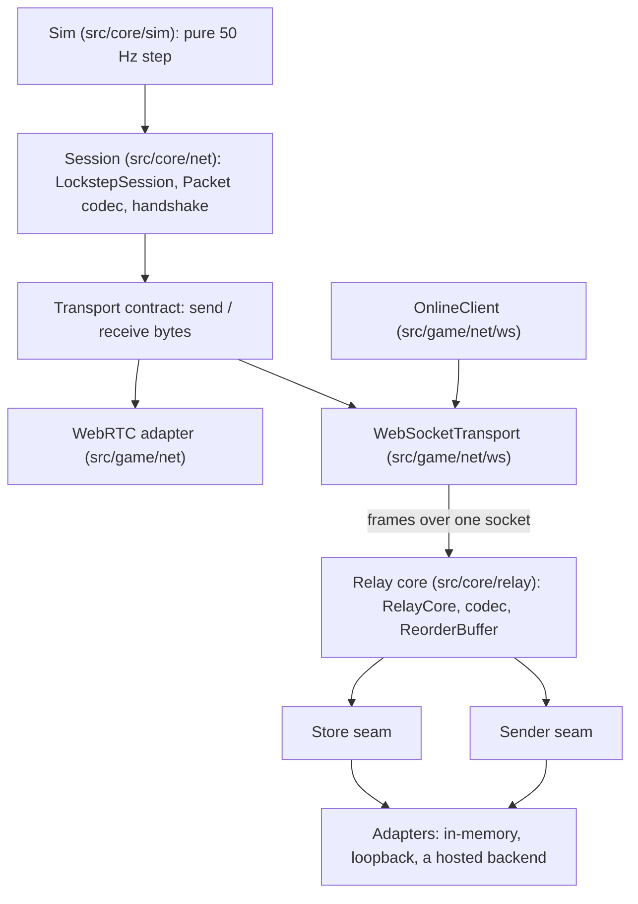

Dependency direction follows [ARCHITECTURE.md](ARCHITECTURE.md): `src/core/net` and `src/core/relay` are pure (no DOM, no `Date`, no Phaser); the
browser adapters live in `src/game/net`. The relay core is exempt from the "no async" lint rule only, and nothing else in `src/core` may import it
(`tests/repo/relay-package.test.ts`) [fact].

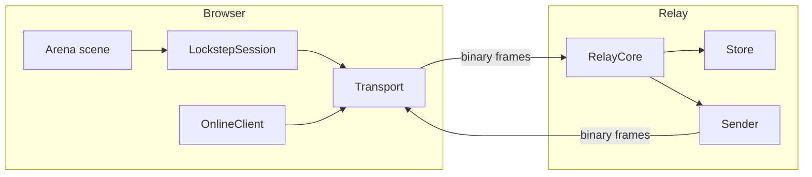

Today no menu entry or Arena wiring uses the online client; the client, transport, relay core and harness are built and tested, and the WebRTC path
is the one players can reach [fact: ONLINE-CLIENT status].

## 3. Lockstep and rollback

The session is driven once per wall tick. The local command is stamped for `simTick + inputDelay` (2, adaptive up to 4, never lowered [fact]). Every
packet carries all unacked inputs (up to 64), an ack, and the last 4 hashes, so loss is repaired by the next packet without timers.

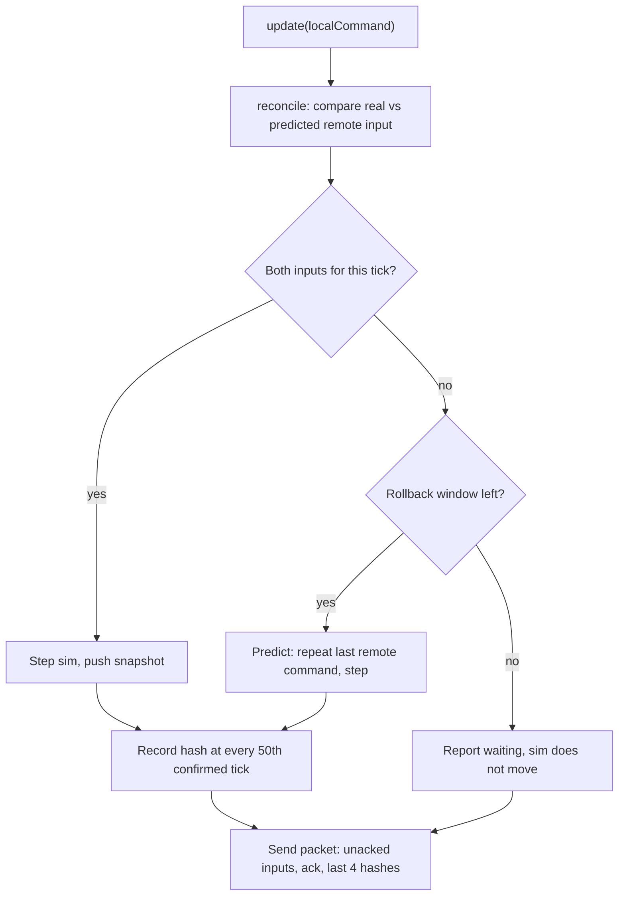

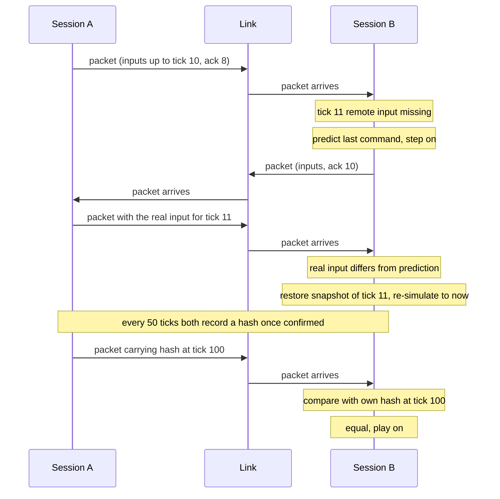

Numbers [fact]: sim 50 Hz; checkpoint interval `HASH_INTERVAL` 50 ticks (1 s); rollback window 6 in the Arena (0 = plain lockstep is the session
default); `timeoutTicks` 250 (5 s) without a packet forfeits the peer; a hidden-tab pause is allowed 1500 ticks (30 s). A predicted tick is never
hashed, so a wrong guess cannot report a desync. Details: [NETCODE.md](NETCODE.md).

## 4. Transport options

The session only sees `Transport`: `send(bytes)` and `receive()` over an unreliable, unordered, duplicating pipe [fact: `src/core/net/transport.ts`].
Both transports honour it, so the session, packet codec and determinism rules are shared.

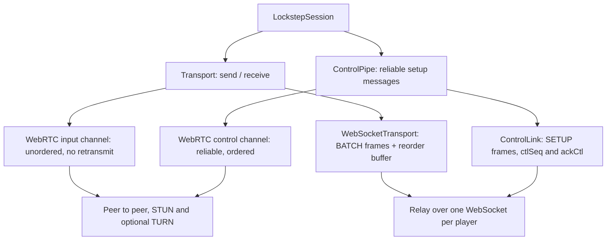

| Aspect | WebRTC path | WebSocket relay path |
|---|---|---|
| Topology | peer to peer; signalling by copied code or the small room relay in `tools/signal-relay/` | client to relay to client |
| Input channel | datagram-like, drops stale data | BATCH frames; the reorder buffer drops duplicates and skips gaps |
| Control channel | second reliable channel | `SETUP` frames with `ctlSeq` / `ackCtl` |
| Fails when | strict NAT without TURN | relay unreachable or resting |
| Status | reachable by players ([NETCODE.md](NETCODE.md)) | client and relay built and tested, not yet in the menu |

## 5. Guest login, ticket and connect

One build-time value, `VITE_ONLINE_URL` (for example `https://relay.example.invalid`), is the only place the client learns a host (spec 3,
[ONLINE-CLIENT.md](ONLINE-CLIENT.md)). Unset or not `https://host` means the online entries are not offered.

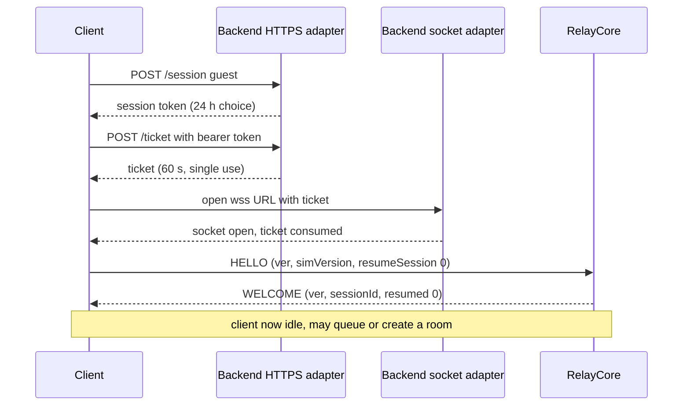

The HTTPS and socket steps belong to the host adapter (the repo defines the contract, not the implementation); `RelayCore` starts at HELLO. A
401 clears the session and fetches one fresh guest session; ERROR `0x0004` gets one fresh ticket, then counts as a failure [fact: client].

## 6. Queue pairing and room codes

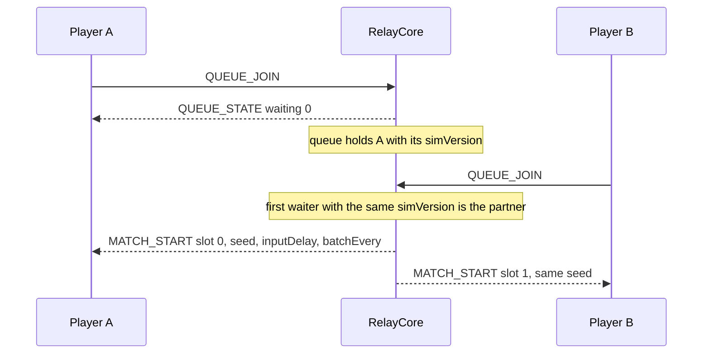

Pairing only matches equal `simVersion` [fact: `onQueueJoin`]. The player who waited longer gets slot 0 [fact]. Leaving the queue or closing the socket
removes the entry.

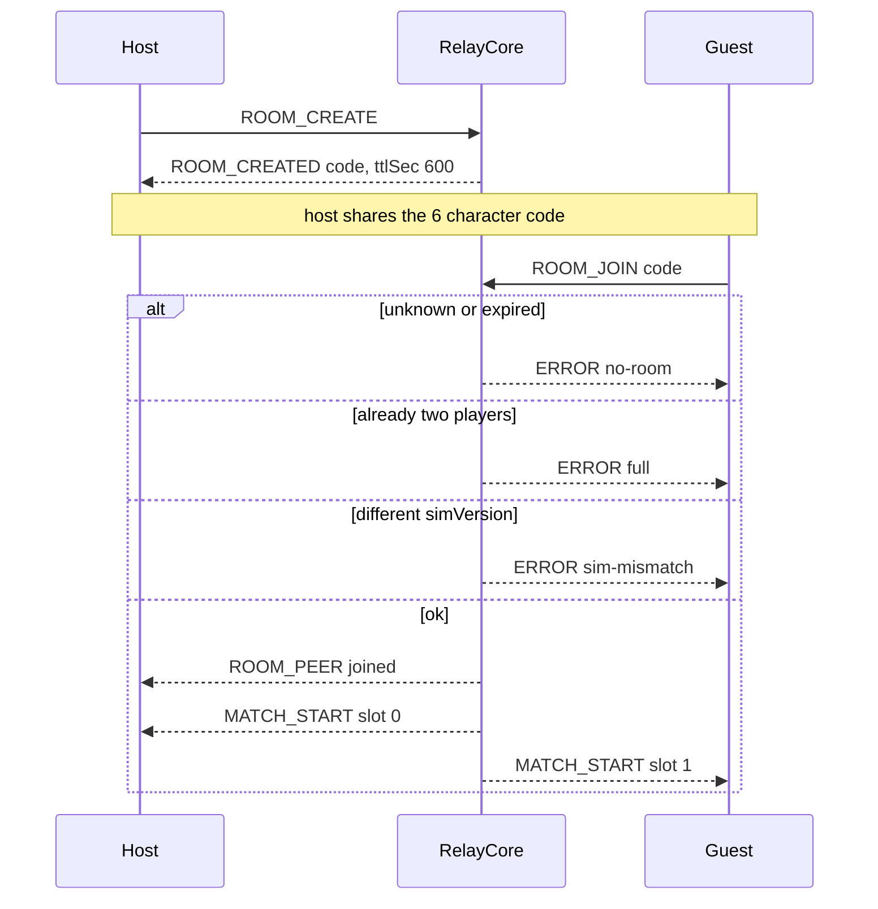

Room rules [fact: `src/core/relay/rooms-rules.ts`]: 6 characters from `ABCDEFGHJKLMNPQRSTUVWXYZ23456789` (no 0, O, 1, I), life 10 minutes, at most 2000
rooms in one store (a host adapter may set its own cap [estimate]), codes upper-cased before lookup. The code rules are one copy shared with the WebRTC
signalling relay. A connection that is already queued or in a room gets ERROR `busy`.

## 7. Match lifecycle

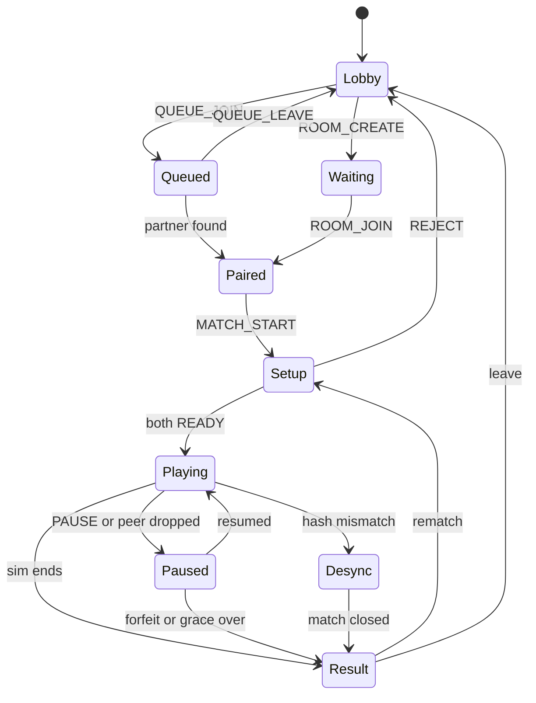

States are the lifecycle the client and relay together realise; the relay core itself tracks the connection as idle, queued, room or match and the
match as live or not [fact: `ConnState`, `MatchRec.live`]. Setup (rosters, flags, seed check) is the existing handshake carried in SETUP frames
([NETCODE.md](NETCODE.md)); `desync` and `result` are covered in section 14.

## 8. SETUP: a reliable control stream

Setup messages (HELLO, READY, REJECT, REMATCH of the handshake) must arrive once and in order, so they do not use the reorder buffer. `ControlLink`
numbers them with `ctlSeq` (u8) and acknowledges with `ackCtl` (spec 6).

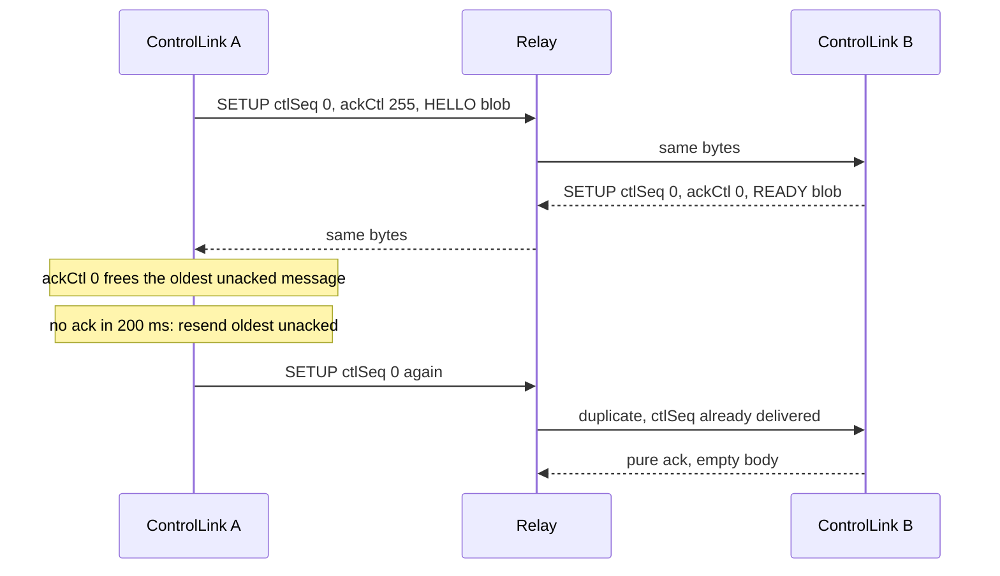

Rules [fact: `control-link.ts`]: `ackCtl` 0xFF means "nothing delivered yet"; an empty body is a pure ack; the oldest unacked message is resent every
200 ms [choice]; at most 32 unacked messages are held [choice]; only `ctlSeq == nextIn` is delivered, duplicates and out-of-order ones are acked and
dropped. The relay forwards SETUP byte for byte; the `seq u32` field in SETUP is reserved and sent as 0.

## 9. Sequence numbers, reorder buffer and skip-ahead

A relay host may deliver frames out of order, so no match-phase frame relies on arrival order (spec 1). The receiver reorders and drops duplicates.

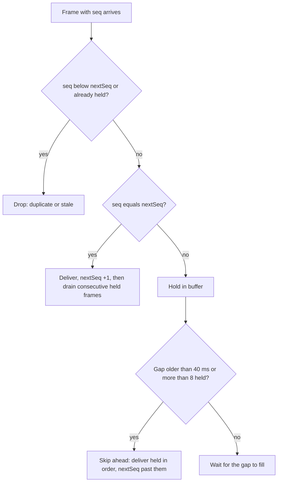

Constants [fact: `constants.ts`]: hold at most 8 frames, skip after 40 ms (2 ticks) [choice]. Skipping is safe for BATCH because the next batch re-sends
every input the peer has not acked.

| | Merged code today | Target, landing in WP-ONLINE-FIX |
|---|---|---|
| Numbered frames | BATCH, PAUSE, HASH, DESYNC, RESULT share one per-sender counter that starts at 0 and is not reset per match [fact: `WebSocketTransport.nextSeq`] | only BATCH and PAUSE carry seq; HASH, DESYNC and RESULT are idempotent, matched by `matchId` and retried |
| Match counter | `MATCH_START.matchId` is 0 for every match [fact: `RelayCore.startMatch`] | a counting `matchId`, from 1 per pair; each rematch increments it |
| Seq reset | counter continues across a reconnect | counter resets per match, so a new match starts at 0 |
| Far-ahead seq | not guarded; one far-ahead frame can make later frames stale [fact, spec 6 open point] | a seq more than 512 ahead of `nextSeq` is rejected (the 512 lead cap) |

Frames that are not redundant are retried by the sender every 500 ms [choice] (DESYNC, RESULT until RESULT_ACK); PAUSE repeats in the next BATCH's
`flags`.

## 10. Reconnect and resume

A dropped socket does not end the match. The relay keeps the slot for a 10 s grace [choice: `DISCONNECT_GRACE_MS`] and tells the peer.

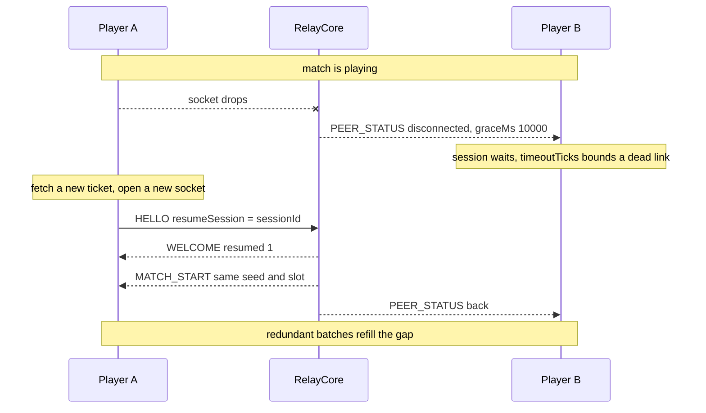

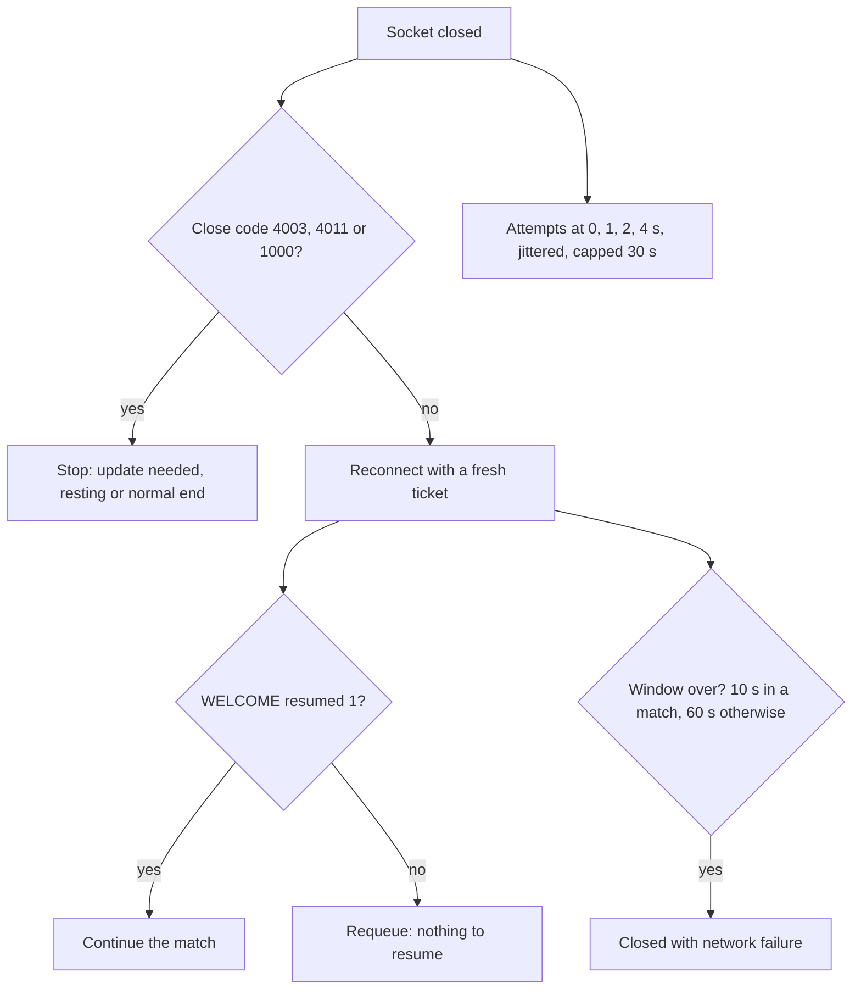

After the grace the relay sends PEER_STATUS `gone` to the peer, whose session forfeits the absentee (`forfeitReason: 'timeout'`) and sends RESULT
[fact: `sweep`]. Frames sent to a dropped player are not buffered; frames to a player in grace are dropped, which redundancy repairs. Today the
seq counter simply continues across a resume. **Landing in WP-ONLINE-FIX:** the counter resets when a new match starts, and a resume continues the
same match (same `matchId`), so its counters keep counting.

## 11. Kill switch: "the game is resting"

The host supplies `RelayCtx.resting` (a retry hint in seconds, 0 = unknown). The core never stores the flag; a switch flip takes effect on the next
call [fact].

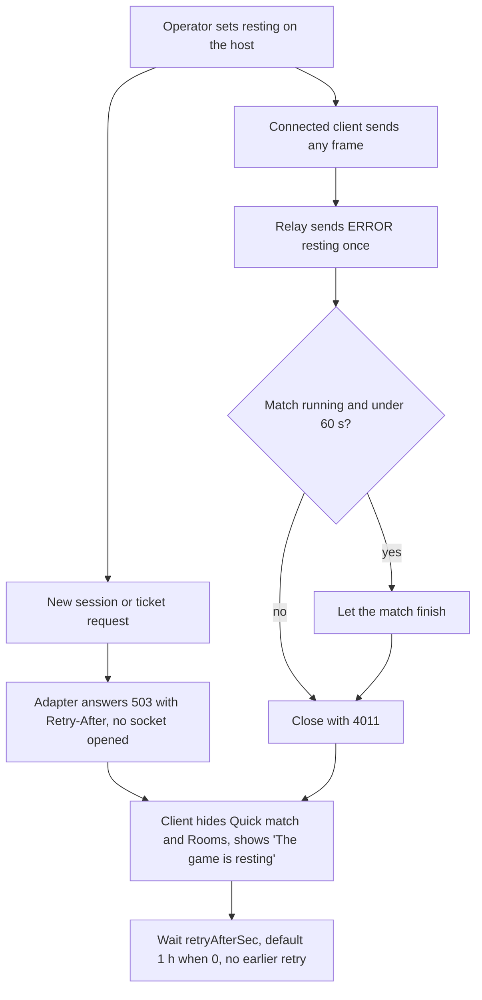

[fact: `restingTick`, `RESTING_CLOSE_MS` 60 s [choice]]. A HELLO while resting is answered with ERROR `resting` and close 4011, which also refuses
resumes. The client does not reconnect after 4011 and refuses `connect()` until the wait is over.

## 12. Version mismatch

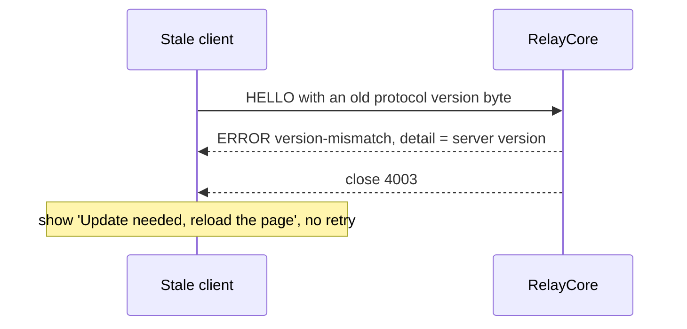

Two separate checks (spec 2): `PROTOCOL_VERSION` (one byte, exact match, checked at HELLO) and `SIM_VERSION` (u16; the queue pairs only equal values,
a room join with another one is ERROR `sim-mismatch`). A wire-format change bumps the protocol byte and the package MAJOR version
([RELAY-PACKAGE.md](RELAY-PACKAGE.md)). Cheats and flags are refused by the setup handshake before tick 0.

## 13. Head-of-line blocking and stalls

TCP never drops a frame while the socket lives, but one delayed segment holds every later one. The relay cannot hide that; the session does.

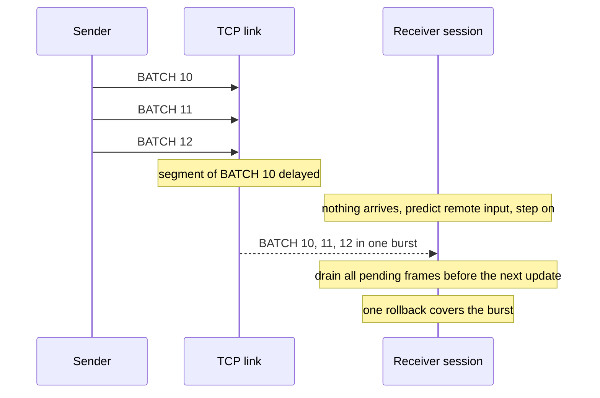

Handling [fact]: the transport queues inbound packets (cap 256, oldest dropped first); `receive` drains them in one update; each batch is idempotent;
if the lateness exceeds the rollback window the session reports `waiting` exactly as plain lockstep, and `timeoutTicks` still bounds a dead link;
`link-quality.ts` counts the extra stalls so a poor link is shown to the player. Open: `?netsim` does not yet model the burst-after-stall shape
(spec 8; open question 4 in section 19).

## 14. Desync detection and RESULT agreement

Two independent checks. The sessions compare hashes through BATCH; the relay compares both players' HASH frames and the final RESULT fields.

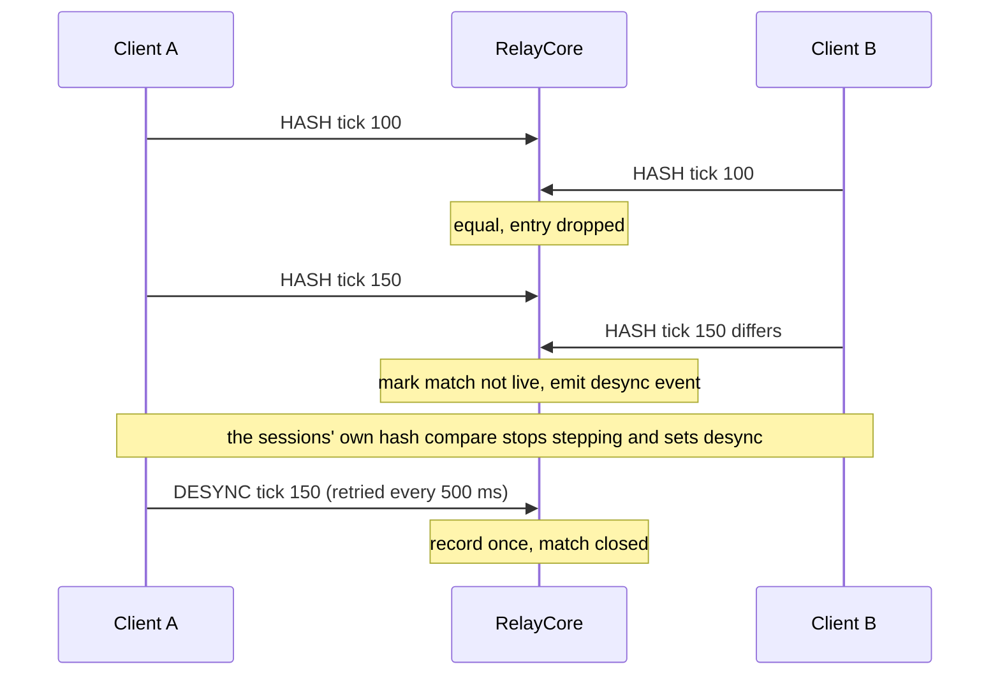

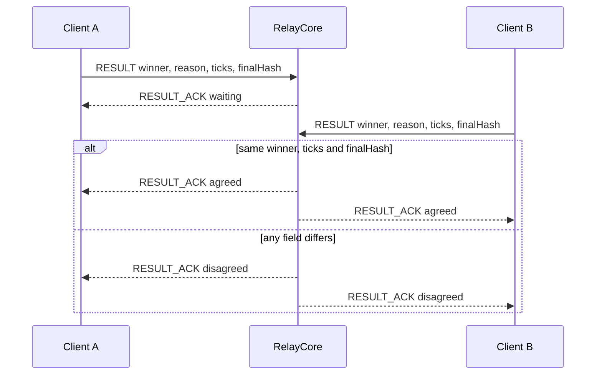

[fact: `onHash`, `onDesync`, `onResult`]. A RESULT retry gets the current status again; the sender stops on RESULT_ACK. The relay never ranks or
punishes: it emits an observability event (`desync`, `result`) and nothing else. A pending-hash table holds at most 64 ticks.

## 15. Relay ports and adapters

`RelayCore` holds no state between calls: each inbound frame is one `handle(conn, bytes, ctx)`. All state lives behind `Store`; delivery goes through
`Sender`; time and randomness come from `RelayCtx`. Any host that can satisfy these three seams can run the relay.

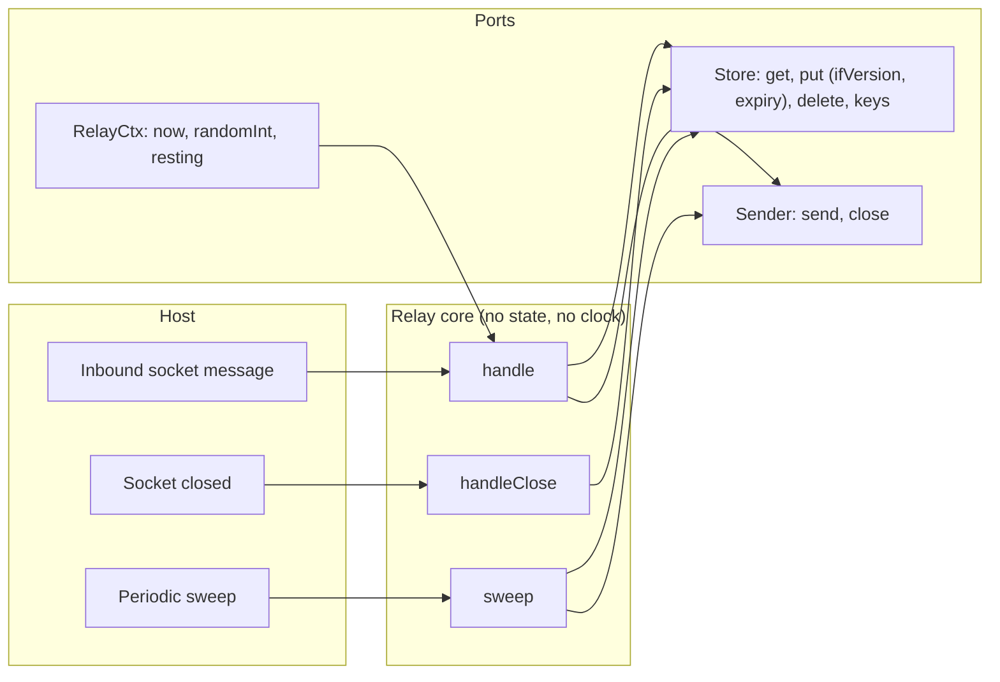

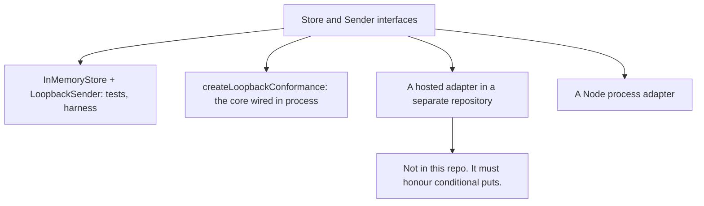

What the store holds [fact: key prefixes in `core.ts`]: `conn:` (state of one connection), `sess:` (session id to connection and match, for resume),
`room:` (code to host and guest), `queue` (waiting players), `match:` (seed, slots, drop times, pending hashes, submitted results). Read-modify-write is
a compare-and-set loop of up to 8 tries using `put(..., { ifVersion })`, so concurrent invocations are safe when the store honours conditional writes.
Records expire (`MATCH_RECORD_TTL_MS`, 2 h [estimate]); the core also checks its own deadlines, so lazy expiry is fine.

## 16. Package, entrypoints and conformance

`@tamingtheelements/relay` is built from `src/core/relay/` (metadata in `packages/relay/`, build by `tools/relay-package/build.mjs`), so a backend can
host the core without importing the game. Semver rules are in [RELAY-PACKAGE.md](RELAY-PACKAGE.md): a wire change is MAJOR.

```mermaid
flowchart TD
  PKG["@tamingtheelements/relay"] --> E1["root: RelayCore, codec, constants, ReorderBuffer, Store, Sender, RelayCtx"]
  PKG --> E2["/testing: InMemoryStore, LoopbackSender, createLoopbackConformance"]
  PKG --> E3["/conformance: runAll, conformanceCases, goldenFrames"]
  E3 --> ADP["Adapter you write: connect returns send, onFrame, onClose, close"]
  ADP --> TGT["Target: a local or deployed relay"]
  E3 --> HK["Optional hooks: sleep, setResting, advanceTime, simVersion"]
  E3 --> REP["Report: pass, fail or skip per case id"]
```

The suite checks a relay against the spec over real frames. A case is a plain `{ id, spec, title, run }` that throws on failure, so it needs no test
runner. Case ids group as `wire.golden.*`, `hello.*`, `version.*`, `malformed.*`, `queue.*`, `room.*`, `batch.*`, `setup.*`, `pause.*`, `hash.*`,
`desync.*`, `result.*`, `resume.*`, `resting.*`. A case that needs a missing hook reports `skip`. This repo runs it against the loopback target in
`src/core/relay/conformance.test.ts`; a deployed adapter runs it the same way with its own `connect`.

## 17. Measurement harness

`pnpm online:measure` plays a full match between two sessions over `WebSocketTransport` and the real `RelayCore` on a virtual clock, with a modelled
link. It measures the protocol's own cost under that model. It does not measure any hosted backend.

```mermaid
flowchart LR
  P["LinkProfile: latency, jitter, dup, reorder, loss"] --> L["Modelled link, 1 ms virtual steps"]
  S1["Session A"] --> T1["WebSocketTransport A"]
  S2["Session B"] --> T2["WebSocketTransport B"]
  T1 --> L
  T2 --> L
  L --> RC["RelayCore + InMemoryStore"]
  RC --> L
  RC --> REP["Report: msgs per s, bytes per s, one-way ms, rollbacks, stalls, hashes equal"]
```

| Quantity | Value | Label |
|---|---|---|
| Messages per second per match, batchEvery 1 / 2 / 3 | 204.1 / 104.0 / 70.6 | measurement (local harness, virtual clock, `typical` profile) |
| Same, batchEvery 3 | about 67, arithmetic on BATCH frames only | estimate (the 3.6 msgs/s gap is PING, HASH and RESULT) |
| One-way latency through a hosted backend | 90 to 120 ms | estimate, never measured |
| One-way latency in the harness (typical) | 110 / 117 / 120 ms (p50 / p95 / max) | measurement of the modelled link, not a server cost |
| Stalls at batchEvery 3 | 250 of 6000 updates (about 4%) | measurement, near the "poor" grade in `link-quality.ts` |
| Rollback cost, window 6, 120 ms one way | about 0.3 extra ticks per tick | measurement (fake network, [NETCODE.md](NETCODE.md)) |
| Match length | about 90 s | estimate |
| Heartbeat | PING every 2 s | choice |

## 18. Security model

```mermaid
flowchart TD
  subgraph Untrusted
    CLI["Browser client: static files, no secrets"]
  end
  subgraph Edge["Host adapter"]
    HTTP["Session and ticket endpoints"]
    SOCK["Socket endpoint"]
  end
  subgraph Core["Relay core"]
    VAL["Validate type, length, slot, matchId"]
    CMP["Compare hashes and results, never simulate"]
  end
  CLI -->|guest session| HTTP
  HTTP -->|60 s single-use ticket| CLI
  CLI -->|ticket in query| SOCK
  SOCK --> VAL
  VAL --> CMP
  CLI -.-x|no key, no host list, no vendor name| HTTP
```

- **Tickets.** A guest session token (24 h [choice]) is exchanged for a ticket (60 s, single use [choice]) for every socket, including reconnects. The
  ticket rides in the query because browsers cannot set headers on a WebSocket; short life and single use limit what a log leak is worth. Residual
  risk is an open question (section 19).
- **No secrets in the client.** The only configuration is `VITE_ONLINE_URL`, baked in at build time and not committed. Nothing else in the client
  knows the host, and the repo documents only `relay.example.invalid`.
- **The relay is not an arbiter.** Both clients simulate everything; remote input is untrusted (bad packets dropped, reserved command bits masked,
  far-ahead ticks ignored) and the relay checks only frame shape, sender slot and `matchId`. A modified client can send only its own legal inputs.
- **Frame hygiene.** Text frames, unknown types and wrong lengths are ERROR `bad-frame` and a close; oversized frames are `too-big`. `rate-limited`
  (`0x0009`) is defined in the spec for the host adapter; `RelayCore` does not emit it today [fact: grep], so limiting is the adapter's job.
- **CORS.** Responses allow only the game's origins (Pages and the itch build).
- **Credentials.** None are read, stored or printed by this repo's net code; deployment secrets belong to the separate backend repository.

## 19. Open questions

| # | Question | Owner |
|---|---|---|
| 1 | Does the chosen backend deliver sends in order, and does it drop frames silently? If so, SETUP and RESULT lean on sender retries | backend adapter owner |
| 2 | Latency budget: 90 to 120 ms one way [estimate] plus `batchEvery` 3 against rollback window 6; may force `inputDelay` 4 or `batchEvery` 2 | netcode owner, after a real measurement |
| 3 | Message billing at about 67 msgs/s per match [estimate] and per-connection rate limits | backend adapter owner |
| 4 | A TCP-shaped netsim mode (hold all frames behind one delayed frame) to test head-of-line bursts | netcode owner (new work package) |
| 5 | Platform caps on connection lifetime and idle time; queue waits need reconnect-in-queue | backend adapter owner |
| 6 | Identity: upgrading a guest to a later provider while keeping history; where the one-time code lives | product owner |
| 7 | Ticket in the query string appears in access logs; first-message auth would avoid it if the host allows | backend adapter owner |
| 8 | Per-match state across invocations needs a store; check its cost per match | backend adapter owner |
| 9 | Kill switch scope: let a running match finish (current rule: until the match ends or 60 s) or cut it | product owner |
| 10 | Origins and the itch build: both origins allowed, same base URL baked into each build | release owner |
| 11 | Wiring: the Arena and menu do not use the online client yet; HASH, RESULT and DESYNC senders are called only by the harness | client owner |
| 12 | Retirement of the WebRTC path once the relay path is proven | product owner |

## 20. Where the code is

| Concern | Path |
|---|---|
| Session, packet, handshake, `Transport` | `src/core/net/` |
| Relay core, codec, store seams, reorder buffer, conformance | `src/core/relay/` |
| WebSocket transport, control link, client, config | `src/game/net/ws/` |
| WebRTC adapters and signalling | `src/game/net/`, `tools/signal-relay/` |
| Measurement harness | `src/testing/net/online-measure.ts`, `tools/online-measure.ts` |
| Package build | `packages/relay/`, `tools/relay-package/` |
