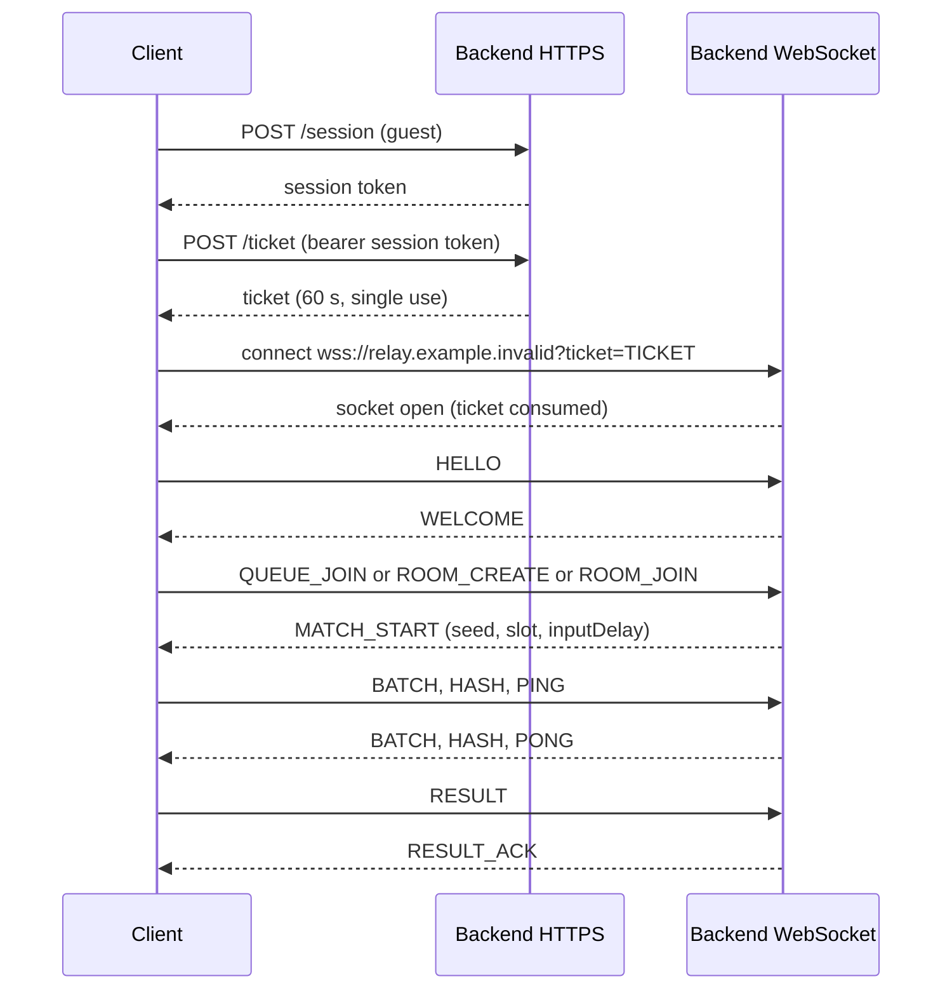

# Online protocol (WebSocket relay)

Wire spec for online play through a relay server over one WebSocket per player. Status: **design, nothing here is implemented yet**. It replaces
the WebRTC path later; until then the WebRTC path described in [WEBRTC-PLAN.md](WEBRTC-PLAN.md) and [NETCODE.md](NETCODE.md) (data channels, SDP codes,
STUN/TURN, the optional signalling relay in `tools/signal-relay/`) stays as it is. Only the transport changes: the lockstep/rollback session, the
`Packet` codec, the handshake and the determinism rules ([DETERMINISM.md](DETERMINISM.md)) are reused unchanged. Hosts and URLs below are placeholders
(`relay.example.invalid`); the real backend address is never written in the repo.

Every number is labelled **[fact]** (read from the code on 2026-11-17), **[estimate]** (reasoned, not measured) or **[choice]** (a value this spec
proposes). Estimates must be verified before anything depends on them.

## 1. Assumptions

- **Ordering.** A WebSocket is ordered per TCP connection, so a plain relay would deliver in order. A serverless backend may not: each inbound message can
  run in its own concurrent invocation, so server-to-client sends can overtake each other. **Nothing may rely on arrival order.** Every match-phase
  frame carries a sender-assigned `seq` (u32); the receiver reorders and drops duplicates (section 6). The existing `Transport` contract is already
  "unreliable, unordered, duplicates allowed" [fact: `src/core/net/transport.ts`], so a late or missing frame costs a stall or a rollback, never a desync.
- **Reliability.** TCP never loses frames while the socket lives, but it blocks everything behind a delayed segment (head-of-line blocking, section 8).
- **Trust.** The relay is not a simulator. It sees inputs and hashes only. Both clients simulate everything (WEBRTC-PLAN trust model [fact]); the
  server uses the hash checkpoints and the result submission only to detect disagreement.
- **Integers** are big-endian (matches `packet.ts` `DataView` calls [fact]). Frames are WebSocket **binary** messages. Text frames are a protocol error.

## 2. Versioning

- `PROTOCOL_VERSION` is one byte, first field of HELLO and echoed in WELCOME. Start at 1 [choice].
- **Mismatch rule (exact match).** The server compares the HELLO version with its own. If they differ it sends ERROR `0x0003 version-mismatch`
  (carrying the server's version in `detail`) and closes with code 4003. The client shows "Update needed, reload the page" and does not retry. No
  negotiation and no down-conversion: a breaking wire change bumps the byte; the static web app and the relay deploy together, a stale cached client
  is the only expected case.
- `simVersion` (u16, `SIM_VERSION`) rides in HELLO and in MATCH_START. A different sim version in the same room is ERROR `0x000A sim-mismatch`
  (the two clients could never share a hash). Flags/cheats are checked by the existing handshake (`handshake.ts`, `cheats` refused) [fact].
- The `match` byte inside the reused `Packet` (0..255) is the rematch counter [fact]; `matchId` in the frames below is the same value.

## 3. Session flow (HTTPS, then WebSocket)

Base URL: **one build-time value**, for example `VITE_ONLINE_URL=https://relay.example.invalid` (same style as `VITE_SIGNAL_URL` [fact]). The WebSocket
URL is derived from it (`https` to `wss`). Absent value means the online entries are not offered. No other place in the client knows the host.

| Step | Request | Answer | Notes |
| --- | --- | --- | --- |
| 1 | `POST /session` body `{"kind":"guest"}` | `200 {"session":"<opaque>","expiresIn":86400}` | Guest first: no account, the server mints an anonymous id. `expiresIn` seconds, 24 h [choice]. The client stores the token locally and reuses it. |
| 2 | `POST /ticket`, header `Authorization: Bearer <session>` | `200 {"ticket":"<opaque>","expiresIn":60}` | Ticket is **single use** and lives **60 s** [choice]. A new one is requested for every WebSocket connect, including reconnects. |
| 3 | WebSocket `wss://relay.example.invalid?ticket=<ticket>` | upgrade or `401` | The ticket is in the query because browsers cannot set headers on a WebSocket; that is why it is short-lived and single-use (URLs get logged). Subprotocol is not used. |

HTTP errors share one JSON body `{"error":"<name>","code":<u16>,"retryAfterSec":<n|0>}` using the codes in section 5 (`resting` is HTTP 503 with a
`Retry-After` header). Responses carry CORS headers allowing only the game's origin.

**Steam later.** The server owns an `IdentityProvider` interface (guest is the first implementation; Steam OpenID the second). Nothing of Steam
lives in the client except navigation: the client sets `window.location` to `<base>/auth/openid/start`, the server redirects to the provider and back
to the game page with a one-time code in the URL **fragment** (`#auth=<code>`); the client removes it from the address bar and calls
`POST /session {"kind":"steam","code":"<code>"}` to receive the same kind of session token. Steps 2 and 3 are unchanged, so the wire protocol below
does not know which identity was used. A guest session may be upgraded to a Steam one by sending the guest token with the exchange (open question 6).

## 4. Frames

All frames: `type u8`, then fields. Lengths are in bytes. "Dir": C to S client to server, S to C server to client, both = the server relays the frame
to the other player unchanged except that it validates size and the sender's slot. **Max** is the encoded size cap; a longer frame is ERROR `0x0002 too-big`
and the socket is closed. Match-phase frames (`0x40`-`0x5F`) carry `seq` right after the type.

| Type | Name | Dir | Fields after `type` | Bytes (max) |
| --- | --- | --- | --- | --- |
| `0x01` | HELLO | C to S | `ver u8`, `simVersion u16`, `resumeSession u32` (0 = new; see 7) | 8 |
| `0x02` | WELCOME | S to C | `ver u8`, `sessionId u32`, `resumed u8` (0/1), `serverHint u16` (max inputs per batch the server accepts, 64 [fact: `MAX_INPUTS_PER_PACKET`]) | 9 |
| `0x10` | QUEUE_JOIN | C to S | `mode u8` (0 = quick match) | 2 |
| `0x11` | QUEUE_LEAVE | C to S | none | 1 |
| `0x12` | QUEUE_STATE | S to C | `waitingSec u16` (time in queue, 0xFFFF = unknown) | 3 |
| `0x20` | ROOM_CREATE | C to S | none | 1 |
| `0x21` | ROOM_CREATED | S to C | `code 6 x ASCII`, `ttlSec u16` | 9 |
| `0x22` | ROOM_JOIN | C to S | `code 6 x ASCII` (case-insensitive, server upper-cases) | 7 |
| `0x23` | ROOM_PEER | S to C | `event u8` (0 = peer joined, 1 = peer left) | 2 |
| `0x30` | MATCH_START | S to C | `matchId u8`, `slot u8` (0 or 1), `seed u32`, `inputDelay u8`, `simVersion u16`, `batchEvery u8` (ticks between batches) | 11 |
| `0x31` | SETUP | both | `seq u32`, `n u16`, `n` bytes: the existing `encodeHello` blob (rosters, flags) | 5 + 2 + 400 = 407 |
| `0x40` | BATCH | both | `seq u32`, then **exactly one `Packet`** as `encodePacket` writes it | 1 + 4 + 172 = 177 |
| `0x41` | HASH | C to S | `seq u32`, `matchId u8`, `tick u32`, `hash u32` | 14 |
| `0x42` | DESYNC | C to S | `seq u32`, `matchId u8`, `tick u32` (first divergent), `localHash u32`, `remoteHash u32` | 18 |
| `0x43` | PAUSE | both | `seq u32`, `matchId u8`, `flags u8` (bit0 paused, bit1 forfeit: same bits as `PacketFlag` [fact]) | 7 |
| `0x44` | PEER_STATUS | S to C | `matchId u8`, `event u8` (0 = peer disconnected, 1 = peer back, 2 = peer gone for good), `graceMs u16` | 5 |
| `0x50` | RESULT | C to S | `seq u32`, `matchId u8`, `winner u8` (0, 1 = slot, 2 = draw), `reason u8` (0 natural, 1 forfeit, 2 timeout, 3 desync), `ticks u32`, `finalHash u32` | 16 |
| `0x51` | RESULT_ACK | S to C | `matchId u8`, `status u8` (0 agreed, 1 waiting for peer, 2 disagreed) | 3 |
| `0x60` | PING | C to S | `nonce u32` | 5 |
| `0x61` | PONG | S to C | `nonce u32` (echoed) | 5 |
| `0x7F` | ERROR | S to C | `code u16`, `retryAfterSec u16` (0 = none), `detail u16` | 7 |

Details:

- **BATCH layout.** The payload after `type` and `seq` is byte-for-byte `encodePacket`: `match u8, flags u8, ack u32, firstTick u32, nInputs u8,
  2 x n input u16, nHashes u8, 8 x m (tick u32, hash u32)`. **Verified against `src/core/net/packet.ts` 2026-11-17: the size is `12 + 2n + 8m` bytes**
  with `n <= 64` and `m <= 4`, so at most 172 bytes [fact]. The relay validates `n`/`m` and the exact length (as `decodePacket` does) but does not
  interpret inputs. The batch already redundantly carries every unacked input and the last 4 hashes, so a lost or late BATCH is repaired by the next one.
- **HASH.** A checkpoint every `HASH_INTERVAL = 50` ticks (1 s) [fact: `format.ts`] and at match end. The hash also travels inside BATCH for the peer; the
  separate HASH frame is for the server only (it compares both players' values per tick and flags the first divergence). It is sent once per checkpoint;
  the final hash in RESULT is the authority.
- **DESYNC.** Sent by a client whose session set `desync` [fact: `LockstepSession.desync`]. The server records it and ends the match as a draw with `reason 3`; no ranked effect is ever derived from it (there is no cheating arbiter, see Trust).
- **PAUSE.** Same meaning as the `paused`/`forfeit` bits in `Packet.flags`; sent as its own frame so it works when no batch is flowing (hidden tab throttles timers).
- **Result submission.** Both clients send RESULT after the sim reports the end. Agreement (same `winner`, `ticks`, `finalHash`) gives RESULT_ACK `0`;
  a disagreement gives `2`, and the server stores neither as a win. The server does no simulation; a replay upload for verification with
  `tools/replay-verify.ts` logic (`parseReplay` + `playReplay`, hash per 50 ticks plus `finalHash`) is a later option [fact for the verifier, design for the upload].
- **Room code.** 6 characters from `ABCDEFGHJKLMNPQRSTUVWXYZ23456789` (no 0, O, 1, I) [fact: `rooms.ts` `CODE_ALPHABET`, `CODE_LENGTH`]. Room life 10 min
  [fact: `ROOM_TTL_MS`], a room holds host and one guest, at most 2000 rooms [fact: `MAX_ROOMS`; the hosted backend sets its own cap, estimate]. The pure
  room logic in `tools/signal-relay/rooms.ts` is reusable for the code rules; its messages (`host`/`join`/`sig`) were JSON text and are replaced by the binary frames here.
- **MATCH_START** fixes everything both sides must agree on: the shared `seed`, slot (0 = host/first joiner = side 0), `inputDelay` (2 by default, adaptive
  up to 4 in the session [fact]) and `batchEvery`. Rosters still go through SETUP (the existing handshake, `MatchSetup` equality check [fact]) before tick 0.
- **Heartbeat.** PING every 2 s [choice]; the client keeps the last 5 round trips and grades the link with `link-quality.ts` (median, `>=100 ms` fair,
  `>=200 ms` poor, stall share `>=1%` fair, `>=5%` poor [fact]). PONG also keeps the connection alive through idle timeouts of the platform.

## 5. Error codes (`0x7F` and the HTTP body)

| Code | Name | Meaning / client action |
| --- | --- | --- |
| `0x0001` | bad-frame | Unknown type, wrong length or text frame. Close. |
| `0x0002` | too-big | Over the frame's max. Close. |
| `0x0003` | version-mismatch | Protocol version differs; `detail` = server version. "Reload to update", no retry. |
| `0x0004` | ticket-invalid | Ticket unknown, used or older than 60 s. Fetch a new ticket and reconnect once. |
| `0x0005` | busy | Already queued or in a room (as `rooms.ts` `busy` [fact]). |
| `0x0006` | no-room | Code unknown or expired. |
| `0x0007` | full | Room already has two players. |
| `0x0008` | full-house | Server at its room cap (`full-house` in `rooms.ts` [fact]). Retry later. |
| `0x0009` | rate-limited | Too many connects or frames; `retryAfterSec` set. |
| `0x000A` | sim-mismatch | The two clients run different `SIM_VERSION`. |
| `0x000B` | resting | **Kill switch.** The game's online service is switched off ("the game is resting"). `retryAfterSec` is when to look again (0 = unknown, use 1 hour). The client shows a friendly message, hides Quick match and Rooms until then, and never retries sooner. It is returned as HTTP 503 from `/session` and `/ticket` (so no socket is opened) and as a frame if the switch flips while connected (the server then closes with 4011 after the current match ends or after 60 s [choice]). |
| `0x000C` | internal | Server fault. Retry with backoff (1 s, 2 s, 4 s, max 30 s [choice]). |

WebSocket close codes use 4000 + the low byte of the error code (for example 4003, 4011). Normal end: 1000.

## 6. Sequence numbers, reorder and duplicates

- Each sender keeps one `seq` counter **per match**, starting at 0 on MATCH_START, +1 per match-phase frame it sends (BATCH, HASH, DESYNC, PAUSE, RESULT, SETUP),
  wrapping at 2^32 (not reachable: 50 frames/s for a 90 s match [estimate]). The server never renumbers; a relayed frame keeps the sender's `seq`.
- The receiver keeps `nextSeq` (first not yet delivered) and a small hold buffer (at most 8 frames [choice]):
  - `seq < nextSeq` or already held: **duplicate or stale, dropped**.
  - `seq == nextSeq`: delivered, `nextSeq++`, then any consecutive held frames are delivered.
  - `seq > nextSeq`: held. If the gap does not fill within 40 ms (2 ticks) [choice] or the buffer is full, the receiver **skips ahead**: delivers the held frames in order and
    sets `nextSeq` past them. A frame that arrives after being skipped is dropped as stale.
- Skipping is safe because BATCH is redundant: the next batch re-sends every input the peer has not acked, and `ack` tells the sender what is still needed. Frames
  that are not redundant (SETUP, DESYNC, PAUSE, RESULT) are **retried by the sender until echoed or answered** (SETUP by the handshake, RESULT by RESULT_ACK) or, for PAUSE, repeated in
  the next BATCH's `flags`. So the reorder buffer trades a few ms of delay against fewer rollbacks, and its worst case is a late input.
- Only match-phase frames are numbered. Control frames (`0x01`-`0x30`) are request/answer and carry no seq; the client tolerates a duplicate answer.

## 7. Reconnect

- A dropped socket does not end the match. The server keeps the slot for a grace period: `timeoutTicks` 250 (5 s) without any input is the session's forfeit [fact],
  and a hidden-tab pause is allowed 1500 ticks (30 s) [fact: `pauseTimeoutTicks`]. The server's disconnect grace for reconnecting is **10 s** [choice]; it tells the other player with PEER_STATUS
  `0` (with `graceMs`) and the session shows the existing waiting/paused state.
- The client fetches a **new ticket** (`POST /ticket`, session token still valid) and reconnects with HELLO `resumeSession = sessionId` from WELCOME. If the slot is still held,
  WELCOME has `resumed = 1`, the server re-sends MATCH_START (same `matchId`, seed, slot) and tells the peer PEER_STATUS `1`. `seq` counters continue (not reset), so frames in flight
  from before the drop are still correctly de-duplicated. The sessions' redundant batches refill the gap; no replay of the old frames is needed.
- After the grace the server sends PEER_STATUS `2` to the peer: the session forfeits the absentee (`forfeitReason 'timeout'` [fact]) and RESULT proceeds.
- Reconnect attempts: immediately, then 1 s, 2 s, 4 s with jitter, until the grace ends [choice]. A ticket-invalid answer gets one fresh ticket, then counts as a failed attempt.

## 8. Head-of-line blocking

One lost TCP segment holds every later frame until it is retransmitted (round trip plus retransmit timer; no figure is measured here). The relay does not mask this; the existing
session does:

1. Frames queue behind the stuck one. When the delayed BATCH finally arrives the session sees inputs for ticks it needed earlier. With rollback (default window 6 [fact]) it had predicted
   the remote command, steps on, and on a wrong guess restores the snapshot and re-simulates (`reconcile`, stat `rollbacks`) [fact].
2. If the lateness exceeds the window it stalls (`waiting`) exactly as plain lockstep does, and `timeoutTicks` still bounds a dead link [fact].
3. When the backlog flushes, several BATCHes arrive in one burst. Each is idempotent (redundant inputs, acks only move forward), so processing them in `seq` order, or in any order, is
   harmless; the receiver should process all pending frames before the next `update` so that one rollback covers the burst.
4. The link readout counts the extra stalls, so a poor connection is shown to the player (`link-quality.ts`).

Mitigations to evaluate, not decided: `?netsim` (`lat`, `jitter`, `loss`, `dup`) already models delay, reordering and drops on the receive path [fact: `netsim.ts`]. It does not model the
burst-after-stall behaviour of TCP; a WebSocket-style netsim mode that holds all frames behind one delayed frame is needed to test this (open question 4).

## 9. Load and latency numbers (all to verify)

| Quantity | Value | Kind |
| --- | --- | --- |
| Sim rate | 50 ticks/s | fact |
| Batch size | 12 + 2n + 8m bytes, max 172 | fact |
| Typical batch | n about 4-8 unacked inputs, m = 1-4 hashes: about 30-60 bytes plus 5 frame bytes | estimate |
| Today's WebRTC send rate | one packet per `update`, 50/s per side | fact: `sendPacket` in `session.ts` |
| Billed messages, 1 batch per tick | 2 players x 50/s x (1 in + 1 out) = 200 msgs/s per match | estimate (arithmetic) |
| Billed messages with `batchEvery = 3` | 2 x 16.7 x 2 = **about 67 msgs/s per match** | **estimate**, cost model unverified |
| One-way latency through the relay | **90-120 ms** typical | **estimate**, to measure per region (client to backend to client) |
| Extra latency from `batchEvery = 3` | up to 2 ticks = 40 ms, avg 20 ms | estimate (arithmetic) |
| Input delay needed at 120 ms one way | about 6 ticks at 50 Hz would hide it in plain lockstep; rollback window 6 covers it | estimate; NETCODE.md measured only up to 120 ms with its fake network |
| Match length | about 90 s | estimate |

Using `batchEvery > 1` needs a session option (not present today: the session sends every update [fact]) and a decision on the input delay floor (open question 2).
Input is 2 bytes per tick, so `batchEvery = 3` still fits 64 inputs with large margin.

## 10. Open questions / what the backend may not satisfy

1. **Concurrency and order.** If the backend delivers sends from one invocation after another, or gives no per-connection serial order at all, sections 1 and 6 hold; if it also drops
   frames without error (rare), redundancy covers BATCH but not SETUP/RESULT, which then rely on sender retries. Needs a test against the real backend.
2. **Latency budget.** 90-120 ms one way [estimate] plus `batchEvery = 3` leaves little room under rollback window 6 (120 ms). It may force `inputDelay` 4+ for everyone or `batchEvery = 2`.
   Measure RTT through the chosen backend per region before fixing the numbers.
3. **Message billing.** About 67 billed messages/s per match [estimate] may be too expensive or hit per-connection rate limits (a common cap is tens of messages per second per connection;
   unverified). If so, raise `batchEvery`, or only the player's own side's inputs need relaying (they already are).
4. **Netsim.** No TCP/WebSocket-shaped impairment mode exists (head-of-line burst). Needs a new WP, not part of this doc.
5. **Idle and lifetime limits.** Platform caps on connection duration (for example hours) and idle timeouts (about minutes) are unknown; PING at 2 s covers idle, not lifetime. A match is far
   shorter, but a queue wait is not: reconnect-in-queue must be possible.
6. **Identity.** Whether a guest can be upgraded to Steam while keeping history, and where the one-time code may live (fragment vs a server-set cookie across origins), is not decided.
7. **Ticket in the query string.** Visible in access logs; mitigated by 60 s single use. A first-message auth would remove it if the backend allowed it before the connection is billed.
8. **Server-side hash/result checks** need the server to hold per-match state across invocations (a store). The backend may offer only a small key-value store; check the cost per match.
9. **Kill switch scope.** `resting` stops new sessions immediately; whether in-progress matches are allowed to finish is a policy choice (above: after the match or 60 s).
10. **Region and CORS.** Cross-origin HTTPS from the Pages origin and the itch.io origin; both origins must be allowed, and the itch build needs the same base URL baked in.
11. **WebRTC removal.** Until it is removed, the two transports must coexist: the `Transport` seam (`send`/`receive`) is the only join point, so a `WebSocketTransport` adapter that wraps and unwraps the
    `0x40` frame (adding and checking `seq`) is the natural, small change; the control side (`SETUP`, rematch) replaces the `control` data channel.
