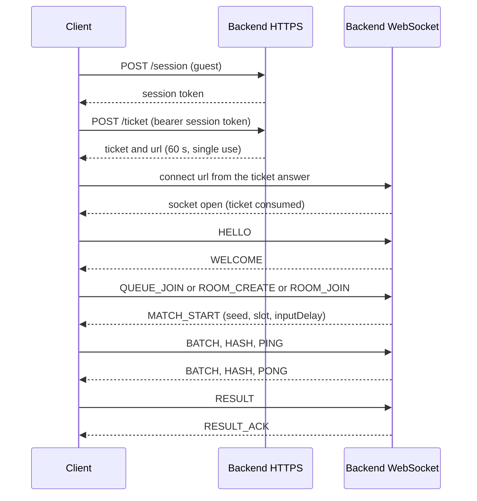

# Online protocol (WebSocket relay)

Wire spec for online play through a relay server over one WebSocket per player. Status: **implemented** by `src/core/relay` (relay) and `src/game/net/ws` (client); this document is the contract both follow. It replaced
the retired WebRTC path ([WEBRTC-PLAN.md](WEBRTC-PLAN.md), history only). The transport is the only seam: the lockstep/rollback session, the
`Packet` codec, the handshake and the determinism rules ([DETERMINISM.md](DETERMINISM.md)) are reused unchanged. Hosts and URLs below are placeholders
(`relay.example.invalid`); the real backend address is never written in the repo.

Every number is labelled **[fact]** (read from the code on 2026-11-17), **[estimate]** (reasoned, not measured) or **[choice]** (a value this spec
proposes). Estimates must be verified before anything depends on them.

## 1. Assumptions

- **Ordering.** A WebSocket is ordered per TCP connection, so a plain relay would deliver in order. A serverless backend may not: each inbound message can
  run in its own concurrent invocation, so server-to-client sends can overtake each other. **Nothing may rely on arrival order.** Every match-phase
  frame carries a sender-assigned `seq` (u32); the receiver reorders and drops duplicates (section 6). The existing `Transport` contract is already
  "unreliable, unordered, duplicates allowed" [fact: `src/core/net/transport.ts`], so a late or missing frame costs a stall or a rollback, never a desync.
- **Reliability.** TCP never loses frames while the socket lives, but it blocks everything behind a delayed segment (head-of-line blocking, section 8).
- **Trust.** The relay is not a simulator. It sees inputs and hashes only. Both clients simulate everything (trust model in [NETCODE.md](NETCODE.md) [fact]); the
  server uses the hash checkpoints and the result submission only to detect disagreement.
- **Integers** are big-endian (matches `packet.ts` `DataView` calls [fact]). Frames are WebSocket **text** messages holding the frame's bytes as **base64** (standard alphabet, `=` padding, RFC 4648 section 4, no line breaks, no URL-safe variant), in both directions. A binary message from a client is a protocol error (ERROR `0x0001 bad-frame`). The client side is lenient: a binary message whose bytes are base64 text is decoded like a text message, though the relay never sends one. Why: API Gateway closes a client's binary frame with 1003. Base64 adds about a third to the size [estimate: 4 chars per 3 bytes]; the largest frame (410 bytes) is about 548 characters. Sizes in section 4 are the decoded byte sizes.

## 2. Versioning

- `PROTOCOL_VERSION` is one byte, first field of HELLO and echoed in WELCOME. Start at 1 [choice]; 2 since the 17-bit command (Run, RUN-W); **3 since the text-frame wire round (RELAY-V3: base64 text frames, `/ticket` returns `{ticket, url}`, advisory close codes, no handshake answer for ticket-invalid or resting)**. The package `@tamingtheelements/relay` went to 1.0.0 with it (MAJOR, see [RELAY-PACKAGE.md](RELAY-PACKAGE.md)).
- **Capabilities (chat).** WELCOME carries `caps u8` (bit0 = chat) in the byte that used to be the high byte of `serverHint`. `PROTOCOL_VERSION` stays 3: the frame stays 9 bytes and with `caps` 0 it is byte-identical to the old one. Chat is **off by default** on a relay (`RelayOptions.chat`, see [RELAY-PACKAGE.md](RELAY-PACKAGE.md)); a client shows chat only when the last WELCOME had bit0 set and reads it again after a reconnect. A relay with chat off treats a `0x70` frame like an unknown type: ERROR `0x0001 bad-frame` and close (advisory 4001). Turning chat on is the operator's step. There is no peer capability: a peer on an old client receives the `0x70` frame and counts it as malformed; the sender's line is lost without notice [choice].
- **Mismatch rule (exact match).** The server compares the HELLO version with its own. If they differ it sends ERROR `0x0003 version-mismatch`
  (carrying the server's version in `detail`) and closes (advisory code 4003, section 5). The client shows "Update needed, reload the page" and does not retry. No
  negotiation and no down-conversion: a breaking wire change bumps the byte; the static web app and the relay deploy together, a stale cached client
  is the only expected case.
- `simVersion` (u16, `SIM_VERSION`) rides in HELLO and in MATCH_START. A different sim version in the same room is ERROR `0x000A sim-mismatch`
  (the two clients could never share a hash). Flags/cheats are checked by the existing handshake (`handshake.ts`, `cheats` refused) [fact].
- `matchId` (u8) is assigned **by the relay**, is 1..255, changes with every match and wraps from 255 back to 1 [choice]; it is never 0, and is sent in MATCH_START; a resumed connection gets the same MATCH_START again, unchanged (section 7). The client passes it as the `match` byte of the reused `Packet` (0..255, the session's rematch counter [fact]), so `matchId` in the frames below and `Packet.match` are the same value. A client drops every match-phase frame (BATCH by its `Packet.match`, PAUSE by its `matchId`) and PEER_STATUS/RESULT_ACK that carry another `matchId` than the one of its latest MATCH_START.

## 3. Session flow (HTTPS, then WebSocket)

Base URL: **one build-time value**, for example `VITE_ONLINE_URL=https://relay.example.invalid` (same style as `VITE_SIGNAL_URL` [fact]). It is the **HTTP API** base only.
The HTTP API and the WebSocket API are separate hosts, so the client never derives the WebSocket address: `/ticket` returns it (step 2). Absent value means the online entries are not offered. No other place in the client knows the host.

| Step | Request | Answer | Notes |
| --- | --- | --- | --- |
| 1 | `POST /session` body `{"kind":"guest"}` | `200 {"session":"<opaque>","expiresIn":86400}` | Guest first: no account, the server mints an anonymous id. `expiresIn` seconds, 24 h [choice]. The client stores the token locally and reuses it. |
| 2 | `POST /ticket`, header `Authorization: Bearer <session>` | `200 {"ticket":"<opaque>","url":"<wss address>"}` | `url` is the **full wss address including the ticket** (for example `wss://ws.relay.example.invalid/play?ticket=<ticket>`); the client opens it exactly as given and appends nothing. The ticket is **single use** and lives **60 s** [choice] (not in the answer any more). A new one is requested for every WebSocket connect, including reconnects. |
| 3 | WebSocket `<url from step 2>` | upgrade or a denied connect | A denied connect shows the browser only close `1006`, no code (so no error code can answer a failed connect; see section 7 and the handshake rule below). The ticket is in the query because browsers cannot set headers on a WebSocket; that is why it is short-lived and single-use (URLs get logged). Subprotocol is not used. |

**A handshake never answers `0x0004` (ticket-invalid) or `0x000B` (resting).** A rejected ticket or a resting service denies the connect, and the browser sees only `1006`. So on any failed handshake (the socket closes or errors before WELCOME) the client fetches **one fresh ticket and retries once**; a second failure is a failed attempt. Resting at connect time is announced **only** by HTTP `503` from `/session` or `/ticket` (the client then opens no socket). A relay that gets HELLO while resting just closes the socket (advisory 4011), without an ERROR frame.

HTTP errors share one JSON body `{"error":"<name>","code":<u16>,"retryAfterSec":<n|0>}` using the codes in section 5 (`resting` is HTTP 503 with a
`Retry-After` header). Responses carry CORS headers allowing only the game's origin.

**Steam later.** The server owns an `IdentityProvider` interface (guest is the first implementation; Steam OpenID the second). Nothing of Steam
lives in the client except navigation: the client sets `window.location` to `<base>/auth/openid/start`, the server redirects to the provider and back
to the game page with a one-time code in the URL **fragment** (`#auth=<code>`); the client removes it from the address bar and calls
`POST /session {"kind":"steam","code":"<code>"}` to receive the same kind of session token. Steps 2 and 3 are unchanged, so the wire protocol below
does not know which identity was used. A guest session may be upgraded to a Steam one by sending the guest token with the exchange (open question 6).

## 4. Frames

All frames: `type u8`, then fields. Lengths are in bytes. "Dir": C to S client to server, S to C server to client, both = the server relays the frame
to the other player unchanged except that it validates size and the sender's slot. **Max** is the encoded size cap; a longer frame is ERROR `0x0002 too-big`
and the socket is closed. Match-phase frames (`0x40`-`0x5F`) carry `seq` right after the type; only BATCH and PAUSE use it (section 6), HASH, DESYNC and RESULT send `seq 0`. CHAT (`0x70`) is outside the seq rules: it has its own 1-byte `chatSeq` (section 4a).

| Type | Name | Dir | Fields after `type` | Bytes (max) |
| --- | --- | --- | --- | --- |
| `0x01` | HELLO | C to S | `ver u8`, `simVersion u16`, `resumeSession u32` (0 = new; see 7) | 8 |
| `0x02` | WELCOME | S to C | `ver u8`, `sessionId u32`, `resumed u8` (0/1), `caps u8` (bit0 = chat, 0 when chat is off), `serverHint u8` (max inputs per batch the server accepts, 64 [fact: `MAX_INPUTS_PER_PACKET`]; fits a u8) | 9 |
| `0x10` | QUEUE_JOIN | C to S | `mode u8` (0 = quick match) | 2 |
| `0x11` | QUEUE_LEAVE | C to S | none | 1 |
| `0x12` | QUEUE_STATE | S to C | `waitingSec u16` (time in queue, 0xFFFF = unknown) | 3 |
| `0x20` | ROOM_CREATE | C to S | none | 1 |
| `0x21` | ROOM_CREATED | S to C | `code 6 x ASCII`, `ttlSec u16` | 9 |
| `0x22` | ROOM_JOIN | C to S | `code 6 x ASCII` (case-insensitive, server upper-cases) | 7 |
| `0x23` | ROOM_PEER | S to C | `event u8` (0 = peer joined, 1 = peer left) | 2 |
| `0x30` | MATCH_START | S to C | `matchId u8` (relay-assigned, from 1, see section 2), `slot u8` (0 or 1), `seed u32`, `inputDelay u8`, `simVersion u16`, `batchEvery u8` (ticks between batches) | 11 |
| `0x31` | SETUP | both | `seq u32`, `ctlSeq u8`, `ackCtl u8`, `n u16`, `n` bytes: ONE control message of the existing setup handshake (a type byte for HELLO, READY, REJECT or REMATCH, then its blob; HELLO carries the `encodeHello` rosters and flags) | 5 + 2 + 2 + 401 = 410 |
| `0x40` | BATCH | both | `seq u32`, then **exactly one `Packet`** as `encodePacket` writes it | 1 + 4 + 300 = 305 |
| `0x41` | HASH | C to S | `seq u32` (always 0), `matchId u8`, `tick u32`, `hash u32` | 14 |
| `0x42` | DESYNC | C to S | `seq u32` (always 0), `matchId u8`, `tick u32` (first divergent), `localHash u32`, `remoteHash u32` | 18 |
| `0x43` | PAUSE | both | `seq u32`, `matchId u8`, `flags u8` (bit0 paused, bit1 forfeit: same bits as `PacketFlag` [fact]) | 7 |
| `0x44` | PEER_STATUS | S to C | `matchId u8` (the match the event is about; echoed from MATCH_START), `event u8` (0 = peer disconnected, 1 = peer back, 2 = peer gone for good), `graceMs u16` | 5 |
| `0x50` | RESULT | C to S | `seq u32` (always 0), `matchId u8`, `winner u8` (0, 1 = slot, 2 = draw), `reason u8` (0 natural, 1 forfeit, 2 timeout, 3 desync), `ticks u32`, `finalHash u32` | 16 |
| `0x51` | RESULT_ACK | S to C | `matchId u8`, `status u8` (0 agreed, 1 waiting for peer, 2 disagreed) | 3 |
| `0x60` | PING | C to S | `nonce u32` | 5 |
| `0x61` | PONG | S to C | `nonce u32` (echoed) | 5 |
| `0x70` | CHAT | both | `matchId u8`, `chatSeq u8`, `n u8` (1-120), `n` bytes UTF-8 text (section 4a) | 4 + 120 = 124 |
| `0x7F` | ERROR | S to C | `code u16`, `retryAfterSec u16` (0 = none), `detail u16` | 7 |

Details:

- **BATCH layout.** The payload after `type` and `seq` is byte-for-byte `encodePacket`: `match u8, flags u8, ack u32, firstTick u32, nInputs u8,
  4 x n input u32, nHashes u8, 8 x m (tick u32, hash u32)`. **Verified against `src/core/net/packet.ts` 2026-11-17: the size is `12 + 4n + 8m` bytes**
  with `n <= 64` and `m <= 4`, so at most 300 bytes [fact]; an input is a u32 holding a 17-bit command (0x1ffff max). The relay validates `n`/`m` and the exact length (as `decodePacket` does) but does not
  interpret inputs. The batch already redundantly carries every unacked input and the last 4 hashes, so a lost or late BATCH is repaired by the next one.
- **HASH.** A checkpoint every `HASH_INTERVAL = 50` ticks (1 s) [fact: `format.ts`] and at match end. The hash also travels inside BATCH for the peer; the
  separate HASH frame is for the server only (it compares both players' values per tick and flags the first divergence). It is sent once per checkpoint;
  the final hash in RESULT is the authority.
- **DESYNC.** Sent by a client whose session set `desync` [fact: `LockstepSession.desync`]. The relay records it, marks the match not live and emits a host event (it sends no frame back; the clients decide what to show); no ranked effect is ever derived from it (there is no cheating arbiter, see Trust).
- **PAUSE.** Same meaning as the `paused`/`forfeit` bits in `Packet.flags`; sent as its own frame so it works when no batch is flowing (hidden tab throttles timers).
- **Result submission.** Both clients send RESULT after the sim reports the end. Agreement (same `winner`, `ticks`, `finalHash`) gives RESULT_ACK `0`;
  a disagreement gives `2`, and the server stores neither as a win. A hash divergence found by the relay arrives as an **unsolicited** RESULT_ACK `2` with the real `matchId` and no preceding RESULT; a RESULT whose peer is gone or swept also gets RESULT_ACK `2`. The client treats every RESULT_ACK of the current match alike: it stops the RESULT retry, leaves the in-match state and emits it, so the app reads `status 2` as the end of the match. The server does no simulation; a replay upload for verification with
  `tools/replay-verify.ts` logic (`parseReplay` + `playReplay`, hash per 50 ticks plus `finalHash`) is a later option [fact for the verifier, design for the upload].
- **Room code.** 6 characters from `ABCDEFGHJKLMNPQRSTUVWXYZ23456789` (no 0, O, 1, I) [fact: `rooms.ts` `CODE_ALPHABET`, `CODE_LENGTH`]. Room life 10 min
  [fact: `ROOM_TTL_MS`], a room holds host and one guest, at most 2000 rooms [fact: `MAX_ROOMS`; the hosted backend sets its own cap, estimate]. The relay core keeps its own copy of these rules (`src/core/relay/rooms-rules.ts`, held equal to the browser client's copy in `src/game/net/relay.ts` by `tests/repo/room-code-rules-drift.test.ts`).
- **MATCH_START** fixes everything both sides must agree on: the shared `seed`, slot (0 = host/first joiner = side 0), `inputDelay` (2 by default, adaptive
  up to 4 in the session [fact]) and `batchEvery`. Rosters still go through SETUP (the existing handshake, `MatchSetup` equality check [fact]) before tick 0.
- **Heartbeat.** PING every 2 s [choice]; the client keeps the last 5 round trips and grades the link with `link-quality.ts` (median, `>=100 ms` fair,
  `>=200 ms` poor, stall share `>=1%` fair, `>=5%` poor [fact]). PONG also keeps the connection alive through idle timeouts of the platform.

### 4a. CHAT (`0x70`)

Layout (both directions): `0x70 | matchId u8 | chatSeq u8 | n u8 | n bytes`, `n` 1-120, so the largest frame is 124 bytes (168 base64 characters) [fact: computed]. The relay forwards the client's bytes unchanged to the peer and never echoes to the sender. Example: match 7, seq 0, "hi" is `70 07 00 02 68 69`, text `cAcAAmhp`.

- **chatSeq** is counted per sender per match: it starts at 0, goes up by 1 per sent line and is kept across a resume of the same match. A new match (including a rematch) resets it. A client sends at most 100 lines per match [choice], so the u8 never wraps. It is not part of the BATCH/PAUSE seq and not reordered by the relay. Uses: a chat ERROR names the line it refuses; the receiver drops repeats; the receiver may repair a late, lower seq locally (the relay does not order).
- **Check order on the relay**, first match wins:

| Condition | Answer | Socket | Event outcome |
| --- | --- | --- | --- |
| Chat off on this relay | `0x0001 bad-frame`, as an unknown type | close 4001 | none |
| Structural error (length under 4, length not `4 + n`) | `0x0001 bad-frame` | close 4001 | none |
| Length over 124 or `n` over 120 | `0x0002 too-big` | close 4002 | none |
| Sender not in a match, or `matchId` differs | silent drop | open | `stale` |
| Over the rate | tagged `0x0009`, `retryAfterSec` at least 1 | open | `rate` |
| Bad text (invalid UTF-8, control characters, empty or all-blank; `n` = 0 is bad text, not structural) | tagged `0x0001` | open | `bad` |
| 101st line from this sender in this match | tagged `0x000D chat-limit` | open | `cap` |
| Peer away (grace, gone, left or rematched) | tagged `0x000E chat-undelivered` | open | `away` |
| Otherwise | forward the unchanged frame to the peer | open | `sent` |

- **Tagged chat ERROR.** An ERROR about one chat line has `detail = 0x7000 | chatSeq` and **never closes the socket** (an exception to the "ERROR then close" notes in section 5). A client tests `(detail >> 8) === 0x70`; the only other nonzero detail is version-mismatch's 3, so there is no clash. The client marks that line "Not sent".
- **Rate (token bucket).** Per sender per match, kept in integer milli-tokens: cap 3000, cost 1000 per line, refill 1000 per second, starts full. That is a burst of 3 and 1 line/s [estimate]. The rate check comes first and a refused line costs nothing; a line past it is charged even if it then fails as bad, cap or away. `retryAfterSec = max(1, ceil((1000 - tokens) / 1000))`, so it is 1. A burst of 5 lines 50 ms apart sends 3 and refuses 2 [fact: computed].
- **Fallbacks** if a host cannot add the new codes: `0x000D` becomes `0x0009` with `retryAfterSec` 3600 (a client shows the limit text when `retryAfterSec` is 600 or more); `0x000E` becomes a silent drop.
- **Logging is counts only.** A relay or host records outcome counts (`sent`, `rate`, `bad`, `cap`, `away`, `stale`) per match and slot, never the text or its length.

## 5. Error codes (`0x7F` and the HTTP body)

| Code | Name | Meaning / client action |
| --- | --- | --- |
| `0x0001` | bad-frame | Unknown type (including `0x70` when chat is off), wrong length, undecodable base64 or a binary message. Close. Tagged (`detail` `0x70xx`): a refused chat line (bad text), no close. |
| `0x0002` | too-big | Over the frame's max (CHAT: over 124 bytes or `n` over 120). Close. |
| `0x0003` | version-mismatch | Protocol version differs; `detail` = server version. "Reload to update", no retry. |
| `0x0004` | ticket-invalid | Ticket unknown, used or older than 60 s. **HTTP only** (for example a 401 from `/ticket` or `/session`); never sent in answer to a handshake (a denied connect shows the browser only 1006). The client's rule is the retry-once above. |
| `0x0005` | busy | Already queued or in a room (as `rooms.ts` `busy` [fact]), or the queue is full (cap 2000 [choice]). The client emits an `error` event and the link stays up. |
| `0x0006` | no-room | Code unknown or expired. |
| `0x0007` | full | Room already has two players. |
| `0x0008` | full-house | Server at its room cap (`full-house` in `rooms.ts` [fact]). Retry later. |
| `0x0009` | rate-limited | Too many connects or frames; `retryAfterSec` set. Tagged (`detail` `0x70xx`): too many chat lines, no close. |
| `0x000A` | sim-mismatch | The two clients run different `SIM_VERSION`. |
| `0x000B` | resting | **Kill switch.** The game's online service is switched off ("the game is resting"). `retryAfterSec` is when to look again (0 = unknown, use 1 hour). The client shows a friendly message, hides Quick match and Rooms until then, and never retries sooner. At connect time it is announced **only** as HTTP 503 from `/session` and `/ticket` (so no socket is opened), never as a handshake answer. As a frame it appears only if the switch flips while connected (the server then closes after the current match ends or after 60 s [choice]; the host may override the 60 s with an immediate cut, which is not a wire change). On that frame the client stops and does not reconnect. |
| `0x000C` | internal | Server fault. Retry with backoff (1 s, 2 s, 4 s, max 30 s [choice]). |
| `0x000D` | chat-limit | Tagged chat ERROR only (`detail` `0x70xx`): the sender's 100-line cap for this match is used up. No close. [choice] |
| `0x000E` | chat-undelivered | Tagged chat ERROR only: the peer is away (grace, gone, left or rematched), the line was not delivered. No close. [choice] |

**The ERROR frame is the authority; the close code after it is advisory.** The relay sends close code 4000 + the low byte of the error code (for example 4003, 4011) when it can, but API Gateway's DeleteConnection takes no close code, so a host cannot always send it. A client acts on the ERROR frame it received and must not depend on a particular close code (or any code) following it. The close code is only a fallback hint when the socket ended with no ERROR frame. Normal end: 1000. **Exception:** an ERROR whose `detail` high byte is `0x70` (a chat line refused, section 4a) never closes the socket.

## 6. Sequence numbers, reorder and duplicates

- Only **BATCH and PAUSE are seq-numbered**. Each sender keeps one `seq` counter **per match** shared by those two frame types, starting at 0 at MATCH_START and +1 per BATCH or PAUSE it sends,
  wrapping at 2^32 (not reachable: 50 frames/s for a 90 s match [estimate]). HASH, DESYNC and RESULT carry `seq 0` (reserved) and are **not part of the seq or reorder rules**: the relay does not
  forward them, so numbering them would leave gaps in the peer's sequence and make its reorder buffer hold BATCHes for 40 ms about once a second [measurement of the old scheme, reviewer]. They are
  matched by `matchId`, `tick` and their retry rules below. SETUP is excluded too (it has its own `ctlSeq`, see below). The server never renumbers; a relayed frame keeps the sender's `seq`.
- A new match on the same connection starts counting again (section 7 for the rule on resume).
- The receiver keeps `nextSeq` (first not yet delivered) and a small hold buffer (at most 8 frames [choice]):
  - `seq < nextSeq` or already held: **duplicate or stale, dropped**.
  - `seq` more than `REORDER_LEAD_MAX = 512` ahead of `nextSeq` [choice]: **dropped** (a buggy or hostile relay could otherwise push `nextSeq` far ahead and make every real frame stale).
  - `seq == nextSeq`: delivered, `nextSeq++`, then any consecutive held frames are delivered.
  - `seq > nextSeq` (within the cap): held. If the gap does not fill within 40 ms (2 ticks) [choice] or the buffer is full, the receiver **skips ahead**: delivers the held frames in order and
    sets `nextSeq` past them. A BATCH that arrives after being skipped (one of the last `REORDER_GAPS_MAX = 64` skipped seqs [choice]) is delivered once, because its inputs are idempotent and order independent; any other late frame, and every PAUSE, is dropped as stale.
- Skipping is safe because BATCH is redundant: the next batch re-sends every input the peer has not acked, and `ack` tells the sender what is still needed. Frames
  that are not redundant are **retried by the sender**: DESYNC is resent every 500 ms [choice] until the match ends, RESULT every 500 ms [choice] until RESULT_ACK, and PAUSE is repeated in
  the next BATCH's `flags`. When both carry the pause state, either one sets it and the BATCH bit wins on conflict. So the reorder buffer trades a few ms of delay against fewer rollbacks, and its worst case is a late input.
- **SETUP is a reliable, ordered control stream** (the setup handshake needs HELLO before READY and never skip-ahead): each side numbers its control messages with `ctlSeq` (u8, from 0),
  resends the oldest unacknowledged one every 200 ms [choice], puts the highest `ctlSeq` it has delivered in `ackCtl`, delivers only in `ctlSeq` order and drops duplicates. The reorder and skip-ahead rules above do not apply to it.
- SETUP details (implemented in `src/game/net/ws/`): the `seq u32` field in SETUP is reserved and sent as 0; `ackCtl = 0xFF` means "nothing delivered yet"; a SETUP with `n = 0` is a pure acknowledgement; a sender holds at most 32 unacknowledged control messages [choice].
- The relay must never skip BATCH/PAUSE numbers of a sender; the far-ahead cap above is the client's guard if it does.
- Relay rules: in a queue match slot 0 goes to the player who waited longer, in a room match to the host [choice]; a RESULT retry that arrives after the match record closed (for example by DESYNC) is answered with the current status; HELLO while the service is resting is closed without an answer frame (section 3) [choice].
- Only match-phase frames are numbered. Control frames (`0x01`-`0x30`) are request/answer and carry no seq; the client tolerates a duplicate answer.

## 7. Reconnect

- A dropped socket does not end the match. The server keeps the slot for a grace period: `timeoutTicks` 250 (5 s) without any input is the session's forfeit [fact],
  and a hidden-tab pause is allowed 1500 ticks (30 s) [fact: `pauseTimeoutTicks`]. The server's disconnect grace for reconnecting is **10 s** [choice]; it tells the other player with PEER_STATUS
  `0` (with `graceMs`) and the session shows the existing waiting/paused state.
- The client fetches a **new ticket** (`POST /ticket`, session token still valid) and reconnects with HELLO `resumeSession = sessionId` from WELCOME. If the slot is still held,
  WELCOME has `resumed = 1`, the server re-sends MATCH_START (same `matchId`, seed, slot) and tells the peer PEER_STATUS `1`. `seq` counters continue (not reset), so frames in flight
  from before the drop are still correctly de-duplicated. The sessions' redundant batches refill the gap; no replay of the old frames is needed.
- **Reset rule.** On MATCH_START with `resumed = 0` (a new match, including a rematch, on the same connection) the client resets its BATCH/PAUSE `seq` to 0, its reorder buffer, and the SETUP control link
  (`nextIn`, `nextOut`, unacked) and drops queued inbound packets. On `resumed = 1` (the same match again) it resets nothing. The client treats a MATCH_START as resumed only when the last WELCOME had `resumed = 1`
  and it carries the `matchId` already running. A peer's SETUP that arrives before our MATCH_START is lost to the reset; the peer's 200 ms resend repairs it.
- WELCOME carries no matchId, so after a WELCOME with `resumed = 1` the server always re-sends MATCH_START and the client may see it twice. A HELLO with an unknown `resumeSession` gets WELCOME with `resumed = 0` and the client re-queues.
- The relay does not buffer or renumber frames for a player who has dropped: frames sent to them during the grace window are dropped, and after PEER_STATUS `1` (back) each client resends its state (the next BATCH covers it).
- Outside a match (idle or queued) the client keeps reconnecting for 60 s [choice] before giving up; HELLO gets a 10 s timeout for WELCOME [choice].
- The relay does not re-simulate matches: it only compares the RESULT fields (winner, ticks, finalHash). Re-simulation (`verifyReplayLog`) is a later option for the backend.
- After the grace the server sends PEER_STATUS `2` to the peer: the session forfeits the absentee (`forfeitReason 'timeout'` [fact]) and RESULT proceeds.
- Reconnect attempts: immediately, then 1 s, 2 s, 4 s with jitter, until the grace ends [choice]. A failed handshake (any close or error before WELCOME, including a bare 1006) gets one fresh ticket and one retry, then counts as a failed attempt.

## 8. Head-of-line blocking

One lost TCP segment holds every later frame until it is retransmitted (round trip plus retransmit timer; no figure is measured here). The relay does not mask this; the existing
session does:

1. Frames queue behind the stuck one. When the delayed BATCH finally arrives the session sees inputs for ticks it needed earlier. With rollback (default window 6 [fact]) it had predicted
   the remote command, steps on, and on a wrong guess restores the snapshot and re-simulates (`reconcile`, stat `rollbacks`) [fact].
2. If the lateness exceeds the window it stalls (`waiting`) exactly as plain lockstep does, and `timeoutTicks` still bounds a dead link [fact].
3. When the backlog flushes, several BATCHes arrive in one burst. Each is idempotent (redundant inputs, acks only move forward), so processing them in `seq` order, or in any order, is
   harmless; the receiver should process all pending frames before the next `update` so that one rollback covers the burst.
4. The link readout counts the extra stalls, so a poor connection is shown to the player (`link-quality.ts`).

Mitigations to evaluate, not decided: `?netsim` (`lat`, `jitter`, `loss`, `dup`) already models delay, reordering and drops on the receive path [fact: `netsim.ts`]. It does not model the
burst-after-stall behaviour of TCP; a WebSocket-style netsim mode that holds all frames behind one delayed frame is needed to test this (open question 4).

## 9. Load and latency numbers (all to verify)

| Quantity | Value | Kind |
| --- | --- | --- |
| Sim rate | 50 ticks/s | fact |
| Batch size | 12 + 4n + 8m bytes, max 300 (section 4) | fact |
| Typical batch | n about 4-8 unacked inputs, m = 1-4 hashes: about 30-60 bytes plus 5 frame bytes | estimate |
| Send rate (as measured on the retired WebRTC path) | one packet per `update`, 50/s per side | fact: `sendPacket` in `session.ts` |
| Billed messages, 1 batch per tick | 2 players x 50/s x (1 in + 1 out) = 200 msgs/s per match | estimate (arithmetic) |
| Billed messages with `batchEvery = 3` | 2 x 16.7 x 2 = **about 67 msgs/s per match** | **estimate**, cost model unverified |
| One-way latency through the relay | **90-120 ms** typical | **estimate**, to measure per region (client to backend to client) |
| Extra latency from `batchEvery = 3` | up to 2 ticks = 40 ms, avg 20 ms | estimate (arithmetic) |
| Input delay needed at 120 ms one way | about 6 ticks at 50 Hz would hide it in plain lockstep; rollback window 6 covers it | estimate; NETCODE.md measured only up to 120 ms with its fake network |
| Match length | about 90 s | estimate |

**Recommended relay options: `batchEvery` 3 with `inputDelay` 4** (owner review 2026-11-20; the package default `DEFAULT_BATCH_EVERY` stays 1, because changing it is a major package bump, so the host passes the options to `RelayCore`; the client reads both from MATCH_START and needs no change). At `batchEvery` 1 one match is about 103 inbound frames/s (BATCH 50/s per player, HASH 1/s, PING 0.5/s; computed, harness 103-105/s), 3 gives about 36/s and 8 about 15.5/s, so the stage throttle (placeholder rate 10, burst 20) cannot carry even one match at any allowed setting: it must rise to roughly 40 req/s per concurrent match, burst at least 2x [estimate]. Stalls depend on `inputDelay + rollbackWindow` only (harness). `batchEvery = 3` needs `inputDelay >= 4` or a bigger rollback window: a harness run (3000 ticks, window 6) gave, typical link: 6 stalls at `batchEvery 1`/delay 2, 10 at 3/2, 10 at 3/4; bad profile: 770 at 1/2, 1530 at 3/2, 447 at 3/4 [measurement, local harness, virtual clock, my run of the current code; the reviewer's earlier figures differed, so treat all as indicative; see ONLINE-MEASURE.md]. Using `batchEvery > 1` needs a decision on the input delay floor (open question 2). The session option `LockstepOptions.batchEvery` now exists (default 1); measured costs are in [ONLINE-MEASURE.md](ONLINE-MEASURE.md).
Each input is a 4-byte u32 (section 4), so `batchEvery = 3` still fits 64 inputs with large margin.

## 10. Open questions / what the backend may not satisfy

1. **Concurrency and order.** If the backend delivers sends from one invocation after another, or gives no per-connection serial order at all, sections 1 and 6 hold; if it also drops
   frames without error (rare), redundancy covers BATCH but not SETUP/RESULT, which then rely on sender retries. Needs a test against the real backend.
2. **Latency budget.** 90-120 ms one way [estimate] plus `batchEvery = 3` leaves little room under rollback window 6 (120 ms). It may force `inputDelay` 4+ for everyone or `batchEvery = 2`.
   Measure RTT through the chosen backend per region before fixing the numbers.
3. **Message billing.** About 67 billed messages/s per match [estimate] may be too expensive or hit per-connection rate limits (a common cap is tens of messages per second per connection;
   unverified). If so, raise `batchEvery`, or only the player's own side's inputs need relaying (they already are).
4. **Netsim.** No TCP/WebSocket-shaped impairment mode exists (head-of-line burst). Needs a new WP, not part of this doc.
5. **Idle and lifetime limits.** Platform caps on connection duration (for example hours) and idle timeouts (about minutes) are unknown; PING at 2 s covers idle, not lifetime. A match is far
   shorter, but a queue wait is not: reconnect-in-queue must be possible.
6. **Identity.** Whether a guest can be upgraded to Steam while keeping history, and where the one-time code may live (fragment vs a server-set cookie across origins), is not decided.
7. **Ticket in the query string.** Visible in access logs; mitigated by 60 s single use. A first-message auth would remove it if the backend allowed it before the connection is billed.
8. **Server-side hash/result checks** need the server to hold per-match state across invocations (a store). The backend may offer only a small key-value store; check the cost per match.
9. **Kill switch scope.** `resting` stops new sessions immediately; whether in-progress matches are allowed to finish is a policy choice (above: after the match or 60 s).
10. **Region and CORS.** Cross-origin HTTPS from the Pages origin and the itch.io origin; both origins must be allowed, and the itch build needs the same base URL baked in.
11. **WebRTC removal.** Done: WebRTC is removed and the `Transport` seam (`send`/`receive`) has one adapter, `WebSocketTransport`, which wraps and unwraps the
    `0x40` frame (adding and checking `seq`); the control side (`SETUP`, rematch) carries setup and rematch.

## Relay decisions the client follows (WP-ONLINE-FIX-CLIENT)

- After a match ends the same socket may QUEUE_JOIN or use rooms again; BATCH/PAUSE seq restart at 0 per match; HASH, DESYNC and RESULT carry seq 0 and the relay never checks it.
- A takeover resume (a new socket for the same session) closes the **old** socket with close code 1000. The client only reacts to the close of its current socket, so that close is neither an error nor a reconnect trigger.
- A resume with another identity (ticket subject) than the session's gets WELCOME `resumed = 0`; the relay host passes `ctx.identity`.
